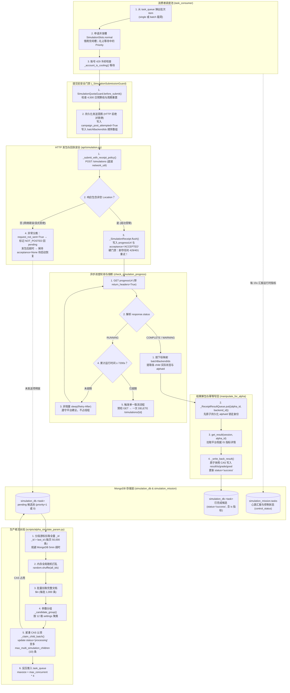
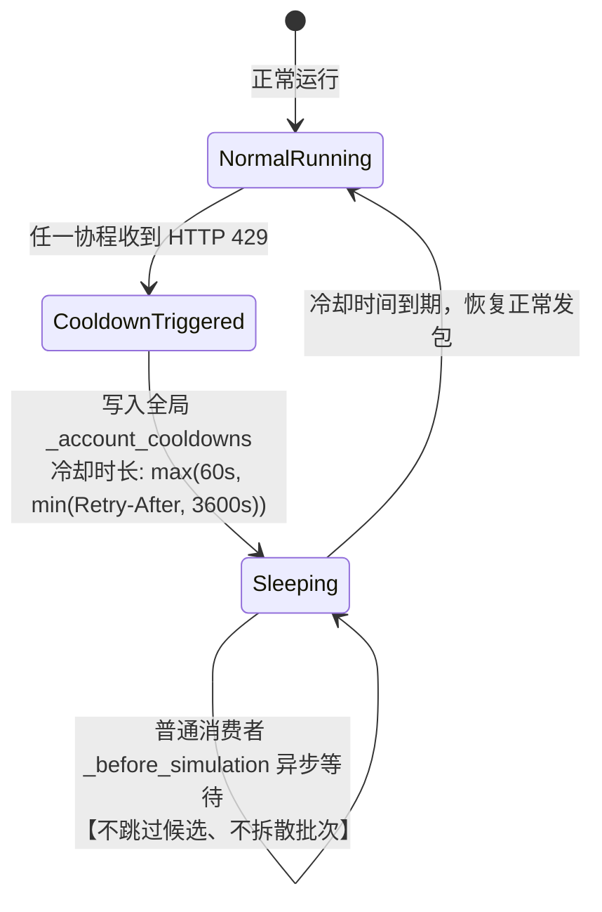
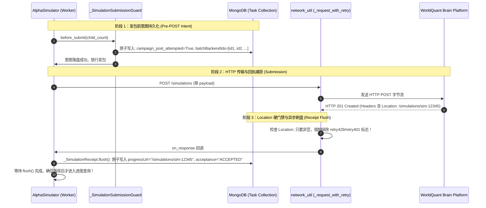
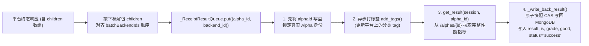
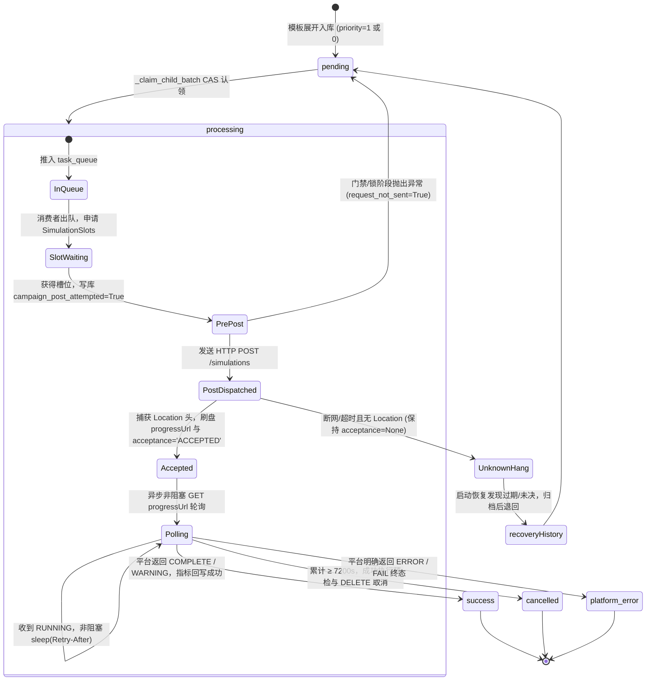

本文档系统性剖析 QuantNight 的**普通异步回测流水线（Regular Asynchronous Simulation Pipeline）**核心调度与执行架构。该流水线是整个仓库吞吐量最大、并发度最高的基础生产底座，负责将模板展开的数十万级候选表达式高可靠地推送到 WorldQuant Brain 平台完成回测，并为上层智能调度（Adaptive 采样与 Priority 进化精炼）提供不可动摇的并发管理、配额控制、回执安全与断点自愈能力。

---

## 0. 核心定位与设计哲学

普通异步回测流水线并非简单的“`for` 循环发请求”，而是基于生产级分布式环境设计的**高并发、强反压、防重放、可恢复状态机**。其核心设计哲学包含以下四条基本原则：

1. **生产者与消费者解耦、单原任务消费者统一控盘**：
   - 候选生成（模板展开）一次性写入 MongoDB 集合，标记 `status="pending"`。
   - 每一个任务由单一的 `alpha_simulate_param.py` 原任务消费者（Source Consumer）独占运行，统一持有并发槽、账号级限流冷却与日配额状态，彻底杜绝多个进程竞争发包导致的 429 封禁与配额浪费。
2. **全局分段打乱与有界队列反压（Backpressure）**：
   - 面对数十万候选，通过基于 `_id` 游标的分段分页与内存打乱，规避 MongoDB `skip` 的性能塌陷与 5 分钟游标超时。
   - 生产者与消费者之间通过有界队列（`maxsize = max_concurrent * 4`）连接，形成天然反压：当网络波动或平台排队时，消费减速自然阻塞生产，杜绝内存无限暴涨。
3. **Multi-Simulation 同源聚合组批（Batching）**：
   - 将相同模拟参数（Region, Delay, Universe, Neutralization 等）的至多 10 个候选聚合为一个父请求發往平台，显著分摊 HTTP 握手与平台调度延迟。
   - 建立严格的数组索引与 ObjectId 映射契约（`batchBackendIds`），保证多子项回测结果精准还原至对应的数据库记录。
4. **两阶段提交与无重放回执铁律（No-Replay Iron Rule）**：
   - **发包前先写意图**：在发出任何网络字节前，原子持久化 `campaign_post_attempted = True` 与批次 ID，绝不留出“已发 HTTP 但本地毫无痕迹”的空窗期。
   - **拿到 Location 立即刷盘**：一旦响应头包含 `Location`，无条件认定请求已受理并剥夺任何重试，立即刷盘 `progressUrl` 与 `acceptance = "ACCEPTED"`。
   - **冷启动 GET-Only 恢复**：任务崩溃重启时绝不盲目重发 POST，仅通过已保存的可信 `progressUrl` 执行只读查询对账；确信过期的旧请求安全归档后才允许重新派发。

---

## 1. 核心模块与关键原语一览

普通回测流水线由四大核心模块协同驱动：执行总控 [`scripts/alpha_simulate_param.py`](../../scripts/alpha_simulate_param.py)、HTTP/回执引擎 [`api/simulation.py`](../../api/simulation.py)、并发槽控制器 [`util/simulation_slots.py`](../../util/simulation_slots.py) 和日配额门禁 [`util/simulation_quota.py`](../../util/simulation_quota.py)。

| 核心类 / 原语                      | 代码位置                                                                                   | 职责定位与核心逻辑                                                                                   |
| ----------------------------- | -------------------------------------------------------------------------------------- | ------------------------------------------------------------------------------------------- |
| `AlphaSimulator`              | [`scripts/alpha_simulate_param.py`](../../scripts/alpha_simulate_param.py#L448-L2700)  | 原任务消费者总指挥：协调生产者队列、并发工作池、运行时心跳汇报、账号冷却与优雅停机                                                   |
| `_random_producer`            | [`scripts/alpha_simulate_param.py`](../../scripts/alpha_simulate_param.py#L2199-L2290) | **全局打乱生产者：通过 `_id > last_id` 分段拉取全量 ID，内存完全打乱后批量取回文档，消除采样集中偏差**                             |
| `_emit_rows`                  | [`scripts/alpha_simulate_param.py`](../../scripts/alpha_simulate_param.py#L2096-L2133) | 参数分组与入队器：按 `_candidate_group` 聚类，驱动 `_claim_child_batch` 并将批次载荷推入 `task_queue`              |
| `_claim_child_batch`          | [`scripts/alpha_simulate_param.py`](../../scripts/alpha_simulate_param.py#L2054-L2070) | 细粒度 CAS 认领：原子修改 `status="processing"`，在组内紧凑聚合至多 `max_multi_simulation_children`（默认 10）个候选   |
| `_child_batch_key`            | [`scripts/alpha_simulate_param.py`](../../scripts/alpha_simulate_param.py#L53-L70)     | 同源聚合校验核：对齐 Region/Delay/Universe/Neutralization/Decay/Language 等 12 个维度                     |
| `task_consumer`               | [`scripts/alpha_simulate_param.py`](../../scripts/alpha_simulate_param.py#L2425-L2492) | 消费者工作池协程：拉取批次任务，向 `SimulationSlots` 申请 `normal` 槽位并派发异步回测任务                                 |
| `SimulationSlots`             | [`util/simulation_slots.py`](../../util/simulation_slots.py#L18-L120)                  | 双轨并发槽管理器：统一总并发 `total` 与优先上限 `priority_limit`，支持空闲槽全量借用与等待优先权                               |
| `SimulationQuotaGuard`        | [`util/simulation_quota.py`](../../util/simulation_quota.py#L38-L150)                  | **服务端日配额门禁：基于平台 `X-RateLimit` 头维护当前周期已用量，执行 4,500 额度熔断硬保护**                                 |
| `_SimulationSubmissionGuard`  | [`scripts/alpha_simulate_param.py`](../../scripts/alpha_simulate_param.py#L156-L246)   | 提交前持久化门禁：核验账号冷却与发送权限，在发包前原子写入 `campaign_post_attempted=True` 及 `batchBackendIds`            |
| `_SimulationReceipt`          | [`scripts/alpha_simulate_param.py`](../../scripts/alpha_simulate_param.py#L248-L370)   | 异步回执适配器：拦截并维护 `progress_url`、`acceptance`、`httpStatus` 等证据，提供异步 `flush()` 保证落盘              |
| `_submit_with_receipt_policy` | [`api/simulation.py`](../../api/simulation.py#L328-L570)                               | 双阶段提交策略引擎：装配 `before_attempt`、`on_response`、`on_error`，驱动底层 `network_util` 发包并拦截 `Location` |
| `check_simulation_progress`   | [`api/simulation.py`](../../api/simulation.py#L200-L288)                               | 异步进度轮询器：遵循服务端 `Retry-After` 头进行非阻塞等待，探测终态与提取子项列表                                            |
| `_finish_monitor_timeout`     | [`api/simulation.py`](../../api/simulation.py#L620-L695)                               | **7200 秒累计超时守卫：监控同一回测的累计运行时间，超时发起预检 GET 与有界单一 `DELETE` 取消**                                 |
| `_ReceiptResultQueue`         | [`scripts/alpha_simulate_param.py`](../../scripts/alpha_simulate_param.py#L372-L446)   | 结果队列截获器：严格保证 `(alpha_id, backend_id)` 配对交付，拦截并发写回保证子项指标不串位                                  |
| `manipulate_for_alpha`        | [`scripts/alpha_simulate_param.py`](../../scripts/alpha_simulate_param.py#L979-L1040)  | 结果采集协程：拉取 `/alphas/{id}` 权威指标，调用 `_write_back_result` 原子写回 `status="success"`               |
| `recover_on_start`            | [`util/mission_recovery.py`](../../util/mission_recovery.py#L393-L483)                 | 启动断点对账器：以只读 GET 轮询未决回执，安全将 404 过期记录归档到 `recoveryHistory` 并释放未解项回 `pending`                  |

---

## 2. 端到端执行流水线与全景数据流

普通回测流水线在单原任务消费者内部推进。以下数据流图展示了一个候选批次从数据库提取、组批、争夺并发槽与配额、发送 HTTP POST、轮询进度直至结果写回的完整生命周期。

### 2.1 全景架构与数据流图



---

## 3. 流水线调度核心机制深度剖析

### 3.1 候选拉取、全局打乱与反压队列（ID Paging & Global Shuffle）

位于 [`scripts/alpha_simulate_param.py`](../../scripts/alpha_simulate_param.py#L2199-L2290)：
当任务集合包含数万甚至数十万条待测项时，传统 `skip(i).limit(n)` 会导致 MongoDB 扫描深度过大引发单请求耗时暴增，且长时间游标遍历极易触发驱动层的 `NetworkTimeout (5-minute socket timeout)`。

普通流水线采用**“三步分段游标采样”**算法彻底解决该问题：
1. **轻量只读拉取全量 `_id` 游标**：
   ```python
   # 使用 _id 排序配合 $gt 是 MongoDB 最稳定的拉取方式
   current_query = task_query.copy()
   if last_id:
       current_query["_id"] = {"$gt": last_id}
   cursor = self.collection.find(current_query, {"_id": 1}).sort("_id", 1).limit(id_batch_size)
   batch = await self._read_candidates(_fetch_batch, 'candidate_page')
   ```
   单页 `id_batch_size = 50000`，只投射 `_id` 字段，秒级拉取几十万条 ID 并累加至内存数组 `all_ids`。
2. **内存绝对全局打乱**：
   拉取完成后调用 `random.shuffle(all_ids)`。由于所有 ID 在内存中全局打散，彻底消除了由于模板生成顺序导致的前后结构集中偏差（例如前 10,000 条全在测某一个数据集）。
3. **分批次取回完整文档**：
   按 `batch_size = 1000` 每次切片 `target_ids`，通过 `{"_id": {"$in": target_ids}}` 批量查回完整候选文档交给 `_emit_rows` 处理。
4. **生产者-消费者有界反压**：
   `task_queue = asyncio.Queue(maxsize=self.max_concurrent * 4)`。当平台出现排队或网络延迟使消费者执行变慢时，`queue.put()` 会自然 `await` 挂起生产者，绝不让内存驻留未认领的文档。

---

### 3.2 Multi-Simulation 同源聚合组批（Batching & Grouping）

位于 [`scripts/alpha_simulate_param.py`](../../scripts/alpha_simulate_param.py#L53-L70, L2054-L2090)：
WorldQuant Brain 允许在单个 POST 请求中提交包含多个表达式的 Multi-Simulation（父模拟分配一个 Simulation ID，内部包含多个 Child 项）。组批能将 HTTP 吞吐能力提升近一个数量级。

#### （1）12 维同源聚合键 `_child_batch_key`
并非任意两个候选都可以组入同一个批次。平台要求同一个 Multi-Simulation 请求下的所有表达式必须具备完全一致的环境配置：
```python
def _child_batch_key(row):
    return (
        row.get('type', 'REGULAR'),
        row.get('settings', {}).get('region'),
        row.get('settings', {}).get('delay'),
        row.get('settings', {}).get('universe'),
        row.get('settings', {}).get('neutralization'),
        row.get('settings', {}).get('decay'),
        row.get('settings', {}).get('truncation'),
        row.get('settings', {}).get('pasteurization'),
        row.get('settings', {}).get('unitHandling'),
        row.get('settings', {}).get('nanHandling'),
        row.get('settings', {}).get('language'),
        row.get('settings', {}).get('instrumentType'),
    )
```
`_emit_rows` 首先将 1,000 条文档按此键分发到各个 group 列表。

#### （2）组内紧凑 CAS 认领与顺序锁定
`_claim_child_batch(group_rows, offset)` 在同组内推进：
- 单遍扫描：逐条调用 `_claim_priority_row(row)`，通过 CAS 原子更新将 MongoDB 中的 `status` 从 `pending` 修改为 `processing`，并记录 `claimedAt`。
- 满载截断：一旦认领满 `max_multi_simulation_children`（默认为 10 条），立即打包返回，绝不跨越不同 group 进行拼接填充。
- 契约保存：打包生成的 payload 格式为 `('batch', [sim_data, ...], [row['_id'], ...])`，将这批文档的 `ObjectId` 列表严格按顺序固化为 `batchBackendIds`。

---

### 3.3 并发槽控制（`SimulationSlots`）与账号级 429 冷却

位于 [`util/simulation_slots.py`](../../util/simulation_slots.py) 与 [`scripts/alpha_simulate_param.py`](../../scripts/alpha_simulate_param.py#L1314-L1322)：

#### （1）`SimulationSlots` 的公平共享与双向借用
每个 `AlphaSimulator` 消费者进程实例化唯一一个 `SimulationSlots(total=max_concurrent, priority_limit=priority_max_concurrent)`。
- **普通任务借满全槽**：当任务没有 Priority 候选或 Priority 活跃数未用满时，普通任务协程通过 `await self.slots.normal.acquire()` 可以借用全部空闲并发槽（最高跑满 `max_concurrent`，如 4 槽）。
- **Priority 等待礼让防饥饿**：
  ```python
  def _priority_ready(self) -> bool:
      return self._priority_waiting > 0 and self._priority_active < self.priority_limit

  # 普通协程申请槽位时的判断条件
  async with self._condition:
      while not (self._has_space() and not self._priority_ready()):
          await self._condition.wait()
      self._normal_active += 1
  ```
  当有 Priority 协程正在等待且 Priority 尚未达到其配额上限时，普通协程在条件变量中礼让，下一个释放的槽位优先给 Priority，但**绝不强行抢占或打断已在执行中的普通回测**。

#### （2）账号级 429 冷却状态机

- 当任一协程收到平台 429 响应时，提取响应头中的 `Retry-After`，将冷却截止时间戳记录到同账号共享的 `_account_cooldowns[auth_profile]`。
- **消费端等待而非丢弃**：与 Priority 任务不同（Priority 在冷却期暂停认领以避免消耗重试次数），普通任务的 `_claim_child_batch` 在冷却期**不拒绝认领**，而是允许完整批次正常推入队列，由 Worker 在 `_before_simulation` 处统一 `asyncio.sleep` 等待冷却结束。这确保了父子批次始终完整聚合，绝不会因为瞬态 429 将 10 项批次截断为残缺单条。

---

### 3.4 服务端日配额门禁（`SimulationQuotaGuard`：4,500 额度线）

位于 [`util/simulation_quota.py`](../../util/simulation_quota.py)：
WorldQuant Brain 平台对每个账号设置了每日回测额度上限（通常为 5,000 次/天）。为了留出安全冗余，QuantNight 设定了 `STOP_AFTER_USED = 4500` 的硬熔断线。

- **以服务端真实响应头为唯一真源**：
  `SimulationQuotaGuard` 绝不使用本地计数器去猜测或扣减配额。它仅在每次收到实际回测响应时，从 HTTP Headers 中解析权威字段：
  ```python
  # 从响应头中提取平台真实配额状态
  limit = int(headers['X-RateLimit-Limit'])
  remaining = int(headers['X-RateLimit-Remaining'])
  reset_val = headers.get('X-RateLimit-Reset')
  used = limit - remaining
  ```
- **发包前原子准入锁**：
  在协程尝试发包前调用 `await quota_guard.before_submit(count)`：
  ```python
  async with self._submission_lock:
      if self.stopped:
          raise SimulationQuotaReached(self.stop_reason)
      if self.remaining is not None and self.limit is not None:
          used = self.limit - self.remaining
          if used + count > self.STOP_AFTER_USED:
              self.stopped = True
              self.stop_reason = f"Quota floor reached: used={used} + count={count} > {self.STOP_AFTER_USED}"
              raise SimulationQuotaReached(self.stop_reason)
  ```
- **平台周期可信重置**：
  当检测到 `X-RateLimit-Reset` 时间戳已跨过 UTC 零点或平台重置周期时，自动重置 `stopped = False`，平滑恢复回测流水线，无需人工重启进程。

---

### 3.5 双阶段提交与 Location 回执硬门禁（Two-Phase Submission & Receipt Safety）

位于 [`scripts/alpha_simulate_param.py`](../../scripts/alpha_simulate_param.py#L156-L246) 与 [`api/simulation.py`](../../api/simulation.py#L328-L570)：
在分布式网络中，HTTP 请求最危险的状态是“发送后超时”：客户端以为失败，但服务端其实已经成功受理并在运行。如果客户端盲目重发，会迅速成倍消耗每日配额。

普通回测流水线通过**两阶段提交**与**底层 Location 硬门禁**彻底杜绝重放风险：



#### 关键容错分类
- **`request_not_sent == True`**：若在并发槽锁、配额拦截或发包前校验抛出异常，此时 HTTP 字节**百分之百未发出**。系统安全打标 `acceptance="NOT_POSTED"`，将候选退回 `pending`，允许下次正常调度。
- **发包后超时且无 Location**：若进入传输阶段后断网或读超时，系统**严禁重发 POST**。此时保留 `campaign_post_attempted=True`、实际错误栈与 `acceptance=None`，保持未决状态，等待启动恢复模块介入对账。

---

### 3.6 异步进度轮询、7200 秒本地超时熔断与单一取消机制

位于 [`api/simulation.py`](../../api/simulation.py#L200-L288, L620-L695)：

#### （1）自适应非阻塞轮询
拿到 `progressUrl` 后，协程进入 `while not is_complete` 循环调用 `check_simulation_progress`：
- 解析响应头中的 `Retry-After`（通常平台给 2s、5s 或 10s）。
- 使用 `await asyncio.sleep(retry_after)` 挂起当前协程，绝不占用底层线程，由事件循环自由调度其它任务。

#### （2）7200 秒累计本地监控超时与单一取消协议
WorldQuant Brain 平台由于集群排队或算子死循环，偶尔会出现某个回测卡在 `RUNNING` 数小时的情况。
- **累计计时而非单次超时**：记录回测首次发起的起点时间戳 `monitor_started_at`，即使进程重启也能跨会话准确累计已经监控的秒数。
- **超时触发熔断取消**：
  当累计时间达到 `SIMULATION_MONITOR_SECONDS = 7200`（2 小时）时，触发取消闭环：
  1. **预检 GET**：在发起取消前先发一次 GET 检查，若平台恰在此时已完成（`COMPLETE`/`WARNING`），则保留成功结果，放弃取消。
  2. **最多一次 DELETE**：若仍处于 `RUNNING`，调用 `api/cancel_simulation.py` 发送一次 `DELETE /simulations/{id}`。
  3. **有界核验 GET**：DELETE 返回后紧接着进行一次确认查询。若平台状态变为 `CANCELLED`，则确认为平台取消，记录 `timeout_error`。
- **严禁虚假报错**：超时与平台取消是明确的调度终态，系统绝不把它们伪造成“表达式语法错误”，也不会因此释放本地候选重复发包。

---

### 3.7 结果收集、权威详情采集与 CAS 幂等写回

位于 [`scripts/alpha_simulate_param.py`](../../scripts/alpha_simulate_param.py#L372-L446, L979-L1040)：

当进度轮询检测到平台返回 `COMPLETE` 或 `WARNING` 时，回测进入结果收割流水线：



1. **多子项精准下标配对**：
   在 Multi-Simulation 模式下，平台返回的 JSON 包含 `children` 数组：
   ```python
   for index, child in enumerate(sim_progress_json["children"]):
       backend_id = backend_ids[index]   # 严格通过 batchBackendIds 数组下标还原！
       alpha_id = child.get("alpha")
   ```
2. **`_ReceiptResultQueue` 拦截契约**：
   将 `(alpha_id, backend_id)` 元组推入专用结果队列。队列的 `put` 方法首先执行 `_persist_simulation_receipt(backend_id, {"alphaId": alpha_id, "acceptance": "ACCEPTED"})`，确保证书和 Alpha 身份即便在后续拉取详细指标失败时也不会丢失。
3. **权威指标采集与 CAS 幂等落库**：
   - 独立协程 `manipulate_for_alpha` 消费结果队列，调用 `api/manipulate_alpha.py::get_result` 拉取包含 Sharpe、Fitness、Turnover、Margin、Returns、Drawdown 的权威指标字典。
   - `_write_back_result` 使用文档的快照比对更新，将提取出的 `is` 指标、计算出的 `grade`（0..3 档评级）与 `good`（布尔优胜标）原子写入，并将候选终态置为 `status="success"`。

---

### 3.8 启动恢复机制与旧尝试归档（Mission Recovery & Ledger Reconciliation）

位于 [`util/mission_recovery.py`](../../util/mission_recovery.py)：
当消费者进程因服务器重启、断网或手动中断而意外退出后，重新启动时首先调用 `recover_on_start(self)` 进行断点扫描。

#### （1）GET-Only 绝对铁律
启动恢复过程**绝不调用任何 POST 请求**。它仅扫描集合中状态为 `processing` 或带有未完结回执（包含 `progressUrl`）的候选。

#### （2）四大对账处理矩阵

| 扫描发现的旧记录状态 | 恢复器判定行为 | 执行动作与候选归宿 |
|---|---|---|
| 携带可信 `progressUrl`，GET 轮询已变成 `COMPLETE` | 平台回测已成功终态 | 提取 `alphaId`，补拉详细指标，写回 `status="success"`，正常结案 |
| 携带可信 `progressUrl`，GET 轮询仍为 `RUNNING` | 平台仍在正常计算 | 接入当前轮询循环，等待其自然运行完成直至终态 |
| 携带可信 `progressUrl`，GET 实际收到 **HTTP 404** | 平台历史回测记录正常过期（通常存活约 1–2 小时） | **安全归档**：在同一次原子更新中，将旧 URL、错误信息写入 `recoveryHistory`，清退旧回执字段，并将候选状态安全退回 `status="pending"`，交由后续流水线重新调度 |
| `request_not_sent=True`（发包前门禁阻断记录） | 确认 HTTP 字节从未发出 | 确认无平台回执后，直接释放回 `status="pending"` |
| 缺少可信回执但标记 `campaign_post_attempted` 且无结果 | 未知未决状态（可能网络中断） | 保留错误现场，满足快照保护时归档旧尝试后退回 `pending`；有冲突时保持锁定等待人工排查 |

- **多子项结果保护**：如果一个批次中部分 Child 已经取得了 `alphaId` 并落盘，而另一部分处于 404 过期状态，恢复逻辑会精确保留已成功的 Child 结果，仅将未解的 Child 重置为 `pending`，绝不重复派发已成功的子项。

---

## 4. 状态字典与生命周期流转矩阵

### 4.1 候选文档生命周期流转图



### 4.2 核心安全与回执字段速查字典

| 数据库字段 | 存在位置 | 业务含义与安全语义 |
|---|---|---|
| `status` | 根文档 | 候选执行大状态：`pending`（待测）、`processing`（认领处理中）、`success`（回测成功结案）、`error`（终态错误）、`cancelled`（平台取消） |
| `campaign_post_attempted` | 根文档 | **通用发包意图标记**（普通/Adaptive/Priority 共用历史字段）：`True` 代表本地已尝试向平台发出过 POST，启动恢复必须核验该事实，严禁盲目直接重发 |
| `batchBackendIds` | 根文档 | **批次子项映射数组**：按请求构建顺序保存同一批 Multi-Simulation 中所有子项的 `ObjectId`，保证子模拟结果与文档 100% 精准对应 |
| `progressUrl` | 根文档 | 平台返回的进度查询端点（如 `/simulations/sim-xxxx`）：只要该字段存在，即证明平台已受理任务，后续一律只允许 GET |
| `acceptance` | 根文档 | 请求受理状态：`ACCEPTED`（已分配 Location）、`NOT_ACCEPTED`（显式 429/401 拒绝）、`NOT_POSTED`（发包前门禁阻断，安全可退 pending） |
| `recoveryHistory` | 根文档 | 历史异常对账账本：记录因 404 过期或未解网络超时归档的旧 URL、错误摘要与时间戳，保留完整审计追踪 |
| `result` / `is` | 根文档 | 实测权威指标字典：包含 `sharpe`、`fitness`、`turnover`、`returns`、`drawdown`、`margin` 等核心量化指标 |

---

## 5. 开发者规范与工程实践原则（Checklist）

在开发、维护或排查 QuantNight 普通回测流水线时，必须严格遵守以下工程规范：

1. **单一消费者原则**：
   - 绝不允许对同一个任务启动两个 `alpha_simulate_param.py` 进程，否则会导致并发槽失控与 429 封禁风暴。
2. **禁止裸调 HTTP 发起回测**：
   - 提交回测必须经过 `api.simulation.submit_simulation_async` 或 `_submit_with_receipt_policy`，绝不能绕过它们直接使用 `session.post`。
3. **严格遵守 Location 硬门禁**：
   - 只要拿到非空 `Location`，无论后续发生何种网络异常，必须无条件将其视为已受理回测，严禁重新发送 POST。
4. **禁止在主循环中手写同步阻塞 Sleep**：
   - 所有的等待（无论是 Retry-After 还是账号冷却）必须使用 `await asyncio.sleep()`，严禁调用 `time.sleep()` 阻塞整个 asyncio 事件循环。
5. **保持 Multi-Simulation 映射契约**：
   - 组装批次时必须同步固化 `batchBackendIds`；解析 `children` 时严格按数组下标解包，严禁跨批次拼凑结果。
6. **启动恢复秉持 GET-Only 铁律**：
   - 恢复器只允许通过既有 `progressUrl` 执行只读查询对账。遇到 404 时记录 `recoveryHistory` 并安全将未解项退回 `pending`，绝不能直接原地发起 POST。
7. **尊重平台日配额安全线**：
   - 始终依赖 `SimulationQuotaGuard` 读取平台真实响应头。当达到 4,500 警戒线时平滑挂起发包，等待服务端重置周期，切勿手写逻辑绕过或强行重置本地额度。
