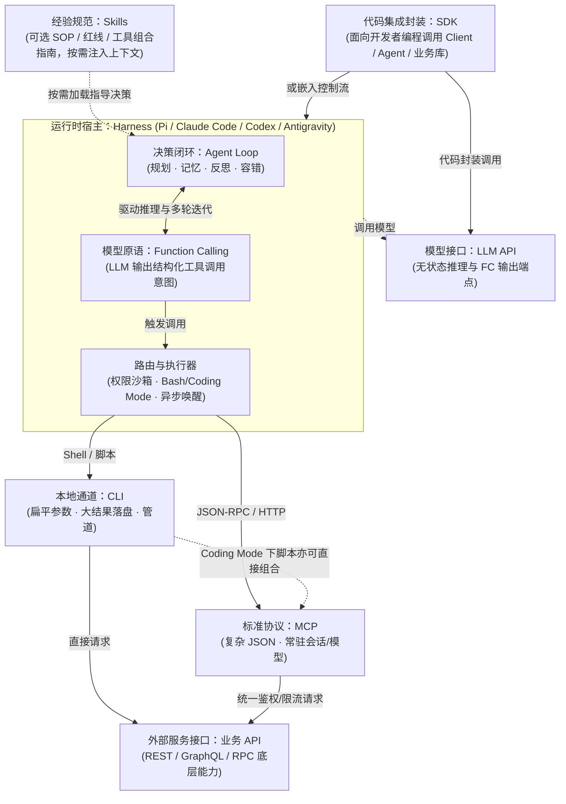

# 一、Agent 工具体系核心概念对比

在构建能与本地环境、数据库、远端 API 强交互的 Agent 系统时，不同抽象层各司其职。以本地强交互场景为例（如读取终端历史总结常用命令并结合项目文件生成 README，或快速配置环境跑通一个开源项目），需要理清各个组件的协作边界。

## 1. 架构定位与协作关系

这八个概念并非简单的“大盒子套小盒子”或单向串联，而是分处**底层接口（API/SDK）、模型能力（Function Calling）、运行时宿主（Harness）、知识引导（Skills）、运行期工具通道（CLI/MCP）与决策主体（Agent）**的正交协作组件：

> **为什么不是严格包含关系？**
> - **API 是最底层的服务边界（分 LLM API 与业务 API）**：无论是 Harness 调大模型，还是 CLI / MCP 调外部平台，最终都落到网络 API。
> - **SDK 面向“写代码集成”，CLI / MCP 面向“运行期 Agent 调用”**：开发者用 SDK 把 LLM API 或 Harness 嵌入自己的服务端程序；而运行起来的 Agent 则是通过 CLI 或 MCP 去消费能力。
> - **Skills 不是 Harness 的下级**：它是按需读取的规范文档，没有 Skill，Agent 也能工作；有了 Skill，Agent 才知道在具体业务里该怎么选 CLI 还是 MCP。
> - **CLI / MCP 不依赖 Function Calling**：它们本身是独立可运行的程序或协议服务（人类和普通脚本也能直接调）；只是当 LLM 参与决策时，需要通过 Function Calling（或 Harness 的 Bash/Coding Mode 执行器）去触发它们。

### 各组件定位、选型边界与设计原则总表

| 维度 / 概念 | 角色定位 | LLM 调用方式与上下文加载 | 什么时候用（适用场合与选型边界） | 核心设计原则与规范 | 真实选型越级 / 用错层反例 |
|---|---|---|---|---|---|
| **决策闭环** **Agent** | 自主干活的**“员工”** | 由 Harness 持续维护多轮 `messages` 循环（含 Compaction 压缩与事件唤醒注入）；LLM 每轮自主决定继续调工具或收尾回复。 | **步骤无法预先写死、依赖中间反馈动态决策的长周期任务**。 | 拆分职责边界、借助 Harness 异步事件驱动推进闭环。 | 把定时数据采集、日志脱敏入库、固定规则的门禁扫描交给多轮自主 Agent 调度，而不是用确定性的 `launchd`/Python 脚本直接跑完。 |
| **经验规范** **Skills** | 按需加载的**“作业指导书 / SOP”** | 平时仅在系统提示词里占极短的“名称 + 触发描述”索引；命中场景后 LLM 用 `read_file` **按需加载** `SKILL.md` 及 `references/` 进入上下文。 | **跨会话复用的领域工作流、判断标准、红线与多工具组合顺序**。 | **入口精简、细节外置**：主 `SKILL.md` 只保留核心流程、红线与路由，大段字典与参考样例拆入 `references/` 按需读取。 | 试图在 `SKILL.md` 里堆砌几百行防御性八股文（如要求“绝不并发写”“必须检查锁”）去堵控制面漏洞，而不是在 **CLI/MCP/Harness** 里用代码锁和 Schema 直接拦截。 |
| **运行时宿主** **Harness** | Agent 的**“操作系统 / 底盘”** | | **需要跑多轮长任务、防上下文爆炸、派发 Subagent 与控制权限沙箱的运行时环境**。 | 1. **严禁前台阻塞死等**：长耗时任务靠外部有界观察器 + 异步事件唤醒（Reactive Wakeup）解耦； 2. **可控上下文**：支持 `hidden`/`codemode` 按需暴露低频工具，配合自动 Compaction 控制长会话窗口。 | 只是一次性文档摘要、批量文本打标或固定几步评测，直接脚本并发调 **API/SDK** 即可，硬拉起完整 **Harness** + Subagent 只会徒增调度和上下文维护开销。 |
| **运行期通道** **CLI** | 原生**“命令行与数据管道”** | **0 常驻 Schema 开销**；LLM 通过 Harness 的 `bash`/`exec` 工具拼命令调用（未知参数现跑 `--help` 读入上下文），大结果可通过 `--output` 落盘不进上下文。 | **参数扁平但返回结果庞大，或需要配合本地文件系统/Git/批处理流水线编排时**（Coding Mode 之前即具备零 Schema 驻留与管道优势）。 | 1. **`stdout` 纯净机器 JSON**（含 `ok`、`status`、`errorType`、`error`），进度日志与诊断全走 `stderr`； 2. **支持 `--output <path>` 落盘与分页**：大结果只回传文件路径与摘要（`count`/`total`/`page`）； 3. **参数扁平自解释 + 高质量 `--help`**（复杂嵌套走 `--config <file>`）； 4. **确定性非 0 退出码 + `--dry-run` / `--confirm <name>`** 门禁； 5. 高频并发写用极薄客户端 + 本地 `flock`（+ 最小字段 CAS）或常驻 `headless host` 复用连接池。 | 用 Bash 命令行直接拼接几十行带单双引号、换行的策略代码或深层配置 JSON（极易因 Shell 转义翻车，该走 **MCP**）；或在 `stdout` 打人类彩色表格破坏管道解析。 |
| **运行期协议** **MCP** | 标准化的**“常驻服务接口”** | 连接时通过 `tools/list` 把完整 JSON Schema **常驻注入系统提示词**（设为 `hidden`/`codemode` 时则隐藏 Schema，仅按需在代码中调用）；返回值直接写回对话上下文。 | 1. **输入参数复杂**：传多行代码、嵌套数组/配置对象，需要 JSON Schema 严格校验； 2. **依赖常驻在线状态**：共享单账号登录锁、限流退避窗口、常驻内存的向量索引/模型； 3. **跨多个 Harness 客户端复用**且需细粒度权限隔离（Coding Mode 下可用 `codemode` 简化调用并消除全量 Schema 负担）。 | 1. **按工作流内聚而非“调用频率”或 1:1 透传 API**：即使低频但涉凭证隔离/不可逆副作用也绝不让 Agent 现场读源码拼脚本；反之高频大列表查询适合 CLI；控制暴露数量并配合 `hidden`/`codemode`； 2. **Schema 强约束与 `default` 二分**：无风险便利参数（`limit=10`/`offset=0`）可留默认，**危险语义/风控/路由参数全删默认并设必填**，配合 `enum`/`oneOf`/`additionalProperties: false`； 3. **内部代码显式 `raise` 异常映射为可自愈报错（`isError=True`）**：校验失败或依赖不可用时在内部代码直接 `raise` 明确异常（由外层调度器统一脱敏密钥并转为 `isError=True` + 修正提示，如 `METADATA_UNAVAILABLE`），严禁吞异常、静默降级或假通过； 4. **`description` 写明边界 + 成对发现工具**：明写 `Do NOT guess parameters` 并配对只读检索工具做到“先查后用”； 5. **Token 预算 + `structuredContent` 双通道**：裁剪大字段（如 embedding），强制分页并返回 `total`/`has_more`/`truncated` 防误判不存在，同时返回强类型 JSON； 6. **幂等护栏与 `ToolAnnotations`**：代码确定 ≠ 生产并发/断线可靠，写操作先落 Intent 回执；如实标注 `readOnlyHint`/`destructiveHint`/`idempotentHint`/`openWorldHint`。 | 1. 把本地 Git/文件读写、建索引、启停本地 shell 脚本（如 `scripts_tools` / `backend_tools`）包装成 MCP，其实原生 Bash + **CLI/Skill** 更直接； 2. 把本地库大列表查询（如 `find_history_alphas`、千行分页结果）做成 MCP，既重复建设又把大段 JSON 塞爆上下文（该走 **CLI `--output`**）。 |
| **模型原语** **Function Calling** | LLM 的**“手和眼”** | 请求参数 `tools` 将工具 Schema 注入模型上下文；LLM 在输出层生成结构化 `tool_call` token，宿主执行后以 `tool_result` 消息回填上下文。 | **单步确定性结构化输出与动作触发**。 | Schema 紧凑清晰、字段名与枚举无歧义。 | 试图靠一次 Function Calling 嵌套深层分支 DSL 代替 **Harness** 的多轮控制与失败重试。 |
| **代码集成层** **SDK** | 面向程序员的**“编程封装库”** | | **把模型推理、Agent 循环或平台能力确定性地写进应用代码里**。 | 统一收口**单一认证锁与重试/超时策略**；非幂等写操作**先持久化 Intent 回执再发请求**，超时未知走只读核验。 | 在各业务脚本里各写一套 HTTP 重试、Cookie 刷新或数据库直连，导致限流失控与并发踩踏。 |
| **底层接口** **API** | 无状态**“网络能力端点”** | | **一切远端模型推理与外部平台服务的最底层协议出口**。 | 接口契约稳定、状态码与错误语义清晰明确。 | 让 Agent 自己拼 `curl` 或手写 HTTP 调带副作用的平台提交/回测接口（漏掉防重投回执与登录锁，极易重复提交）。 |

---

# 二、Agent 工具通用方法分类与特征矩阵

无论通过 MCP 还是 CLI 暴露能力，生产级方法都应按物理特征拆分为四类，避免全部套用同一种“同步阻塞等待”模型：

| 方法类别 | 典型特征 | 输入 / Schema 特征 | 执行与超时特征 | 返回与容错特征 |
|---|---|---|---|---|
| **1. 轻量同步只读型** （健康检查、本地字典/算子文档、参数枚举） | 无副作用、毫秒级响应、可并发 | 扁平参数或明确互斥选择器（如 `oneOf` 限制只传一种查询条件），严禁隐式正则放大 DoS 风险 | 同步返回；绕过重型初始化锁实现极速冷路径；对 DB 查询设置明确超时上界 | 返回分页元数据（`total`、`has_more`、`truncated`），**数据库不可用时必须明确报 `METADATA_UNAVAILABLE` 而非假通过** |
| **2. 常驻状态 / 模型计算型** （向量语义检索、本地相关性评分） | 依赖百兆级本地模型/索引或共享连接池 | 结构化过滤 `params` + 自然语言 `query`，禁止猜测枚举值 | 常驻守护进程内**冷加载一次长期复用**，耗时操作放到线程池避免阻塞异步事件循环 | 裁剪体积过大的内部字段（如原始 embedding 向量、`_id`），只返回得分与精简摘要 |
| **3. 异步长任务提交与追踪型** （远端批量计算、长时间 API 轮询） | 远端耗时数分钟到数小时，必须跨断线与进程重启存活 | 复杂嵌套对象/数组 + 显式通知/轮询模式契约（`notification` 或 `{"mode":"poll"}`） | **立即返回 `task_id`**，严禁阻塞等待；关键回执（Intent / `Location`）同步原子落盘，定时写检查点 | 配套独立的只读进度查询与安全重启恢复（仅对已获可信回执做 GET-only 续查，**绝不自动重发 POST**） |
| **4. 破坏性 / 敏感写操作型** （外部提交、远端任务取消） | 不可逆或高权限影响 | 严格最小白名单字段（`additionalProperties: false`），禁止混用本地 ID 与远端 ID；强制客户端按角色隔离权限 | 前置身份/状态核验 + 单次有界执行 + 二次状态确认 | **确认受理 ≠ 确认成功**；严格区分明确拒收、确认完成与超时未知（`UNKNOWN`），绝不静默重试 |
