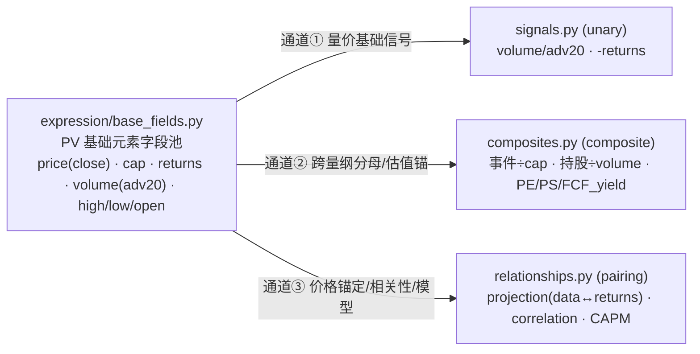

## 一、PV 量价衍生数据四阶谱系（严格 0→1→2→3 阶 + WorldQuant FASTEXPR 对齐）

量价（Price-Volume，简称 PV）严格按**算子演化层级（对 0 阶直接运算 vs 在 1 阶之上嵌套/复合）**分为四阶：**0 阶**为平台原生字段；**1 阶**为直接作用于 0 阶原生字段的单步跨字段算术或单层时序变换/标准化（含 `ts_zscore`、`ts_std_dev`、`ts_mean`、`ts_max_diff` 等直出单层算子）；**2 阶**为在 1 阶衍生量之上再做窗口统计/高阶矩（波动率的波动、偏度信息比、换手高阶能量）、跨字段复合技术指标、截面基准或双变量相关性/回归；**3 阶**为多个 1/2 阶特征的交叉组合及实战中性化/分桶/门控结构角色。

> 图例说明：在一至三阶衍生指标中，绿色加粗条目表示已在本地平台实测记录中检索到达标信号（非 SUPER，`fitness >= 1.0` 且 `sharpe >= 1.2`；除 CHN 地区外，`fitness <= -1.0` 且 `sharpe <= -1.2` 的反向可取负信号亦计为达标）；红色加粗条目表示库中已有实测记录但未达上述门槛；默认颜色为尚未在库中检索到测试记录的理论或扩展方向。

| 0 阶数据（平台原生字段） | 一阶数据（直接作用于 0 阶的单步算术与单层变换） | 二阶数据（嵌套衍生、复合技术指标、高阶矩与回归） | 三阶数据（跨特征复合与实战结构角色） |
|---|---|---|---|
| **基础行情 (`pv1`)** • `open` / `high` / `low` / `close`：开/高/低/收价格 • `vwap`：当日成交量加权均价 • `returns`：当日收益率 • `volume`：当日成交股数 • `adv20`：过去 20 日均量 • `sharesout`：总股本（百万股） • `cap`：当日总市值（百万）  **公司行为与复权** • `dividend`：每股分红 • `split`：拆股比例 • `adjfactor`：原生复权因子  **7 个原生分组** • `country` / `market` • `sector` / `industry` / `subindustry` • `currency` / `exchange` | **收益、跳空与极值回落** • 日收益 / 价格变化率 (ret_calc / ROC)：`(close - ts_delay(close, 1)) / ts_delay(close, 1)`、`ts_returns(close, d)`、`ts_delta(close, d)`（邻日或 `d` 日价格涨跌） • 累计收益 (cumret)：`ts_product(1 + returns, 20) - 1`（20 日复利累计收益率） • 中长期动量 / 短期反转 (momentum / reversal)：`ts_mean(returns, 252)`、`-ts_mean(returns, 20)` 或 `-returns`（对 `returns` 做单层均值/取反） • **最大回撤 (`maxdrawdown`)** / 高点回落 (max_diff)：`(ts_max(close, 60) - ts_min(close, 60)) / ts_max(close, 60)`（60 日区间最大回撤幅）；`ts_max_diff(close, 10)`（当前价相对 10 日高点差值）；`close - last_diff_value(close, 10)`（相对最近变动值差） • 日内实体 (intraday_ret)：`open - close` 或 `close / open - 1`（开盘至收盘的日内多空净强弱） • 隔夜跳空 (oc_gap)：`open / ts_delay(close, 1) - 1`（昨收至今日开盘的隔夜跳空收益） • 跳空极值比 (gap_high / gap_low)：`high / ts_delay(open, 1)`、`low / ts_delay(open, 1)`（最高/最低价相对前日开盘的偏离倍数）  **价差与 K 线位置** • 收盘-VWAP 偏离 (close_vwap_dev)：`close - vwap` 或 `close / vwap - 1`（尾盘收盘相对全天均价的拉升/回落偏离） • 日内振幅 (hl_range)：`(high - low) / close`（日内极值波幅占收盘价比例） • 中点偏离 (hl_midpoint_dev)：`(high + low) / 2 - close`（收盘价相对日内高低中点的偏离） • K 线分位、CLV 与影线 (candle_pos / CLV)：`(close - low) / (high - low)`（收盘所处日内位置）；`((close - low) - (high - close)) / (high - low + 1e-6)`（值域 `[-1, 1]` 的对称收盘位置值 CLV）；`(close - high) / (close - low)`、`(low - open) / (close - low)`（上下影线与实体比） • **微观价差近似 (`spread_1d`)**：`(high - low) / vwap`（以振幅相对均价近似日内买卖价差）  **成交量、波动率与尺度** • 成交额 (dollar_volume)：`close * volume`（当日名义成交金额） • 计算市值 (mkt_cap)：`close * sharesout`（价格×股本近似总市值） • 换手率 (turnover)：`volume / sharesout`（成交量占总股本比例；部分区域需 `sharesout * 1000000` 对齐单位） • 量比 / 异常成交量 / 长周期均量 (volume_ratio / abn_volm / adv12m)：`volume / adv20`、`volume / ts_mean(volume, 252)`、`ts_mean(volume, 252)`（当日量相对 20 日/年均量的放缩倍数与长周期均量基准） • 量能标准化 (volume_z)：`ts_zscore(volume, 20)`（直接对 0 阶成交量做滚动 Z 分数标准化） • 总波动 (volatility) / **下行波动 (`downside_vol`)**：`ts_std_dev(returns, 20)`、`ts_std_dev(min(returns, 0), 20)`（直接对 0 阶收益率求标准差与下行风险） • **对数压缩**（`log_volume` / size_effect）：`log(volume)`、`log(cap)`（压缩成交量与市值的右偏长尾） • 单日非流动性 (illiq_1d)：`abs(returns) / volume` 或 `abs(returns) / (close * volume)`（单位成交量/成交额推动的涨跌幅） | **嵌套均值与截面基准** • 市场超额收益 (excess_ret)：`returns - group_mean(returns, cap, market)`（个股收益减去市值加权市场平均收益） • 均换手 (turn20) / **滚动 VWAP**：`ts_mean(volume / sharesout, 20)`、`ts_sum(close * volume, 20) / ts_sum(volume, 20)`（对 1 阶换手率与成交额再做窗口聚合） • **市场背离度 (`fear`)**：`ts_mean(abs(returns - group_mean(returns, 1, market)) / (abs(returns) + abs(group_mean(returns, 1, market))), 20)`（个股偏离大盘均值的相对强度）  **经典复合技术指标（WQ 算子对齐）** • RSI（相对强弱指标）：`ts_mean(max(ts_delta(close, 1), 0), 14) / (ts_mean(abs(ts_delta(close, 1)), 14) + 1e-6)`（14 日上涨幅度均值占总波动均值比，衡量超买超卖） • **MACD（快慢指数均线差）**：`ts_decay_exp_window(close, 12, factor=0.85) - ts_decay_exp_window(close, 26, factor=0.93)`（12 日与 26 日指数衰减均线之差，捕捉趋势加速） • RSV / Stochastic %K / %D：`RSV = (close - ts_min(low, 9)) / (ts_max(high, 9) - ts_min(low, 9))`（收盘价在 9 日高低区间所处百分比）；`%D = ts_mean(RSV, 3)`（平滑随机震荡线） • Williams %R（威廉超买超卖）：`(ts_max(high, 14) - close) / (ts_max(high, 14) - ts_min(low, 14))`（收盘价距 14 日最高点的回落占波幅比） • **OBV（能量潮）**：`ts_sum(sign(ts_delta(close, 1)) * volume, 20)`（按价格涨跌方向累积的 20 日净成交量） • CMF（蔡金资金流）：`ts_sum(((2 * close - high - low) / (high - low + 1e-6)) * volume, 20) / ts_sum(volume, 20)`（以 K 线收盘位置加权的 20 日资金净流入占比） • CCI（商品通道指数）：`tp = (high + low + close) / 3; (tp - ts_mean(tp, 20)) / (0.015 * ts_mean(abs(tp - ts_mean(tp, 20)), 20) + 1e-6)`（典型价相对移动均值的统计偏离度，识别超买超卖与趋势启动） • Force Index（强力指数）：`ts_mean(ts_delta(close, 1) * volume, 13)`（成交量加权的邻日价格位移均值，衡量推动涨跌背后的量能冲击力） • EMV（简易波动指标）：`ts_mean(((high + low) / 2 - ts_delay((high + low) / 2, 1)) * (high - low) / (volume + 1e-6), 14)`（单位成交量推动价格中点位移的难易程度，捕捉缩量易动与放量滞涨） • Bollinger Bands（布林带带宽 / 通道分位 %B）：`4 * ts_std_dev(close, 20) / ts_mean(close, 20)` 或 `(close - (ts_mean(close, 20) - 2 * ts_std_dev(close, 20))) / (4 * ts_std_dev(close, 20) + 1e-6)`（均线 ± k 倍标准差通道相对宽度或价格在通道内位置） • Stochastic RSI（随机相对强弱指数）：`(RSI - ts_min(RSI, 14)) / (ts_max(RSI, 14) - ts_min(RSI, 14) + 1e-6)`（对 RSI 序列再做滚动极值归一化，放大超买超卖灵敏度） • NVI（负量指标）：`ts_sum(if_else(volume < ts_delay(volume, 1), returns, 0), 60)`（仅在缩量日累积收益率，追踪低换手阶段资金动向） • **ADX（平均趋向指数）**：基于真实波幅 `TR = max(high - low, max(abs(high - ts_delay(close, 1)), abs(low - ts_delay(close, 1))))` 与正负方向移动 `+DI / -DI` 的归一化差值 `abs(+DI - -DI) / (+DI + -DI)` 做滚动平滑（衡量无方向单边趋势强度）  **复合波动率与高阶矩** • **OHLC 波动率 (`realized_vol`)** / Parkinson 波动率 (parkinson_vol)：`sqrt(ts_sum(0.5 * power(log(high / low), 2) - (2 * log(2) - 1) * power(log(close / open), 2), 20) / 20)`（Garman-Klass OHLC 估计量）；`sqrt(ts_sum(power(log(high / low), 2), 20) / (4 * 20 * log(2)))`（Parkinson 高低价估计量） • 非对称跳空波动率 (asymmetric_gap_vol)：`-ts_std_dev(high / ts_delay(open, 1), 60) + ts_std_dev(low / ts_delay(open, 1), 60)`（1 阶上下行跳空比的 60 日标准差不对称差） • 偏度稳定性 (ir_of_skewness)：`-ts_ir(ts_skewness(high, 60), 60)` 或 `-ts_ir(ts_skewness(close, 60), 60)`（价格偏度的滚动信息比） • 极值收益乘积 (extreme_ret_prod)：`ts_max(returns, 5) * ts_min(returns, 5)` 或 `ts_mean(max(returns, 0), 5) * ts_mean(min(returns, 0), 5)`（正负极端日收益乘积，刻画双向剧烈震荡） • 换手波动与高阶能量 (turnover_vol / turnover_energy)：`ts_std_dev(volume / sharesout, 20)`、`ts_sum(power(volume / (sharesout * 1000000), 2), 500)`（长期累积换手二/三阶能量） • 隔夜与日内反转冲突 (co_oc_conflict)：`ts_sum(if_else(oc_gap > 0 && intraday_ret < 0, 1, 0) - if_else(oc_gap < 0 && intraday_ret > 0, 1, 0), 20)`（统计高开低走与低开高走的 20 日频次差，刻画隔夜与日内定价分歧）  **流动性、价量协同与回归残差** • Amihud 非流动性 (amihud_illiq)：`ts_mean(abs(returns) / (close * volume), 20)`（对 1 阶 `illiq_1d` 取 20 日均值） • 价量相关性 (pv_corr)：`ts_corr(vwap, volume, 5)`、`ts_corr(close, volume, 20)`（量价齐升/背离的滚动相关系数） • 价量回归与 Amihud 剥离 (pv_reg / amihud_neut)：`ts_regression(-returns, volume, 120)`、`regression_neut(-returns, -returns / volume)`（剥离成交量冲击后的纯反转残差） • 相对市值扩张 (cap_rel_mom)：`ts_zscore(cap, 63) - ts_zscore(group_neutralize(cap, sector), 63)`（个股市值相对行业 3 个月的扩张 Z 分数） • 价格-市值协整残差 (price_cap_coint)：`ts_regression(ts_zscore(ts_mean(close, 22), 252), ts_zscore(cap, 252), 500, rettype=0)`（剥离股本变化后的价格长周期残差） • 市场 Beta 残差 (capm_resid)：`ts_regression(vector_neut(returns, cap), group_mean(returns, cap, country), 20, rettype=6)`（剥离市值与市场因子后的特异残差） | **风险 / 流动性调整组合** • **流动性调整收益 (`liq_adj_ret`)**：`returns / (1 + abs(returns) / volume)`（用单日非流动性对收益折价） • **风险调整动量 (`risk_adj_mom`)**：`ts_mean(returns, 252) / ts_std_dev(returns, 20)`（动量除以波动率的信息比） • **下行风险反转 (`reversal_risk`)**：`(-ts_mean(returns, 20)) / ts_std_dev(min(returns, 0), 20)`（月度反转除以下行波动率） • **动量-反转耦合 (`mom_reversal`)**：`ts_mean(returns, 252) * (-ts_mean(returns, 20))`（长期趋势与短期回撤共振） • 量比-反转共振 (vol_ratio_rev)：`rank(-returns) * rank(volume / adv20)`（放量下跌后的超跌反转强化） • **缺口波动率比 (`gap_volatility`)**：`(open / ts_delay(close, 1) - 1) / realized_vol`（用 OHLC 波动率标准化隔夜跳空） • **流动性动量 / 流动性波动 (`liq_mom` / `liq_vol`)**：`momentum * (-amihud_illiq)`、`volatility * amihud_illiq` • **流动性调整回撤 (`vol_adj_mdd`)**：`maxdrawdown / adv20` • **尺度化换手 / 波动换手比 (`scaled_tvr` / `vol_tvr_ratio`)**：`(volume / sharesout) / log(cap)`、`volatility / turnover_vol` • 换手波动交互 (vol_of_tvr_interact)：`zstr = zscore(turnover_vol); zturn = zscore(turn20); -(zstr + (zstr / (1 + abs(zstr))) * zturn)`（高换手水平放大高换手波动惩罚）  **实战结构化角色（分桶 / 基准 / 门控）** • 动态分桶中性化：`group_neutralize(signal, bucket(rank(cap), range='0,1,0.1'))`（同理可用 `close * volume`、`adv20`、`ts_std_dev(returns, 20)` 构造市值/成交额/流动性/波动率分桶） • 量加权行业基准：`vector_neut(signal, group_mean(signal, volume, sector))`（用成交量作权重构造行业平均基准并正交） • 多阶风险剥离：`regression_neut` 连续正交剥离 `cap`、`ts_std_dev(returns, 66)`、`ts_delta(close, 200)`、`ts_delta(close, 5)`、`volume / cap` • 流动性换手限速：`ts_target_tvr_delta_limit(signal, adv20, lambda_min=0, lambda_max=1, target_tvr=0.1)` • 状态门控 (trade_when)：`trade_when(ts_corr(close, volume, 20) > 0, signal, -1)`、`volume > adv20`、`ts_std_dev(returns, 60) < 0.5` |

---

## 二、市值对应关系与复权（Adjusted Close）数学原理

在跨期比较历史价格与计算真实收益率时，必须处理拆股（split）与分红除权（dividend）带来的价格跳空：

- **总市值**：$\text{cap} = \text{close} \times \text{sharesout}$
- **复权因子定义（`adj_factor`）**：
  - 无公司行为事件日：$\text{adj\_factor} = 1$
  - 拆股日（split）：$\text{adj\_factor} = \frac{1}{\text{split}}$（事件日通常 $< 1$）
  - 除权日（dividend）：$\text{adj\_factor} = 1 - \frac{\text{dividend}}{\text{close}_{\text{pre}}}$（事件日通常 $< 1$）
- **复权收盘价（`adj_close`）与一阶近似**：
  $$\text{adj\_close} = \frac{\text{close}}{\prod \text{adj\_factor}} \approx \frac{\text{close}}{\sum(\text{adj\_factor} - 1) + 1}$$
  - **为什么做一阶近似**：因为 $\prod \text{adj\_factor} = \prod (1 + (\text{adj\_factor} - 1))$，当拆股/除权事件较稀疏且单次调整幅度不大时，保留一阶项即得到加法形式。
  - **`adj_close` 的意义**：消除离散价格跳跃，保留收盘价的长期连续趋势，使不同历史时期的价格具有可比性。
- **相邻两日比值与真实收益率**：
  - 局部相邻两天：$\frac{\text{adj\_close}}{\text{adj\_close}[-1]} = \frac{\text{close}}{\text{close}[-1]} \cdot \frac{1}{\text{adj\_factor}}$
  - 真实收益率：$\text{returns} = \frac{\text{close} / \text{adj\_factor} - \text{close}_{\text{raw}}[-1]}{\text{close}_{\text{raw}}[-1]}$（因为拆股和除权在时间序列上属于稀疏事件，仅在事件日修正分母/分子即可消除虚假暴跌）。
- **后向复权特征（Yahoo / Tiingo 等数据源）**：以最新交易日为锚点向历史反推，因此越接近当前的 `adj_close` 越接近真实成交 `close`，而越久远的历史 `adj_close` 数值会越小。

---

## 三、在 QuantNight `analyze-dataset` Skill 中的实战应用

在 QuantNight 的 `analyze-dataset` 研究流程中，PV 数据（如 `pv1`）很少单独用来硬挖信号，而是作为全市场共用的**“基础元素字段池（Base Field Pool）”**，贯穿在**通道①②③**的经济学配对与特征工程中（真源见 `.agents/skills/analyze-dataset/prompts/economics_pairing_principles.md` 与 `expression/base_fields.py`）：

### 1. 定位：跨数据集边界中的“参照系原子”
`expression/base_fields.py` 明确定义了 `analyze-dataset` 的跨数据集引用边界：**“不跨内容数据集（如基本面跨新闻），但允许引入基础元素字段池”**。
- `load_base_field_pool(region, universe, delay)` 会从本地 `data_db` 快照按白名单按角色加载 PV 原子字段：
  - `price`: `["close", "last", "px_last"]`
  - `cap`: `["cap", "mktcap"]`
  - `returns`: `["returns", "ret_1d"]`
  - `volume`: `["volume", "adv20"]`
  - `high` / `low` / `open`（外加 `risk_factor`）
- **核心原因**：纯 PV 衍生指标人尽皆知、独立 Alpha 拥挤度高；但在分析基本面、分析师预测、新闻情绪、机构持股或期权等内容数据集时，往往缺少股价、市值和成交量作为度量标尺。此时优先用本数据集自身字段，缺失时即从基础元素池取 PV 角色作参照系。

### 2. 通道① 单字段信号（`signals.py`）：量价自身与二阶衍生加工
在 `prompts/economics_pairing_principles.md` 的数据集类型路由与 `prompts/classic_alpha_strategies.md` 中：
- **默认方向**：`price/volume` 类数据集在通道①优先检视**成交量激增（`volume / adv20`）**、**短期反转（`-returns`）**，以及上表二阶衍生中的波动率压缩/扩张（`ts_std(returns, 20)`）、非流动性溢价（`Illiquidity` / `Amihud`）与换手率冲击（`turnover`）。
- **算子加工**：这些 0 阶或一阶字段会进入 `signals.py` 的 7 个信号键（`smooth` / `momentum` / `anomaly` / `structural` / `accumulate` / `relative` / `transform`）展开组合，例如用 `ts_rank`、`group_zscore` 或 `ts_arg_max` 去捕捉拐点与异常尾部。

### 3. 通道② 中间字段构造（`composites.py`）：流÷存量归一与估值构造
这是 PV 衍生数据在 `analyze-dataset` 中**最高频的用法**——当内容数据集只给出原始计数、股数、金额或每股数据时，用 PV 的 `close`、`cap`、`volume`、`sharesout` 做分母或估值锚，先构造成有经济意义的“中间字段”，再送入通道①（`unary`）或通道④（`composite_op`）加工：

| 构造模式 | PV 承担角色 | `expression/composites.py` 已注册模板实例 |
|---|---|---|
| **流 / 事件量 ÷ 规模存量** （消除大盘股/高成交偏差） | `cap` / `volume` / `sharesout` | • `coverage_density`：`{count} / {marketcap}`（新闻/事件计数 ÷ `cap`） • `short_pressure`：`{notional} / {cap}`（空头名义金额 ÷ `cap`） • `institutional_liquidity_days`：`{shares_held} / ({daily_volume} + 0.001)`（机构持股 ÷ `volume`） • `ownership_coverage`：`{shares_held} / {shares_out}`（机构持股 ÷ `sharesout`） • `share_turnover_intensity`：`{trading_volume} / ({shares_outstanding} + 0.001)`（对应表中 `turnover`） • `intraday_volume_range_share`：`(max_vol - min_vol) / (daily_volume + 0.001)` |
| **估值 / 收益率重构** （基本面与分析师相对估值） | `close` / `cap` / `sharesout` | • `pe`：`{price} / {eps}` • `ps`：`{price} * {sharesout} / {revenue}`（即 `mkt_cap / revenue`） • `cf_price` / `fcf_yield`：`({cashflow_op} - {capex}) / {cap}` • `ev_ebitda`：`({cap} + {debt} - {cash}) / ({ebitda} + 0.001)` • `dividend_yield_reconstructed`：`{dividends_per_share} / ({price} + 0.001)` • `price_target_premium`：`{price_target} / ({price} + 0.001) - 1` |

### 4. 通道③ 双字段配对（`relationships.py`）：价格锚定、相关性与 CAPM 模型
在通道③配对与范式路由（`economics_pairing_principles.md` §二–§三）中，PV 数据直接作为**比较对象或预期模型基准**：
- **价格锚定（`projection` / `exceed`）**：`returns / close ↔ data`，对内容字段与股价或日收益率做回归残差（`ts_regression` / `regression_neut`）或比率，剥离纯价格趋势影响，提取超额信息。
- **双序列相关性（`correlation`）**：`pv ↔ news`（价格/成交量变化与新闻情绪的领先滞后相关）、`pv ↔ pv`（不同滞后窗口的量价相关结构）。
- **模型类配对（Model-Based Pairings）**：
  - **CAPM 市场代理**：用 `returns` 与 `ts_mean(cap, 21)` 构造 `group_mean(returns, ts_mean(cap, 21))` 作为预期基准，与真实 `returns` 做偏离比较；
  - **戈登增长模型**：用 `ts_mean(close, 21)` 作为股价均线 actual data，与股息贴现模型 `D / (r - g)` 做估值偏离比较；
  - **PEG 比率**：以 `PE = close / eps` 锚定预期盈利增长率。
