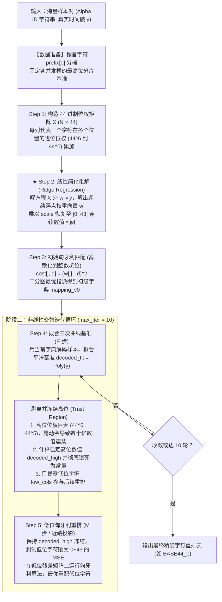

## 常用哈希与编码方案比对

| 可能的方案 | 做法 | 特点 | 输入 | 输出 |
| --- | --- | --- | --- | --- |
| **密码**学 hash 函数 (SHA-256 / SHA-1 / MD5) | **碎纸机**： → 生成和输出相同的初始值 加入输入的内容进行各种非线性混合 重复多次 | 1. 相近的输入会输出完全不同的结果 2. 可以人为制造 hash 冲突 | 任意长度二进制文本 | md5: 128bit / 32hex SHA-256: 256bit |
| 多项式除法的**校验**码 (CRC32) | 把输入的任意长度看成 (mod 2) 多项式 $M(x)$ → 指定生成多项式 $G(x)$ 得到输出为 residue $R(x)$  实际中通过移位 + XOR 实现 | 1. 常见的变化，输出可预测 (单比特错、双比特错、突发错) | 任意长度二进制文本 | CRC32: 32bit / 8hex |
| 文本**去重**，片段**匹配** Rolling Hash | 把字符串看成 B 进制整数，对 M 取 residue | 1. 计算方便 2. 根据 hash 能快速找到相同字串 3. 不是强校验，冲突常见 4. 相似字串 hash 差别大 | 任意长度字符串 | 整数 |
| 相似度**聚类** (LSH) (MinHash, SimHash) | **MinHash**： 提取文本特征，映射成整数集合 → 用 n 组随机 hash 函数 $h(x) = ax + b \pmod P$ 对集合每个元素 hash 每个 hash 值取 hash 最小值 | 1. 比较 hash 值有多少位重复，就能知道文本中有多少重复特征 2. 可以把整数分成 band，用于 LSH bucketing | 任意大小整数集合 | 取决于算法的超参数 n 位 int vector |
| | **SimHash** (PCAHash, Spectral Hash)： 输入向量 → 用 n 个投影向量计算投影，二进制化 | 1. 相似的向量会使 hash 值相同位数多，从而可以被 LSH bucketing 召回 2. 过程和逻辑回归一样都是线性 + 激活。用逻辑回归训练 + 预测，准确率应该高于 0.5 | 固定长度向量 | n bit |

---

## 研究背景与核心假说证伪链

| 假设阶段                                    | 猜想 / 机制                                                                                       | 证伪实验 / 观测现象                                                                                                                                                                                                                                                                                                                         | 判定结论                                            |
| --------------------------------------- | --------------------------------------------------------------------------------------------- | ----------------------------------------------------------------------------------------------------------------------------------------------------------------------------------------------------------------------------------------------------------------------------------------------------------------------------------- | ----------------------------------------------- |
| **1.1 假设：PnL 向量特征哈希**                   | 平台是否像感知哈希一样，将 2496 天的每日 PnL 收益率浮点向量经由局部敏感哈希（LSH / MinHash / SimHash）压缩成 7 位短码，用于底层快速去重和相似度聚类？ | 人工构造并提交多组 PnL 序列完全相同的变体（同一公式在不同账户或不同参数下跑出相同收益），结果发现生成的 Hash 毫无规律，有些前缀相似但有些完全风马牛不相及；反之，收益曲线截然相反的两个 Alpha 却可能共享前缀。                                                                                                                                                                                                                    | **排除**                                          |
| **1.2 假设：用户 ID 异或加密**                   | 由于用户 ID 与 Alpha ID 同为 7 位字符串，是否采用了简单的可逆加密（如 `hash_a ^ id_a == hash_b ^ id_b`）？                | 位运算异或关系在统计上完全为 0；                                                                                                                                                                                                                                                                                                                   | **排除**                                          |
| **1.3 假设：AST 编码**                       | 是否由清洗后的表达式 AST 与参数联合编码？                                                                       | 清洗后的 AST 指纹与生成的 Hash 之间不存在一一映射，相同 AST 多次提交仍会获得不同 Hash。                                                                                                                                                                                                                                                                              | **排除**                                          |
| **1.4 假设：settings, 表达式, user id 的联合编码** | 是否由多个特征联合编码？                                                                                  | 特征完全不同的 alpha 却共享前缀                                                                                                                                                                                                                                                                                                                 | **排除**                                          |
| **1.5 假设：时间戳主导与并发带**                    | 是否主要是由提交时间戳确定?                                                                                | 实验: 将回测数据库中海量 Alpha 的 `dateCreated` 转换为 Unix 秒级时间戳，按 Hash 前缀进行聚合分析（计算每个前缀覆盖的时间跨度 `span_sec = max_time - min_time`）：  • **现象 A（时间极度集中）**：样本数极多的前缀，其覆盖的 `span_sec` 却极小（通常集中在数秒到几分钟内），说明相同前缀的 ID 必然是在同一短暂时间窗口内生成的。  • **现象 B（平行并发槽）**：在任意一个极小的时间片段内，前缀并不唯一，而是固定平行出现约 44 种不同的前缀；跨到下一个相邻时间段，前缀集合平移并变为另一组 44 种（两段叠加显示为 88 种）。 | **证实** ID 是时间强主导的，但横向存在约 44 个并行的并发槽（分片/机器带）。 |
| **2.1 假设：独特的 Base44 字符集**               | 平台生成的 7 位字符串**仅使用了 44 个固定字符**                                                                 | 对全库千万级 Alpha ID 字符频数统计验证这一结论： `BASE44 = "012356789AEGJKLMNOPQRVWXYZabdegjklmnopqrvwxz"`                                                                                                                                                                                                                                          | **证实** 排除了常见的 Base64/Base58 编码               |
| **2.2 假设：等距排列**                         | 不同的平行带是否只是按固定的整数步长均匀等距排列？                                                                     | 当直接将各带在散点图的纵轴投影进行对比时，**视觉上各带之间的垂直间距截然不等、离散分布**                                                                                                                                                                                                                                                                                      | **排除**                                          |
| **2.3 假设：全局统一的字符顺序（固定字典）**              | BASE44 的顺序是否固定的？                                                                              | 同时出现了 0N -> 0x, PY -> Px, pM -> px                                                                                                                                                                                                                                                                                                  | **排除**                                          |
| **2.4 假设：确定“1 位字符”即可锁定分片**              | 是否并行槽由首字母唯一确定？                                                                                | 固定首字母，并行槽坍缩成一条。  **这里是我直觉滞后了，其实从 hash/timestamp 图中分片本身就能确定，因为 hash 基本是由首字母 dominant 的**（这里是 1.5 的补充）                                                                                                                                                                                                                          | **证实** 首字母是并行工号 后 6 位才和时间有关               |
| **3.1 假设：专属映射表**                        | 44 组分片经过专属映射表之后，是 timestamp 的单调光滑函数                                                           | 算法拟合                                                                                                                                                                                                                                                                                                                                | **证实** 变换后，44 组分片坍缩融合为一条极紧密、平滑的单调曲线          |
| **3.2 假设：指数函数**                         | 光滑函数是否是指数函数                                                                                   | 观察得知函数有 $y' = Cy$ 的特征，高度疑似指数函数。 • 指数假设：`log(decoded - intercept) = log(A) + B * timestamp` • 固定 intercept 的情况 • exp 优化的自由度太高了，数值算法无法收敛                                                                                                                                                                                     | **尚未证实**                                        |

---

### 3.1 假设：专属映射表（详细实现与数学反演）

#### 一、两阶段交替近端求解算法（求解 44 组专属映射表）

##### Step 1：构造 44 进制位权矩阵 $X$
在 44 进制中，从左至右 7 个位置对应的进位位权分别为：
$$[44^6, 44^5, 44^4, 44^3, 44^2, 44^1, 44^0]$$
对于样本集中的 $N$ 个 ID，构造设计矩阵 $X \in \mathbb{R}^{N \times 44}$。对于第 $i$ 个 ID，若字符 $c$ 出现在位置 $pos$（从 0 开始），则在第 $char\_index[c]$ 列累加进位权重 $44^{6 - pos}$。

##### Step 2：线性简化初估与尺度拉伸
在物理上，ID 的解码数值与时间戳 $y$ 之间满足单调正相关（$\text{Decoded} \approx \text{slope} \cdot y + \text{intercept}$）。为了打破离散全排列的死锁，第一步**主动做线性简化**：将时间戳 $y$ 作为因变量，解多元线性回归方程 $X \cdot w \approx y$：
$$w = (X^T X + \lambda I)^{-1} X^T y$$
由于单调性保序原理，时间戳越大的样本，其对应高位字符的权重必然越大。解出的连续向量 $w \in \mathbb{R}^{44}$ 已经严格锁定了 44 个字符的**相对大小顺序与比例距离**。
接着，利用设定的平台发号斜率 `init_slope`，对权重做线性缩放：
$$w = w \times \left(\frac{\text{init\_slope}}{\text{cur\_slope}}\right)$$
将缩小的连续解完整拉伸映射回 $[0, 43]$ 的连续区间。

##### Step 3：初始匈牙利匹配（离散化到整数坑位，代码第 103-106 行）
为了将 44 个带小数的浮点估计值 $w$ 分配到 $0 \sim 43$ 的互不重复整数坑位上，构建 $44 \times 44$ 的欧氏距离代价矩阵：
$$\text{cost}[j, d] = (w_j - d)^2 \quad (j \in 0\dots43 \text{ 为字符}, \; d \in 0\dots43 \text{ 为整数坑位})$$
调用 `linear_sum_assignment(cost)`（匈牙利算法），在毫秒级内完成全局二分图最优指派，产出第一版初级字典 `mapping_v0`。

##### Step 4：锁定三次曲线基准（E 步）
初级字典由于线性简化的误差，个别相邻字符可能出现微小倒错。进入 `iterate_mapping_step` 循环：
1. 用当前字典将全量样本解码为大整数：$\text{decoded} = X \cdot \text{mapped\_vals}$；
2. 以时间戳 $y$ 为自变量，对解码值拟合平滑的 3 阶多项式：
   $$\text{poly} = \text{Polynomial.fit}(y, \text{decoded}, \text{deg}=3)$$
3. 冻结计算出的理想平滑值：$\text{decoded\_fit} = \text{poly}(y)$。**在接下来的字符微调评估期间，三次曲线基准靶心保持固定不变**。

##### 关键机制：剥离并冻结高位贡献（`decoded_high` 与 Trust Region）
在 7 位 ID 中，不同位置的进位权重悬殊极大：
- 最高位权重为 $44^6 \approx 72.5$ 亿，次高位为 $44^5 \approx 1.64$ 亿；
- 而最低位仅为 $44^0 = 1$。

如果在微调字符映射时让所有 44 个字符同时自由震荡，高位字符即便发生 $\pm 1$ 的极微小抖动，解码出的数值就会产生数亿至数十亿的垂直巨震，直接把刚拟合好的平滑曲线炸飞，导致整个迭代算法发散。为此，高低位解耦与高位冻结机制将已确立的高位数值贡献 `decoded_high` 彻底锁死为常量，为算法构建了一层坚实的**信任域（Trust Region）**，只将剩余低位字符暴露给后续的重排优化。

##### Step 5：低位匈牙利重排求解（M 步）
在保持 `decoded_high` 冻结不变的前提下，对低位待优化字符 $j$ 进行对照实验：如果把字符 $j$ 尝试赋值为整数 $d \in 0\dots43$，全库样本的新数值会偏离平滑基准曲线多远？
$$\text{new\_decoded} = \mathbf{decoded\_high} + col_i \times d + \text{other}$$
计算全库样本偏离曲线的**均方误差（Mean Squared Error, MSE）**：
$$\text{cost}[j, d] = \frac{1}{N} \sum_{i=1}^{N} \left( \text{new\_decoded}_i(j \to d) - \text{decoded\_fit}_i \right)^2$$
由此构建出低位字符对候选数字的 **MSE 残差矩阵**：
- 若字符 $j$ 取到真正正确的整数，全库样本在图上极度贴合平滑曲线，MSE 逼近于 0；
- 若字符 $j$ 取错，全库样本在图上剧烈震荡，MSE 飙升。

匈牙利算法在此处充当了**从连续误差空间向离散置换矩阵空间投影的“近端投影算子（Proximal Operator）”**，在低位残差矩阵中一瞬间找到让全局总 MSE 最小的唯一无冲突字符重配！

上述 E-M 两步交替迭代 10 轮，三次多项式基准靶心与字符字典双向平滑收敛，最终沉淀出 44 组专属映射表（从 `BASE44_0` 到 `BASE44_z`）。

---

#### 二、截距校准与三次多项式联合拟合（44 条并发带归一坍缩）

当 44 组字符集全部求出后，每一条轨道内部均已变得极其平滑，但 44 条轨道之间仍悬挂在不同的绝对高度上（并发槽常数截距），且整体发号速度受全平台提交活跃度影响，呈现平滑的三次曲线走势。

构造**带分片虚拟变量（Dummy Variables）的联合最小二乘模型**：

$$\text{Decoded}_i = \underbrace{c_3 \hat{t}_i^3 + c_2 \hat{t}_i^2 + c_1 \hat{t}_i + c_0}_{\text{全局共享的三次时间曲线}} + \underbrace{\sum_{p=1}^{43} \beta_p \cdot \mathbb{I}(\text{prefix}_i == p)}_{\text{43 个槽相对于基准槽的截距差}}$$

1. **时间归一化**：$\hat{t} = \frac{t - T_{\min}}{T_{\max} - T_{\min}} \in [0, 1]$，消除 $1.7 \times 10^9$ 高次幂引发的浮点溢出与矩阵病态；
2. **一步最小二乘求解**：设计矩阵 $X \in \mathbb{R}^{N \times (4 + 43)}$，调用 `np.linalg.lstsq(X, y)` 一次性解出全局多项式系数 $[c_0, c_1, c_2, c_3]$ 与 44 个槽的绝对截距 `BASE44_INTERCEPTS`；
3. **归一坍缩**：对于任意样本，只需执行 $\text{Aligned\_Decoded} = \text{Decoded} - \text{Intercept}(prefix)$，44 条原本错落平行的散点带便瞬间严丝合缝地完全坍缩在同一条纯净的三次曲线上！

---

#### 三、反向求解实数根（生产还原与验证）

在生产工具 [`alpha_id_2_time.py`](file:///Users/wenliu/Code/python/world_quant_brain/alpha_id_2_time.py) 中，给定任意 7 位 Alpha ID，反查时间的完整流程为：

1. **提取首字母**：取 $p = \text{ID}[0]$，查表获取该槽专属的 `BASE44_p` 字典与截距 $\text{Intercept}_p$；
2. **解码与去截距**：按 `BASE44_p` 将 7 位字符串转为大整数，减去截距得到 $d$；
3. **构造一元三次方程**：
   $$c_3 \hat{t}^3 + c_2 \hat{t}^2 + c_1 \hat{t} + (c_0 - d) = 0$$
4. **解析实数根**：调用 `np.roots([c3, c2, c1, c0 - d])`。由于三次曲线在有效区间内严格单调递增，方程必然有且仅有 **1 个实数根**落在 $[0, 1]$ 之间；
5. **反归一化还原秒级时间戳**：
   $$t = \hat{t} \times (T_{\max} - T_{\min}) + T_{\min}$$

---

## 平台物理架构反推与 8 位扩容之谜

### 一、44 并发槽与 380 次/天心算悖论的物理本质

根据逆向结论，平台首字符映射了 44 个平行的并发槽（分片/Worker）。基于并发槽结构，可以建立一个基础的容量与并发测算模型：

1. **理论并发带宽与全网日吞吐上限**：
   - **44 个平行发号分片**：首字母确定分片，全网并发槽总数为 44；
   - **发号槽理论并发基准**：若以每个分片 1 次/秒估算全平台瞬时吞吐基准：
     $$R_{\text{platform}} = 44 \text{ 分片} \times 1 \text{ 次/秒/分片} = \mathbf{44 \text{ 次/秒}}$$
   - **每分钟满载上限**：
     $$44 \times 60 = \mathbf{2,640 \text{ 次/分钟}}$$
   - **每 5 分钟满载上限**：
     $$2,640 \times 5 = \mathbf{13,200 \text{ 次/5分钟}}$$
   - **每小时满载上限**：
     $$2,640 \times 60 = \mathbf{158,400 \text{ 次/小时}} \quad (\approx \mathbf{15.84 \text{ 万次/小时}})$$
   - **全天 24 小时满载上限**：
     $$158,400 \times 24 = \mathbf{3,801,600 \text{ 次/天}} \quad (\approx \mathbf{380 \text{ 万次/天}})$$
   - **全网 10,000 顾问平摊悖论**：
     若简单由全网约 10,000 名量化顾问均匀平分：
     $$3,801,600 \div 10,000 \approx \mathbf{380 \text{ 次/人/天}}$$

#### 为什么 380 次/天与实际高频量化感受严重不符？
在实际量化研究中，活跃的量化顾问经常使用自动化脚本进行大批量回测，单人单日提交量就可达到 **3.5 万 ~ 5 万次回测**，远远超越了“380 次/人/天”的心算平摊值。

核心在于**顾问活跃度的极端二八偏态（长尾分布）**：
- 10,000 名注册顾问中，95% 以上属于沉睡或低频用户；
- 真正消耗平台算力的是运行多线程自动化流水线的极少数活跃顾问，单人单日回测量即可达到 3.5 万 ~ 5 万次；
- 全网同时活跃的自动化高频顾问通常仅数十人，全网日总回测量完全处于全网约 380 万次/天的物理承载能力范围内。

---

### 二、7 位升级 8 位：容量饱和与进位实证

根据本地 MongoDB 全量回测数据挖掘，7 位升级 8 位的本质是**时间戳数值突破 Base44 容量上限后的自然进制进位**：

1. **容量极限与切换时间**：
   - 7 位 ID 结构为“1 位分片 + 6 位编码”，容量上限为 $44^6 = \mathbf{7,256,313,856}$（约 72.56 亿）。
   - 切换精确发生在 **2025 年 9 月 30 日 10:25 ~ 11:12（UTC-4）**。
2. **7 位饱和铁证（99.9984%）**：
   对 7 位末期样本的后 6 位进行解码验证：
   - 7 位末期的样本，其高位字符已全部达到 Base44 的最高索引 **43**；
   - 最后一批 7 位样本的后 6 位有效编码数值已达 **7,256,197,594**；
   - 计算其占 6 位容量极限的比例：$\frac{7,256,197,594}{7,256,313,856} = \mathbf{99.9984\%}$，剩余空间不足 11.6 万（0.0016%），濒临溢出。
3. **8 位自然进位机制**：
   - 数值突破 $44^6$ 后自然向高位进位，长度扩展至 8 位。
   - 全库 8 位样本的前两位前缀固定坍缩为 44 种，且第 2 位字符在对应分片字典中**索引严格为 1**，确证为溢出向高位进位的“进位 1”（$1 \times 44^6$）。
4. **8 位 ID 饱和时间推算**：
   - 8 位 ID 单分片容量扩容至 $44^7 = \mathbf{319,277,809,664}$（约 3,192.78 亿，扩大 44 倍）。
   - 实测物理时钟推进速率约为 $141.14 \text{ 步进/秒}$（约 44.5 亿/自然年），当前仅消耗约 3.82%（122 亿）。
   - 剩余空间约 3,070 亿，还可支撑 **约 69 年** 的物理时间，预计到 **2095 年左右** 才会面临下一次进位。
