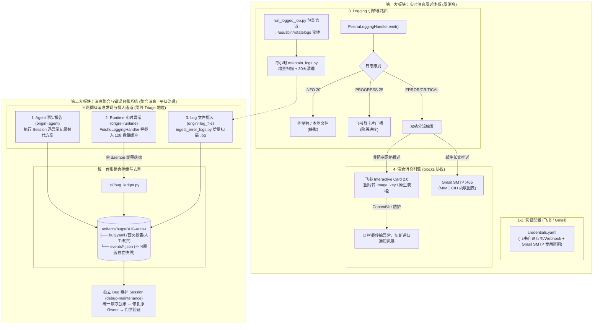
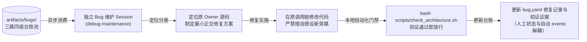

现代后台与量化回测服务必须严格解耦并协同两套平级体系：
1. **实时消息发送体系（发消息）**：负责对外的主动触达与状态广播。涵盖飞书自建应用凭证与群机器人搭建、系统 Logging 日志分流、自定义 `PROGRESS` 级别、`ContextVar` 死循环切断机制、定时日志轮转维护，以及通过 `blocks` 块协议驱动飞书交互卡片 2.0 与 Gmail SMTP 图文邮件。
2. **消息整合与错误台账系统（整合消息）**：负责对内的故障留痕与质量治理。将来自 Agent 事实报告、Runtime 运行时捕获与 Log 文件增量摄入三路同级通道的错误与诊断信息，统一整合并持久化到 `artifacts/bugs/`，通过 AST 指纹聚合去重与绝对安全脱敏，交由独立维护 Session 闭环修复。



---

## 一、实时消息发送体系（发消息）

实时消息发送体系关注“如何快速、稳定、富交互地把系统动态推送到开发者终端”，涵盖凭证准备、日志截获路由与多终端卡片协议三大支柱。

### 1. 飞书机器人搭建与凭证配置指南

系统支持向飞书群自动推送富文本卡片与图表。飞书开放平台的规范要求：**若要在卡片中展示本地图片，必须走自建应用的 API 上传图片以获取 `image_key`**；因此需要同时配置企业自建应用与群自定义机器人。

#### (1) 开放平台创建自建应用
1. 打开 [飞书开放平台](https://open.feishu.cn/) 并登录。
2. 进入 **开发者后台** → 点击 **创建企业自建应用**（填写应用名称，如 `QuantNight Bot`）。
3. 在左侧导航栏进入 **凭证与基础信息**：
   - 记录 **App ID**（格式如 `cli_a1b2c3d4...`）；
   - 记录 **App Secret**。
4. 进入 **添加应用能力** → 添加 **机器人** 能力。
5. 进入 **权限管理**：
   - 搜索并开通 `im:message`（读取与发送单聊/群聊消息）；
   - 开通 `im:resource`（上传与下载富文本图片、文件资源）。
6. 进入 **版本管理与发布** → 创建并发布一个可用版本（企业管理员审核通过后生效）。

#### (2) 飞书群添加自定义机器人（Webhook）
1. 在飞书客户端打开接收告警的目标群聊。
2. 群设置 → **群机器人** → **添加机器人** → 选择 **自定义机器人**。
3. 命名机器人后，飞书会生成一个 Webhook 地址：
   `https://open.feishu.cn/open-apis/bot/v2/hook/7f8a9b0c-xxxx-xxxx-xxxx-xxxxxxxxxxxx`
4. 提取该 URL 末尾的唯一标识串，即为 `feishu_token`。

#### (3) 本地凭证文件规范（`credentials.yaml`）
在项目根目录的 `credentials.yaml` 中配置飞书节点：

```yaml
feishu:
  app_id: "cli_a1b2c3d4e5f6xxxx"     # 用于上传图片换取 image_key (token 有效期 2 小时)
  app_secret: "YourAppSecretString"   # 应用密钥
  feishu_token: "7f8a9b0c-xxxx-xxxx" # 群自定义机器人的 Webhook token
```

---

### 2. Gmail SMTP 凭证与应用专用密码配置指南

系统支持通过 Gmail SMTP 465 端口向指定邮箱推送长篇图文分析报告。由于 Google 已废弃普通账号密码直接登录第三方客户端，必须通过**两步验证（2FA）+ 应用专用密码（App Passwords）**完成鉴权。

#### (1) 开启两步验证并生成应用专用密码
1. 登录 Google 账号，进入 [Google 账号安全性中心](https://myaccount.google.com/security)；
2. 确保已开启 **两步验证（2-Step Verification）**；
3. 直接访问 [Google 应用专用密码配置页](https://myaccount.google.com/apppasswords)；
4. 在页面中输入应用名称（如 `QuantNight Alert`），点击 **创建**；
5. 系统将生成一组 **16 位应用专用密码**（格式如 `abcd efgh ijkl mnop`）；
6. 妥善保存该密码。注意：严禁使用个人的 Google 主登录密码。

#### (2) 本地凭证文件规范（`credentials.yaml`）
在项目根目录的 `credentials.yaml` 中配置 `email` 节点（与 `feishu` 节点同级）：

```yaml
email:
  smtp_server: "smtp.gmail.com"
  smtp_port: 465                         # SSL 端口 (推荐 465)
  email: "your_sender@gmail.com"         # 发件人 Gmail 地址
  password: "abcd efgh ijkl mnop"        # 16 位 Google 应用专用密码
  receiver_email: "receiver@example.com" # 接收报告的目标邮箱
```

> [!TIP]
> **代理环境直连白名单**：在 macOS 环境下如果开启了 Clash / Surge 等 TUN 虚拟网卡模式，务必将 `smtp.gmail.com` 加入直连（DIRECT）分流规则，防止 465 端口 SSL 握手被远程代理节点重置导致发送超时。

---

### 3. 系统 Logging 日志架构与配置实战

日志系统位于 `util/logging_config.py`，负责控制台显示、本地文件落盘、飞书消息广播、Bug 台账的统一调度，以及定时采集任务的日志轮转与维护。

#### (1) 自定义日志级别：`PROGRESS = 25`
为了让长时间运行的任务（如大批量历史回测、数据同步）能在不滥用 WARNING 的前提下向移动端播报进度，系统引入了介于 `INFO (20)` 与 `WARNING (30)` 之间的自定义级别：

```python
PROGRESS_LEVEL = 25
logging.addLevelName(PROGRESS_LEVEL, "PROGRESS")

# 业务代码直接调用：
logger.progress("已完成 500/1000 个 Alpha 回测计算...")
```

#### (2) 三级日志过滤与路由矩阵

| 日志级别 | 数值 | 控制台 / 本地文件 | 飞书群推送 (Webhook) | 写入本地 Bug 台账 | 典型用途与设计初衷 |
|---|:---:|:---:|:---:|:---:|---|
| **INFO** | `20` | ✔️ 输出 | ❌ 忽略 | ❌ 忽略 | 常规流转日志，禁止打扰移动端。 |
| **PROGRESS** | `25` | ✔️ 输出 | ✔️ **异步卡片推送** | ❌ 忽略 | 任务阶段里程碑广播，不需要作为代码缺陷沉淀。 |
| **ERROR** | `40` | ✔️ 输出 | ✔️ **异步告警推送** | ✔️ **非阻塞落盘** | 捕获到明确异常，需要人类介入与台账追溯。 |
| **CRITICAL** | `50` | ✔️ 输出 | ✔️ **异步告警推送** | ✔️ **非阻塞落盘** | 系统级严重故障。 |

#### (3) `setup_logging` 初始化用法与参数

```python
from util.logging_config import setup_logging
import logging

# 标准初始化（控制台 + 文件 + 飞书告警 + Bug 台账）
setup_logging(
    log_file_path="logs/simulation.log", # 可选：指定本地日志落盘路径
    stream=sys.stdout,
    enable_feishu=True,                 # 是否推送飞书 (默认 True)
    enable_bug_ledger=True,             # 是否落盘本地 Bug 台账 (默认跟随 enable_feishu)
    bug_ledger_dir=None,                # 可选：自定义台账根目录，默认 artifacts/bugs/
    level=logging.INFO
)

logger = logging.getLogger("TaskRunner")
logger.info("启动任务")                     # 本地记录
logger.progress("当前进度：30%")             # 飞书播报进度
logger.error("连接超时，触发降级重试")         # 飞书告警 + 本地台账记录
```

#### (4) 关键防护：`ContextVar` 切断死循环通知风暴
如果网络发生中断，推送飞书的 HTTP 请求本身也会报错并输出 `logger.error`。若未加防护，该错误会再次触发 `FeishuLoggingHandler.emit()`，瞬间引发无限递归的风暴，打满磁盘并耗尽线程池。

```python
# 防护实现：
_feishu_delivery = ContextVar('feishu_delivery', default=False)

def _run_async_in_thread(coro):
    def _runner():
        token = _feishu_delivery.set(True) # 标记当前正在执行飞书推送
        try:
            asyncio.run(coro)
        finally:
            _feishu_delivery.reset(token)
```
Handler 在 `emit()` 时首先校验 `_feishu_delivery.get()`，若已在发送上下文中，强制终止，确保递归被彻底切断。

#### (5) 定时日志轮转与增量维护闭环（launchd + rotatelogs + 30 天留存）

对于生产中由 macOS `launchd` 托管的长时间运行或定时采集任务，系统通过 `docs/log_maintenance.md` 规范实现了从轮转、增量摄入到 30 天自动清理的完整工程闭环：

```text
[定时任务运行]
     │
     ▼
run_logged_job.py 包装管道 ──► /usr/sbin/rotatelogs (单文件 50MB 或每日轮转) ──► 归档为 raw .log.<epoch>
                                                                                       │
[每小时维护任务 launchd: maintain_logs.py]                                              │
     │                                                                                 │
     ├── 1. 增量扫描: ingest_error_logs.py (按 inode/offset 增量录入，更新 checkpoint.json) ◄┘
     │        │
     │        ▼
     │   脱敏写入 artifacts/bugs/ 三路同级台账 (origin=log_file)
     │
     ├── 2. 证据校验: 核对 manifest hash 链、generation 与 event SHA 可用诊断副本
     │
     └── 3. 清理核验 (全部满足才 unlink):
              ├── 归档文件名时间与 mtime 均满 30 天
              ├── checkpoint 确已完整读到 EOF (无残缺)
              ├── lsof 确认无活跃进程占用 (非 symlink / 单硬链接)
              └── 先记录不可覆盖清理 receipt 再安全 unlink 归档 (绝对保护 current / launcher / checkpoint)
```

1. **Native 管道轮转 (`run_logged_job.py`)**：
   - 包装白名单原 `uv run -m` 定时任务，exec 原 job 进程组内的 Bash pipefail 管道指向系统自带 `/usr/sbin/rotatelogs`；
   - 策略定义在 `scripts/scheduler/log_policy.json`：按单文件 50MiB 或每日轮转，生成 `.log.<epoch>` 原生归档；
   - 当前 `.log` 保持为 native 归档 `.log.<epoch>` 的硬链接，保证原子无缝写入；
   - 独立小型 `.launcher.log` 记录启动失败，原退出码严格透传；`flock` 跨 exec 持有，防止并发多开。

2. **每小时有界维护 (`com.quantnight.log_maintenance`)**：
   - 由 macOS launchd 每 3600 秒触发一次 `scripts.maintain_logs --apply-retention --rebuild-evidence`；
   - 默认单次扫描协作式预算（单文件 8MiB / 总 64MiB / 2000 观察 / 60 秒），超时安全退出，绝不卡死系统。

3. **断点续扫与摄入 (`ingest_error_logs.py`)**：
   - 按文件的 `inode`、`generation` 与 `offset` 增量扫描；
   - 游标与证据链保存在 `artifacts/bugs/.log-intake/checkpoint.json`，即使维护任务被打断，续扫依然保证绝对幂等；
   - 提取的 `ERROR` / `CRITICAL` 自动进行安全脱敏并写入 `artifacts/bugs/`（作为三路平级台账中的 `origin=log_file` 通道）。

4. **严格 30 天删除核验条件**：
   - 仅限白名单数字 epoch 归档；绝对禁止删除当前 `.log`、launcher 日志、台账与 checkpoint；
   - 归档文件名时间与最后修改时间（mtime）均超过 30 天；
   - 同 generation 完整读到 EOF，无跳过历史、超长丢行或堆栈缺口；
   - `lsof` 确认无任何活跃进程持有文件句柄；
   - 任何身份、证据或占用存疑均保留并记录原因，绝不盲目 rm。

---

### 4. 混合消息引擎（blocks 块协议）

消息引擎抹平了不同终端的格式差异，统一输入规范数据块：

```python
blocks = [
    {"type": "text", "content": "📊 **Alpha 回测统计报告**\n任务执行完成。"},
    {"type": "table", "content": df_summary},         # Pandas DataFrame
    {"type": "image", "content": "./output/pnl.png"},  # 本地图片路径
]
```

#### (1) 飞书 Interactive Card 2.0（`util/message/feishu_message.py`）
*   **图片换 Key**：自动并发调用 `upload_image_to_feishu()` 将本地图片上传至飞书资源库，获取 `image_key` 后以原生 `{"tag": "img", "img_key": ...}` 节点渲染。
*   **表格原生化**：`dataframe_to_feishu_elements(df)` 将 DataFrame 映射为飞书卡片内置的 2.0 Table 结构，支持横向对齐、列宽自适应与灰底加粗表头。
*   **发送调用**：
    ```python
    from util.message.feishu_message import send_feishu_card
    await send_feishu_card(blocks, title="回测日终汇总")
    ```

#### (2) Gmail SMTP 邮件（`util/message/email_message.py`）
*   **MIME CID 内联图表**：避免外链图床被邮件客户端屏蔽。采用 `MIMEMultipart("related")`，将本地图片以 `MIMEImage` 挂载在邮件包体内，分配唯一 `Content-ID`（如 `cid:image_0`），在 HTML 中通过 `` 渲染。
*   **465 SSL 链路**：
    - 读取 `credentials.yaml` 的 `email` 节点（支持 Google 16 位专用 App Password）。
    - 代理环境注意：TUN 模式下务必配置 `smtp.gmail.com` 为直连白名单，防止 465 握手被境外节点中断。

---

## 二、消息整合与错误台账系统（整合消息）

消息整合系统关注“如何将散落在各处的运行故障、Agent 阻碍与离线日志消息聚合沉淀为高质量资产”，与发送系统地位平级。根据项目架构规范（`docs/error_bug_ledger.md`、`docs/architecture/README.md`），系统设计了**三路平级的错误采集通道与闭环修复机制**。

### 1. 三路平级来源定义（同等 Triage 地位）

> [!IMPORTANT]
> **通道平等，统一 Triage**：
> `origin` 仅代表错误与异常信息进入系统的**物理摄入管道**（无论是 Agent 自主上报、运行时代码抛出、还是离线日志文件增量摄入），**绝不代表轻重缓急或次要待办**。所有来源均按同一套 repair/triage 流程处理，统一汇聚到根目录 `artifacts/bugs/`，遵循统一的去重、脱敏与门禁验收准则。

| 来源通道 (`origin`) | 触发时机与机制 | 数据流转路径与写者 | 核心诊断证据 (`diagnostic_evidence`) |
|---|---|---|---|
| **1. Agent 事实报告**<br>(`origin=agent`) | 执行 Session 在运行中遇到基础设施异常（如平台限制、不可抗力网络错误）。 | 业务 Session 直接落盘写入 `artifacts/bugs/<bug_id>/bug.yaml`，自身 Goal 不中断。 | 事实描述、业务影响、现场证据引用（`evidence_ref`）及合规替代方案。 |
| **2. Runtime 实时观察**<br>(`origin=runtime`) | 代码执行中抛出未捕获的 `ERROR` 或 `CRITICAL` 级别异常。 | `FeishuLoggingHandler` 拦截后放入 128 容量有界缓冲，由 daemon 线程调用 `util/bug_ledger.py` 落盘。 | 异常类名、AST 提取的静态代码文字模板、安全裁剪调用栈（无 locals/参数）。 |
| **3. Log 文件增量摄入**<br>(`origin=log_file`) | 定时采集任务（launchd）或离线脚本产生的原始 `.log` 文件。 | `scripts/ingest_error_logs.py` 按文件的 `inode` / `generation` / `offset` 增量扫描，复用 `record_log_observation` 落盘。 | 原文件路径与字节偏移、原日志时间戳、脱敏诊断正文 / JSON body / 栈片段。 |

---

### 2. 台账持久化目录规范

台账严格锚定在代码根目录 `artifacts/bugs/`：

```text
artifacts/bugs/BUG-auto-<fingerprint>/
  ├── bug.yaml               # 首次发生时生成（记录源码位置、模板与影响）；后续由修复 Session 人工维护
  └── events/
        ├── <event_id_1>.json # 每次发生的不可覆盖独立快照（精确到毫秒的时间戳、PID、安全堆栈）
        └── <event_id_2>.json
```

*   **写入纪律**：自动写入脚本**绝不覆盖**人工已编辑的 `bug.yaml`（例如已填写的修复计划、根因诊断）。
*   **统计无争写**：发生次数、最近发生时间完全通过扫描 `events/` 下的 JSON 文件聚合得出，避免多进程并发改写 YAML 文件头导致损坏。

---

### 3. 指纹算法（Fingerprint）与去重聚合

为了避免在几万次批量循环中产生海量的垃圾 Bug 文件夹，指纹算法强制做静态位置聚合：

$$\text{Fingerprint} = \text{SHA256}(\text{源码相对路径} + \text{函数名} + \text{代码行号} + \text{AST 固定文字模板} + \text{异常类名})$$

*   **排除易变因子**：指纹计算**严禁包含**发生时间、动态参数、当前任务 ID、Session ID 或 Logger 名称。
*   **同一调用点归一**：同一代码位置触发的同类错误，无论发生多少次，始终聚合到同一个 `BUG-auto-<fingerprint>` 目录下，仅以追加 `events/*.json` 的形式累计。

---

### 4. 绝对安全脱敏与 AST 模板提取原则

**严禁把动态日志正文或敏感变量持久化到台账**：

1. **Python AST 提取代码常量**：
   - 提取源文件该行代码的 AST 语法树，提取字符串硬编码字面量作为标签；
   - 动态拼接的 f-string 或 format 参数一律替换为 `<value>`。
2. **凭据与敏感字段屏蔽**：
   - 正则匹配 `token`、`cookie`、`password`、`authorization`、`secret`、`key` 等关键词，整行强制脱敏为 `<sensitive/structured text omitted>`。

---

### 5. 闭环修复与工程门禁（debug-maintenance Session 治理）

三路同级错误汇入 `artifacts/bugs/` 后，系统建立了两类责任分离的闭环治理机制：



*   **责任彻底解耦**：业务执行 Session（如 Alpha 挖掘、回测任务）只负责发现并记录事实，自身 Goal 在授权范围内继续推进，严禁现场中途去修基础设施；
*   **统一维修队列**：由独立的 **Bug 维护 Session**（`debug-maintenance`）异步消费台账，按照 `origin` 平级标准统一进行 Triage、分类与根因诊断；
*   **架构门禁验收**：修复必须在原入口/原调用链进行，修复后执行本地自动门禁：
    ```bash
    bash scripts/check_architecture.sh
    ```
    门禁通过后才可放行，并将修复证据沉淀至对应 `bug.yaml`，形成完全自闭环的质量护城河。
