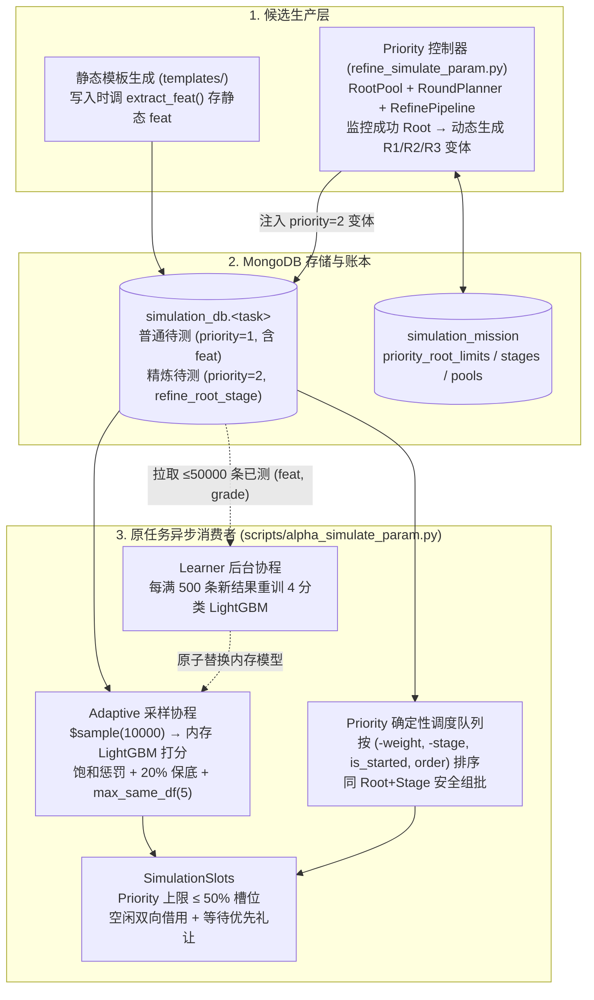

在量化回测中，Alpha 搜索本质上是一个**受限配额下的黑箱资源分配问题**。

### 1. Alpha 搜索的三个核心难点与局部特点

在尝试自动化挖掘 Alpha 时，我们面临的挑战远比普通模型拟合复杂：

- **搜索范围极广 (Dimensionality Curse)**：Datafields 数量庞大，加上算子组合、参数空间，理论搜索空间呈指数级爆炸。
- **有效 Alpha 极稀疏 (Sparse Signals)**：在数亿种组合中，真正能通过过拟合测试、具有预测能力的信号寥寥无几（**尾部识别**）。
- **协同效应与相关性 (Synergy & Correlation)**：单一字段的优劣并不代表全部。Alpha 的最终效果往往取决于字段间的组合正交性，而单纯的线性排序无法捕捉这种“1+1>2”的化学反应。

#### Alpha 搜索的局部特点

- **难以直接求解**：缺少可用梯度、解析解或可靠的精确优化器，需要依靠黑箱反馈推进。
- **存在共享规律**：某些数据类型适合某类处理，某些算子结构容易产生高换手或集中持仓。
- **存在局部改进**：平滑、中性化、异常值处理等，有时能改善已有信号。

---

### 2. 算法选型

- 先验特征引导
  - 从历史回测结果提出的特征冷启动
  - 引入外部世界先验：论文 / AI 数据集分析 / 经济 Idea
- 为长尾深处的稀疏信号保留无偏探索通道
- 闭环在线反思
- 局部探索优化

#### 为什么不用渐进披露

1. **怎么移植**：**alpha之间的组合关系并不是同一公式的投影**. 考虑 PROSAC 算法，只选取一个特征 **字段**, 假设总回测预算 5000 次、总字段数 1000 个，均匀随机下每个字段被选中的期望次数为 $5000 \times \frac{1}{1000} = 5$ 次。按先验排名（Rank）把这 5 次期望“提前兑现”，就变成了按照排名顺序对每个字段依次回测 5 次。
2. **没有“唯一真相”**：渐进披露是极度贪婪地从最可能的地方找起，一旦找到最优解便立刻终止（Early Stop），目的是**以最快速度收敛到单一结果**；
3. **“不弱于随机”是伪命题**：在单特征抽样下，扩池步长退化为常数（$T_{n+1} - T_n = \text{const}$），PROSAC 的组合探索彻底退化为极其机械的“单向纯顺序遍历”。所谓的不弱于随机, 只是每个字段的回测次数完全相同。因为字段并不是唯一特征, 而我们的目标是在有限预算内尽可能挖掘出更多有效 Alpha，本来就会有意向高潜力字段倾斜更多回测额度。
	1. 之前搞混是, 我们想让我们的算法, 比随机更能
4. **开环调度无法应对不可信排序**：渐进披露属于静态开环调度，测试顺序事先排死、中途不会动态更换；而在现实中，字段的初始排序充满噪声、并不可信。

总结: 渐进披露是适用于组合最速找到唯一结果的算法, 和我们的问题不匹配. 

---

### 3. 现有双轨系统

#### 3.1 全局架构：Adaptive（广度）与 Priority（深度）协同图

---

