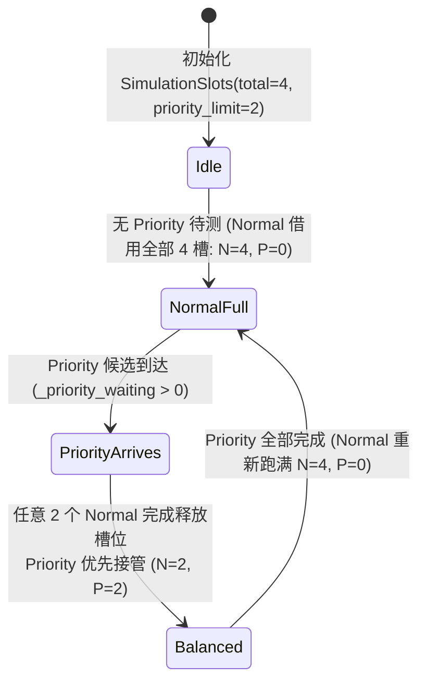
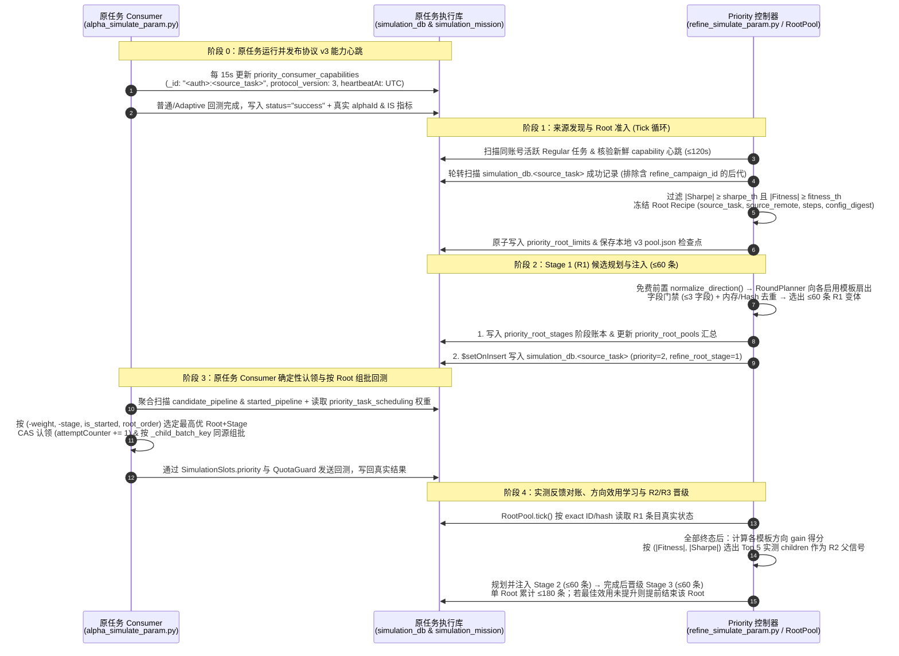
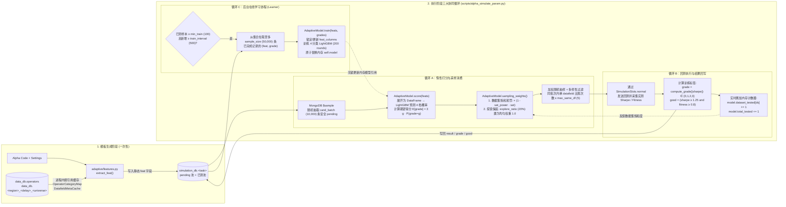

本文档详细阐述 QuantNight 的**整体异步回测流水线（Asynchronous Simulation Pipeline）**，以及构建在该流水线之上的两大智能调度与进化子系统：**Priority Task（基于实测反馈的多源 Per-Root 三阶段自动精炼编排）** 与 **Adaptive Task（基于结构特征与在线 LightGBM 的探索-利用自适应采样调度）**。


## 0. 三类任务模式全景对比表

| 特性维度           | 普通任务 (Regular)                      | 自适应任务 (Adaptive Task)                                          | 精炼优先任务 (Priority Task)                                                              |
| -------------- | ----------------------------------- | -------------------------------------------------------------- | ----------------------------------------------------------------------------------- |
| **核心目标**       | 按既定列表测完模板展开的候选池                     | 在超大待测池中**被动优选**高潜结构先测                                          | 基于实测好 Alpha **主动生成并迭代** 3 轮精炼变体                                                     |
| **是否生成新表达式**   | 仅启动前生成一次                            | 否（只对已有 `pending` 池动态排序）                                        | **是**（根据实测反馈动态生成 R1/R2/R3 变体）                                                       |
| **驱动Runner进程** | `scripts/alpha_simulate_param.py`   | `scripts/alpha_simulate_param.py`（开启 `adaptive.enabled`）       | 控制器：`scripts/refine_simulate_param.py`<br/>执行器：**借用原任务的 `alpha_simulate_param.py`** |
| **与其它队列的关系**   | 与同集合的 Priority 共享 `SimulationSlots` | 在 `SimulationSlots.normal` 槽位内替代纯随机采样，与 Priority 无缝共存          | 写入原任务集合（`priority=2`），占用原任务 `SimulationSlots.priority`（$\le 50\%$ 槽位）               |
| **学习模型 / 算法**  | 无（随机或顺序）                            | 进程内 4 分类 LightGBM + 数据集饱和度惩罚 + 20% 探索保底                        | Per-Root 同 Scope 父子实测 Fitness 相对增益（Gain）+ Top-5 晋级                                  |
| **持久化状态与账本**   | `simulation_db.<task>`              | `simulation_db.<task>` 中的静态 `feat` + 实测 `grade`/`good`（模型全在内存） | 本地 `pool.json` (v3) + MongoDB `priority_root_limits / stages / pools`               |


---

## 1. 整体异步回测架构全景（End-to-End Async Simulation）

QuantNight 的异步回测体系采用**“生产者与消费者解耦、单原任务消费者（Source Consumer）统一持有并发槽与配额门禁、回执先落库后发包”**的架构设计。

### 1.1 全局架构与数据流图

```mermaid
flowchart TB
    subgraph Producers ["候选生成与生产层 (Producers)"]
        TmplGen["普通模板生成 (templates/)<br/>make_simulation_datum()<br/>写入时调 extract_feat() 存静态 feat"]
        PrioCtrl["Priority 控制器 (scripts/refine_simulate_param.py)<br/>RootPool.tick() + RoundPlanner + RefinePipeline<br/>动态发现活跃原任务成功 Root → 生成 R1/R2/R3 变体"]
        SuperGen["SUPER 模板生成 (super_templates/)<br/>Selection + Combo 单变体冻结"]
    end

    subgraph Storage ["MongoDB 持久化与控制面 (simulation_db & simulation_mission)"]
        TaskColl[("simulation_db.&lt;task&gt;<br/>普通待测项 (priority=1, 含 feat)<br/>Priority 待测项 (priority=2, refine_campaign_id)")]
        RootLedgers[("simulation_mission<br/>priority_root_limits / stages / pools<br/>priority_task_scheduling<br/>priority_consumer_capabilities")]
        TaskMeta[("simulation_mission.tasks<br/>任务配置 / simulatorRuntime 心跳<br/>startupRecovery / superActiveSlots")]
    end

    subgraph Consumer ["原任务异步消费者核心 (scripts/alpha_simulate_param.py)"]
        direction TB
        subgraph Schedulers ["双轨候选调度器"]
            NormalFetch["普通 / Adaptive 采样协程<br/>AdaptiveModel ($sample → 惰性打分 → 加权采样)<br/>Learner 协程 (攒够新结果后台重训 LightGBM)"]
            PrioFetch["Priority 认领与本地堆调度<br/>util/priority_scheduling.py + PriorityTaskQueue<br/>按 权重 → R3/R2/R1 → 已开始 Root 连续性 排序<br/>_child_batch_key 同源组批"]
        end

        SlotGate["SimulationSlots (util/simulation_slots.py)<br/>总槽位 max_concurrent<br/>Priority 上限 ≤ floor(max_concurrent / 2)<br/>空闲槽双向借用 + Priority 等待优先获槽"]
        QuotaGate["SimulationQuotaGuard + _PrioritySubmissionGuard<br/>4,500 日预算门禁 + 账号 429 冷却检查<br/>【HTTP 前】原子持久化 campaign_post_attempted=True"]
    end

    subgraph Transport ["HTTP 传输与回执采集 (api/simulation.py & util/network_util.py)"]
        SubmitPOST["_submit_with_receipt_policy()<br/>POST /simulations (单条或 Multi-Sim Batch)<br/>拿到 Location 立即刷盘 ACCEPTED"]
        PollGET["check_simulation_progress()<br/>按 Retry-After 异步轮询 GET Location<br/>COMPLETE 后拉取 /alphas/{id} 逐 child 落库"]
        StartupRec["启动恢复与未知回执对账<br/>util/mission_recovery.py & util/super_recovery.py<br/>只读 GET 回收 ACCEPTED/UNKNOWN，绝不盲目重发 POST"]
    end

    TmplGen -->|"写入普通待测项"| TaskColl
    PrioCtrl <-->|"1. 校验能力心跳 & 写阶段账本"| RootLedgers
    PrioCtrl -->|"2. $setOnInsert 注入 priority=2 变体"| TaskColl
    PrioCtrl <-- "6. 读取真实回测反馈晋级下一阶段" --- TaskColl

    TaskColl --> NormalFetch
    TaskColl --> PrioFetch
    RootLedgers -->|"读取任务权重与能力租约"| PrioFetch

    NormalFetch -->|"申请 normal 槽"| SlotGate
    PrioFetch -->|"申请 priority 槽"| SlotGate
    SlotGate --> QuotaGate
    QuotaGate --> SubmitPOST
    SubmitPOST --> PollGET
    PollGET -->|"3. 写回实测 is / grade / good / alphaId"| TaskColl
    Consumer -->|"发布 15s 运行时与能力心跳"| TaskMeta
    Consumer -->|"发布 protocol_version=3 心跳"| RootLedgers
    StartupRec <-->|"启动时只读对账"| TaskColl
```

---

### 1.3 并发槽共享（`SimulationSlots`）与配额状态机（`SimulationQuotaGuard`）

#### （1）`SimulationSlots`：普通/Adaptive 与 Priority 的公平共享与借用
位于 [`util/simulation_slots.py`](../../util/simulation_slots.py)：
- **单一控制器**：每个 `alpha_simulate_param.py` 消费者进程实例化唯一一个 `SimulationSlots(total=max_concurrent, priority_limit=priority_max_concurrent)`。
- **硬上限与双向借用**：
  - `priority_limit` 默认等于 `floor(max_concurrent / 2)`（可在顶层配置显式调低为 `0..floor(max_concurrent / 2)`；当 `max_concurrent == 1` 时 `priority_limit == 0`，自动禁用 Priority 认领）。
  - **Priority 不空占槽位**：当没有 Priority 候选或 Priority 活跃数未用满时，普通/Adaptive 队列可以借用**全部剩余槽位**（最高跑满 `max_concurrent`）。
  - **Priority 等待防饥饿**：当有 Priority 协程正在等待（`_priority_waiting > 0`）且当前 `_priority_active < priority_limit` 时，下一个释放的槽位**优先分配给 Priority**，**普通协程在 `Condition.wait_for` 中礼让，但绝不抢占已在运行中的普通模拟**。




#### （2）回执安全与冷启动恢复（No-Replay Iron Rule）

- **先写意图后发 HTTP**：`_PrioritySubmissionGuard.before_submit` 在发出任何网络字节前，先将 `campaign_post_attempted = True` 与 `batchBackendIds` 写入 MongoDB。
- **拿到 Location 立即刷盘**：`_PriorityReceipt` 一旦捕获 `progress_url`（`Location` 头），立即异步刷入 `progressUrl` 与 `acceptance = "ACCEPTED"`。
- **故障分类不串味**：
    - `request_not_sent == True`（发包前在本地门禁/锁阶段被拒）→→ 标记 `_not_posted_ = True` / `NOT_POSTED`，可安全退回 `pending`。
    - HTTP 已尝试但超时/断网且无 `Location` →→ 原API保留具体error/errorClass、发送意图与 `acceptance=None`；历史 `UNKNOWN` 仍兼容读取，**不因额度ready而自动重投 POST**。
    - 启动恢复（[`util/mission_recovery.py`](https://file+.vscode-resource.vscode-cdn.net/Users/wenliu/Code/python/quantnight/util/mission_recovery.py)）按原payload/hash/身份绑定和唯一可信回执决定GET-only观察，不单凭acceptance枚举。缺少可信回执时保留具体错误与防重投证据，不能凭UNKNOWN构造GET或重发POST；只有核验后的真实结果才写回。

---

## 2. Priority Task 架构详解（多源 Per-Root 三阶段自动精炼）

Priority Task 是 QuantNight 的**闭环 Alpha 自动进化引擎**。它本身**不启动独立的回测消费进程**，而是作为轻量级编排控制器（Producer），动态监控活跃的原任务（Source Tasks），将高表现的实测 Alpha 纳为研究根（Root），分三阶段（R1 $\rightarrow$ R2 $\rightarrow$ R3）生成精炼变体并注入回**原任务自己的集合**，交由原任务的 `alpha_simulate_param.py` 消费执行。

### 2.1 核心模块组成

| 模块文件 | 核心类 / 函数 | 职责说明 |
|---|---|---|
| [`scripts/refine_simulate_param.py`](../../scripts/refine_simulate_param.py) | `RefineSimulator` | Priority 主控循环：管理配置热重载、发现活跃来源、校验证书/能力心跳、驱动 `RootPool.tick()`、执行未知回执只读补读与 MongoDB 账本持久化 |
| [`refine_templates/root_pool.py`](../../refine_templates/root_pool.py) | `RootPool` | Per-Root 动态来源池状态机：维护 v3 检查点 `pool.json`，管理每个 Root 的冻结配方（`recipe`）、阶段保留计划、实测反馈对账与晋级 |
| [`refine_templates/rounds.py`](../../refine_templates/rounds.py) | `RoundPlanner` | 单 Root 内阶段规划器：计算各精炼方向的实测效用增益（Gain），按探索比例（20%）+ 利用权重分配每阶段最多 60 条预算，选出 `promote_top_k=5` 晋级下一阶段 |
| [`refine_templates/pipeline.py`](../../refine_templates/pipeline.py) | `RefinePipeline` | 多模板独立扇出与门禁校验：调用 15 种精炼模板（`ablation`, `turnover_adjust`, `operator_transfer`, `group_op_add`, `event_op_add` 等），执行字段数 $\le 3$、禁用字段、Python MATRIX/GROUP 校验与去重 |
| [`refine_templates/direction.py`](../../refine_templates/direction.py) | `normalize_direction` | 负 Sharpe 方向免费前置规范化：在进入精炼前免费修正反向信号，不消耗独立模拟预算、不篡改源实测指标 |
| [`util/priority_scheduling.py`](../../util/priority_scheduling.py) & [`util/priority_queue.py`](../../util/priority_queue.py) | `scheduling_key`, `PriorityTaskQueue` | 原任务消费者侧的确定性调度器：按 `(-weight, -stage, is_started, order, owner, root, _id)` 7 元组对本地预取堆实时重排（`rerank`） |

#### 数据结构和存储位置

| 存放位置                                                                                          | 具体内容                                                                                                                                                                                                                                                                                                                                                                                                                                                            |
| --------------------------------------------------------------------------------------------- | --------------------------------------------------------------------------------------------------------------------------------------------------------------------------------------------------------------------------------------------------------------------------------------------------------------------------------------------------------------------------------------------------------------------------------------------------------------- |
| **MongoDB：`simulation_mission`**                                                              | **`tasks`**：任务 ID、名称、账号、类型、控制状态、执行位置、保存的启动配置。<br>**`priority_root_limits`**：root 归属声明，包含 root ID、来源任务、来源执行位置、账号、campaign ID、配置摘要。<br>**`priority_root_stages`**：阶段预留账本，包含阶段号、保留数量、计划摘要，以及候选的集合名、精确 item ID、payload hash。<br>**`priority_root_pools`**：池监控汇总，包含 root 数量、阶段分布、等待/阻塞/完成数量、来源统计、原因及更新时间。<br>**`priority_consumer_capabilities`**：原 consumer 的协议版本、实例标识、来源任务 ID、执行位置、能力心跳、冷却及提交闸门诊断。<br>**`priority_task_scheduling`**：Priority 任务的调度权重、账号、任务名及更新时间。 |
| **MongoDB：`simulation_db.<source_task>`**                                                     | **候选内容**：源码 `regular`、完整 `settings`、稳定 `_id`、`refinePayloadHash`。<br>**研究归属**：直接父 ID、root ID、campaign/pool ID、阶段、模板、冻结来源字段及父响应 `refine_source`。<br>**执行状态**：pending/processing/success 等状态、领取次数、提交意图、心跳。<br>**平台回执**：接受状态、HTTP 回执、`progressUrl`、冷却/重试信息、终态及错误证据。<br>**实测结果**：`alphaId`、完整实际响应 `refine_result`、指标摘要 `result`。<br>以上均写在对应候选文档中，不是分别存放的队列或结果集合。                                                                                                    |
| **文件：`artifacts/alpha_optimization/priority_roots/<priority_task>/<auth_profile>/pool.json`** | **池身份**：版本、模式、Priority 任务、账号、运行目标。<br>**root 来源**：root ID、来源任务名、原任务 ID、来源执行位置、原始响应；原模拟 item ID 位于 `roots[root_id].initial_source.refine_origin_item_id`。<br>**冻结 recipe**：该 root 的阶段参数、模板及模板参数、配置摘要。<br>**阶段计划**：当前阶段、完整候选源码/settings、精确 item ID/hash、实际父响应。<br>**预算分配记录**：每个 parent×方向的生成数、合法候选数、选中数、探索/利用数和方向得分等 `decisions`。<br>**反馈与历史**：实测结果、失败记录、未解决条目、实际效用、历史父子关系、反馈复用标记。<br>**恢复状态**：已见 payload、阶段状态、等待原因、开始时间、截止期限、更新时间。                               |
| **文件：配置文件，通常为 `tmp/tmp_config_<priority_task>.json`**                                         | 启动账号、来源筛选。<br>启用模板、模板参数、候选数量限制。<br>阶段上限、每阶段预算、晋级数、探索比例。<br>等待期限、轮询间隔、任务权重等。<br>这是启动/更新配置，不是既有 root 冻结计划的替代品。                                                                                                                                                                                                                                                                                                                                                    |
| **文件：配置目录内的 `reload_trigger_<priority_task>`**                                                | 文件存在表示请求重载配置。<br>检测后删除文件，并设置进程内的重载标志。<br>它不保存回测进度，也不证明重载已经成功。                                                                                                                                                                                                                                                                                                                                                                                                   |
| **文件及操作系统锁：checkpoint 同目录的 `pool.lock`**                                                      | `flock` 排他锁用于防止多个 producer 同时执行同一个池的 tick。<br>锁占用由操作系统管理；文件存在不代表进程仍在运行。                                                                                                                                                                                                                                                                                                                                                                                         |
| **进程内存**                                                                                      | **Priority 临时规划数据**：父响应、各 parent×方向候选池、校验结果、预算选择过程、checkpoint 的工作副本 `RootPool.state`。<br>**Priority 读取辅助状态**：扫描分页游标、receipt 轮转位置、结果缓存、读取退避时间、发布缓存。<br>**原 consumer 内部调度**：普通/优先异步队列、预取 payload、结果采集队列、运行中协程、semaphore 等槽位状态。<br>进程退出会丢失这些内存对象；已落盘的计划、候选及执行证据仍从文件/MongoDB 恢复。                                                                                                                                                                                    |

---

### 2.2 Per-Root 三阶段生命周期与交互时序图



---

### 2.3 Priority 核心调度与学习法则

#### （1）Per-Root 独立预算（无全池阶段屏障）
- **单根上限**：每个 Root 最多运行 **3 个阶段（R1、R2、R3）**，每阶段最多保留 **60 个候选**，单 Root 终身累计最多 **180 个候选**。
- **池级无上限、无屏障**：整个 Priority 任务池没有 60 或 180 的总分母限制；`root-A1` 可以正在跑 R3，而刚发现的 `root-B1` 正在跑 R1，互不阻塞。

#### （2）方向效用在线学习（Direction Utility Gain）
当某个 Root 的第 $k$ 阶段全部完成真实回测对账后，[`refine_templates/rounds.py`](../../refine_templates/rounds.py) 仅利用**该 Root 自己同 Scope 的真实父子实测记录**计算每个精炼方向（Template）的收益得分：
$$\text{gain} = \frac{|\text{child.Fitness}| - |\text{parent.Fitness}|}{\max(|\text{parent.Fitness}|, |\text{child.Fitness}|, 1)}$$
$$\text{score}(\text{direction}) = 1 + \frac{\sum \text{gain}}{\text{有效样本数} + 2}$$
- **平滑先验**：分母 $+2$ 的零收益先验防止单次偶然高分垄断后续阶段全部预算。
- **探索与利用分配**：下一阶段预算（60 条）中，$\lceil 60 \times \text{exploration\_fraction} \rceil$（默认 20%，即 12 条）固定均匀分配给所有可用方向保底探索，其余 80% 按 $\text{score}(\text{direction})$ 比例分配给高收益精炼方向。

#### （3）原任务 Consumer 内的 7 元组确定性排序
在 [`util/priority_scheduling.py`](../../util/priority_scheduling.py#L42-L57) 中，Consumer 每次从 MongoDB 预取或对本地 [`PriorityTaskQueue`](../../util/priority_queue.py) 重排时，使用如下最小堆键（越小越优先）：
```python
scheduling_key = (
    -weight,                      # 1. Priority 任务调度权重 (越大越优先，默认 1.0)
    -stage(row),                  # 2. 阶段号：R3 (-3) 优先于 R2 (-2) 优先于 R1 (-1)
    0 if is_started else 1,       # 3. 同阶段已开始 (已认领/已模拟) 的 Root 优先连续跑完！
    order,                        # 4. 本地首次认领序号 (未开始则按 root_id 字典序)
    owner,                        # 5. refine_pool_id / refine_campaign_id
    root,                         # 6. refine_root_alpha_id
    str(row.get('_id', ''))       # 7. 文档 ObjectId 兜底稳定序
)
```
- **为什么这样设计**：通过 `(-stage, 0 if is_started else 1)`，Consumer 会**集中火力把一个已经开始的 Root 从 R1 迅速推到 R3 完结**，快速产出可提交的终极变体，而不是在几百个 Root 之间雨露均沾地随机打散。
- **同源安全组批（`_child_batch_key`）**：在组 Multi-Simulation 批次时，[`_child_batch_key`](../../scripts/alpha_simulate_param.py#L54-L70) 严格保证只有属于**同一 `owner`、同一 `root`、同一 `stage`、同一 `source_task` 且平台 `region/delay/language/instrumentType` 完全一致**的候选才会被打包进同一个父请求，绝不跨 Root 拼凑批次。

---

## 3. Adaptive Task 架构详解（基于结构特征与 LightGBM 的自适应回测）

当一个普通回测任务包含数万至数十万条展开的待测表达式时，纯随机抽样会浪费大量配额在低效算子或饱和数据集上。[`adaptive/`](../../adaptive/) 子系统在不生成新表达式的前提下，通过**“静态特征入库 + 内存动态模型在线重训 + 惰性打分加权采样”**实现越测越聪明的调度。

### 3.1 核心设计哲学：动静分离

> **静态入库（Write-Once `feat`）**：表达式写入 MongoDB 时提取一次原始结构标识字典 `feat`，此后永不修改数据库中的待测项。<br/>
> **动态内存（In-Memory `AdaptiveModel`）**：模型参数与瞬时预测分数完全驻留在 `alpha_simulate_param.py` 进程内存中，每次拉取候选批次时现场算分，**彻底避免对几十万条 MongoDB 记录做全表优先级更新**。

### 3.2 Adaptive 三大并发协程闭环图



---

### 3.3 特征工程、模型打分与防坍缩机制

#### （1）结构特征字典 `feat`（[`adaptive/features.py`](../../adaptive/features.py)）
`extract_feat(code, settings, client)` 利用 `expression.alpha_parse.parse_alpha` 解析 AST（自动剔除 `sector/industry/subindustry/country` 等分组关键字防止误判为字段），提取以下原始特征：
- **数据字段层级**：`df`（字段 ID 列表）、`df_dataset`（所属数据集 ID）、`df_cat`（大类）、`df_sub`（子类）。
- **算子与拓扑层级**：`ops`（算子名列表）、`op_cnt`（按 `Time Series` / `Cross Sectional` / `Group` 等算子大类统计频次）、`chain_len`（算子链总长度）、`has_backfill`（是否包含 `ts_backfill`）。
- **分组与设置层级**：`group`（使用的 grouping 名）、`settings`（`neutralization`, `region`, `universe`, `delay`, `decay`, `language`）。

#### （2）四档有序多分类目标与期望效用打分（[`adaptive/model.py`](../../adaptive/model.py)）
- **标签分级（`compute_grade`）**：默认按 `grade_bounds = [0.5, 1.25, 2.0]` 将实测 Sharpe 划分为 4 个等级（`0: <0.5`, `1: [0.5, 1.25)`, `2: [1.25, 2.0)`, `3: >=2.0`）。相比直接回归容易被极端离群值带偏，分级多分类对噪声极度稳健。
- **期望分数（`score`）**：LightGBM 输出 4 个等级的概率分布 $(p_0, p_1, p_2, p_3)$，计算期望等级：
  $$S_i = \sum_{g=0}^{3} g \cdot p_{i,g} \in [0, 3]$$

#### （3）三重防模式坍缩（Anti-Mode-Collapse）机制
为了防止模型过早收敛到某一个局部最优的数据集或单一字段，Adaptive 设计了三道保险：
1. **数据集饱和惩罚（Dataset Saturation Penalty）**：
   - 实时统计每个 `dataset` 已回测的样本数占比 $\text{sat}_i = \min\left(\frac{\sum_{ds \in \text{item}_i} \text{dataset\_tested}[ds]}{\text{total\_tested}}, 1.0\right)$。
   - 对基础权重乘以衰减因子：$w_i = (S_i + 10^{-6}) \times (1 - \text{sat\_power} \cdot \text{sat}_i)$（默认 `sat_power = 0.5`），测得越多的数据集自动降权。
2. **保底随机探索（$\epsilon$-Exploration，`explore_ratio = 0.2`）**：
   - 每个候选以 `20%` 的概率直接忽略模型打分与饱和惩罚，强制将采样权重重置为 `1.0`，确保持续给未知结构提供训练样本。
3. **批次内字段多样性硬约束（`max_same_df = 5`）**：
   - 在加权抽样组装本轮执行批次时，如果某个具体 `datafield` 在当前批次中已出现满 5 次，后续含该字段的候选在本批次中直接跳过。

---

