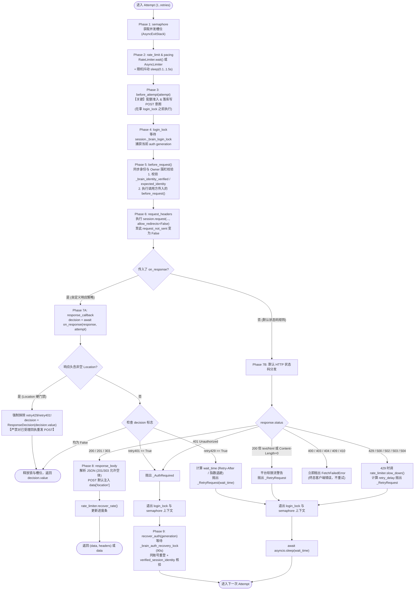

本文档深入剖析 QuantNight 的统一 HTTP 传输与容错底座 [`util/network_util.py`](../../util/network_util.py)，涵盖其内部 9 阶段请求流水线、回调契约（`ResponseDecision`）、**Location 回执硬门禁**、**同账号 401 世代去重自愈**、限流与分页原语，以及全仓各业务模块（回测引擎、Native MCP、数据同步、恢复器）如何组装并调用该模块。
 

---

## 1. 模块定位与核心原语一览

[`util/network_util.py`](../../util/network_util.py) 是整个仓库访问 WorldQuant Brain 平台 API 的**唯一底层 HTTP 执行与重试底座**。任何上层模块均不得绕过它直接裸调 `session.get/post` 自行拼装重试或私自重连。

| 核心原语 / 类 | 代码位置 | 职责定位 |
|---|---|---|
| `_request_with_retry(...)` | [`util/network_util.py`](../../util/network_util.py#L317-L607) | 核心单请求状态机：信号量、滑动窗口限流、前置门禁、HTTP 传输、自定义响应策略、Location 防重放硬门禁、同账号 401 世代自愈、指数退避重试与异常打标 |
| `request_with_response_policy(...)` | [`util/network_util.py`](../../util/network_util.py#L610-L639) | `_request_with_retry` 的泛型策略包装器，强制使用 `ResponseDecision[T]` 回调接口 |
| `ResponseDecision[T]` | [`util/network_util.py`](../../util/network_util.py#L28-L35) | 响应分类决策数据类：`value`（返回值）、`retry429`（是否按限流退避重试）、`retry401`（是否触发同账号重登后重试）、`wait_seconds`（指定等待秒数） |
| `RateLimiter` | [`util/network_util.py`](../../util/network_util.py#L96-L202) | 多维自适应限流器：最小发包间隔（`1/rate`）+ 60 秒滑窗（`minutely_limit`）+ 3600 秒滑窗（`hourly_limit`），支持 429 自动降速 `slow_down()` 与平滑恢复 `recover_rate()` |
| `fetch_total_count(...)` | [`util/network_util.py`](../../util/network_util.py#L642-L702) | 探测分页接口总条数 `count`（支持 `strict_count=True` 严苛模式，区分空集与请求失败） |
| `fetch_paginated(...)` | [`util/network_util.py`](../../util/network_util.py#L705-L905) | 高并发分页拉取器：先探测 `count` 再并发拉取所有 offset 页，支持多轮失败页补拉（`page_retry`）与完整性强校验（`require_complete=True`） |
| `stratified_fetch(...)` | [`util/network_util.py`](../../util/network_util.py#L909-L1069) | 动态区间二分拉取器：针对平台单次查询上限（如 `count >= 1000` 截断），按数值维度（如 `sharpe`）动态二分拆分子区间直至全部落入安全阈值 |
| `FetchFailedError` | [`util/network_util.py`](../../util/network_util.py#L38-L82) | 结构化请求失败异常：携带 `status`、`retry_after`、`response_text`、`response_json`、`response_headers` 以及阶段诊断属性 |
| `_request_log_target(url)` / `exception_stack(exc)` | [`util/network_util.py`](../../util/network_util.py#L221-L263) | 安全诊断脱敏工具：日志隐去 URL 路径与查询参数（仅保留 `scheme://host:port/[path omitted]`），异常栈仅输出类型与行号，绝不泄露凭据或响应原文 |

---

## 2. `_request_with_retry` 内部 9 阶段执行流水线

每一次调用 `_request_with_retry` 在单个 `attempt`（`1..retries`）内部严格推进 `phase` 状态变量。一旦在任何阶段抛出异常，外层捕获器都会把当前所处的 `phase`、`request_not_sent`（是否尚未发出 HTTP 字节）、耗时 `request_elapsed` 挂载到异常对象上，供上层回执状态机精准判定。

### 2.1 单次 Attempt 内部状态流转图



### 2.2 关键设计机制详解

#### （1）`request_not_sent` 与 `phase` 精确边界（Lines 350–433, 567–594）
- 在进入 `session.request(...)`（即 `phase = "request_headers"`）**之前**，`request_not_sent` 始终为 `True`。
- 如果在 `semaphore`、`rate_limit`、`pacing`、`before_attempt`（例如配额拦截或前置写库失败）、`login_lock` 或 `before_request`（如身份围栏不匹配）阶段抛出任何异常，`_tag_exception` 会将 `exc.request_not_sent = True` 标记在异常上。
- **业务价值**：上层 [`api/simulation.py`](../../api/simulation.py) 看到 `getattr(exc, "request_not_sent", False) is True` 时，可以 **100% 确信没有任何字节发往平台**，从而安全地将回执标为 `acceptance = "NOT_POSTED"`（允许后续恢复重排），而绝不会误判为 `UNKNOWN`。一旦进入 `request_headers` 阶段，`request_not_sent` 立即翻转为 `False`，此后发生超时或断连一律按 `UNKNOWN` 保护。

#### （2）`Location` 回执硬门禁（Lines 440–443）
```python
location = response.headers.get("Location") or response.headers.get("location")
if isinstance(location, str) and location.strip():
    decision = ResponseDecision(decision.value)
```
- **为什么需要**：在极端情况下，自定义 `on_response` 回调可能因为某些头部或状态码误设了 `retry429=True` 或 `retry401=True`。
- **硬门禁语义**：只要平台响应头带回了非空的 `Location`（代表平台已受理该回测并分配了进度 URL），`_request_with_retry` **无条件剥夺重试标志**，直接返回 `decision.value`，从根源上杜绝已受理回测被二次 POST。

#### （3）同账号 401 世代去重自愈 `recover_auth(generation)`（Lines 272–314, 355–423, 535–554）
当 40 个并发协程同时因 Cookie 过期收到 `HTTP 401` 时，如果每个协程都独立发起登录，会瞬间触发平台 `POST /authentication` 的 429 封禁（登录风暴）。`_request_with_retry` 通过**双锁 + 世代号（Generation）**彻底解决了该问题：
1. **请求前快照世代号**：协程在 Phase 4 获取 `session._brain_login_lock` 时，记录请求发出前的世代号 `generation = getattr(session, "_brain_auth_generation", 0)`。
2. **释放请求槽位后再恢复**：收到 `401` 抛出 `_AuthRequired` 后，先退出 `login_lock` 和 `semaphore` 上下文（避免占着并发槽阻塞其它请求），再调用 `await recover_auth(generation)`。
3. **恢复锁与世代去重**：
   - `recover_auth` 获取 `session._brain_auth_recovery_lock`（最多等待 90s）。
   - 拿到锁后首先检查：`if getattr(session, "_brain_auth_generation", 0) != generation:`。如果世代号已经变了（说明排在前面的兄弟协程刚刚完成了重登），则直接读取 `session._brain_auth_succeeded` 返回，**0 次多余网络请求**！
   - 若世代号未变，则在 `_brain_login_lock` 内执行 `on_auth(session)`（默认调用 `api.login.async_login_to_brain(session, auth_profile=...)`），随后强制核验 `verified_session_identity(session) == expected_identity`，防止跨账号串号，最后将 `_brain_auth_generation += 1`。

#### （4）默认 HTTP 状态码分类矩阵

| 状态码 / 响应特征 | 分类行为 | 是否重试 | 附加动作 |
|---|---|---|---|
| `200 OK` 但 `Content-Type: text/html` 或 `Content-Length: 0` | 平台网关软限流（Soft Limit） | 是（`_RetryRequest`） | 指数退避 `retry_delay(attempt, base_delay, Retry-After)` |
| `200`, `201`, `303` | 正常成功响应 | 否（直接返回） | 解析 JSON（`201`/`303` 允许空 body）；`POST` 且 `return_headers=False` 时把 `Location` 注入 `data["location"]`；调用 `rate_limiter.recover_rate()` |
| `401 Unauthorized` | 认证失效 | 是（`_AuthRequired`） | 触发同账号 `recover_auth(generation)`，成功后进入下一 attempt |
| `409 Conflict` | 资源状态冲突 | **否（立即抛出 `FetchFailedError`）** | 保留完整响应文本与 headers |
| `403 Forbidden` | 权限拒绝 / 禁用特性 | **否（立即抛出 `FetchFailedError`）** | 解析并附加 `response_json`（供上层识别细节） |
| `400`, `404`, `410` | 客户端语法/路径/资源不存在 | **否（立即抛出 `FetchFailedError`）** | 不消耗重试次数 |
| `429 Too Many Requests` | 平台限流 | 是（`_RetryRequest`） | 若配置了 `RateLimiter` 则调 `slow_down()`（速率减半）；优先遵守 `Retry-After` 头（秒数或 HTTP-date，上限 600s） |
| `500`, `502`, `503`, `504` | 服务端瞬态故障 | 是（`_RetryRequest`） | 按 `base_delay * 2^(attempt-1) + jitter` 指数退避 |
| `asyncio.TimeoutError` / `aiohttp.ClientError` | 网络/传输层异常 | 默认 GET 重试；上层可通过 `on_error` 拦截 | 若 `on_error(exc, attempt)` 返回 `False`（如回测 POST），则立即终止重试并原样抛出 |

---

## 3. 限流、分页与分层采样原语

### 3.1 `RateLimiter`（多维自适应限流器）
位于 [`util/network_util.py`](../../util/network_util.py#L96-L202)：
- **三层约束**：
  1. **瞬时发包间隔**：`min_interval = 1.0 / current_rate`（默认 `rate_per_sec=2.0`，上限 `max_rate=10.0`）。
  2. **分钟级滑窗**：`minutely_limit`（60s 双端队列 `minutely_timestamps`）。
  3. **小时级滑窗**：`hourly_limit`（3600s 双端队列 `hourly_timestamps`）。
- **自适应调节**：
  - 遇到 HTTP 429 时调用 `slow_down(factor=0.5)`：将 `current_rate` 乘以 `0.5`（最低 `0.1 req/s`），并标记 `is_Recovering = True`。
  - 随后每次成功请求调用 `recover_rate()`：按 `+0.05 req/s` 线性爬升，直至恢复到 `base_rate`。

### 3.2 `fetch_total_count` 与 `fetch_paginated`（高并发完整分页）
位于 [`util/network_util.py`](../../util/network_util.py#L642-L905)：
- **两阶段拉取**：
  1. 先请求 `limit=1&offset=0` 获取 `count`（当 `strict_count=True` 或 `require_complete=True` 时，若探测失败或缺少整数字段 `count`，直接抛 `RuntimeError`，绝不把网络错误伪装成 `0` 条记录）。
  2. 生成所有 `offsets = range(0, total_count, page_limit)`，通过 `asyncio.gather` + `Semaphore(max_concurrent)` + `RateLimiter` 并发拉取。
- **失败页多轮补拉（`page_retry`）**：
  - 第一轮并发拉取中若部分 offset 页失败，记录到 `failed_offsets`，在最多 `page_retry`（默认 3）轮内专门针对失败页降速重试（轮间等待 `5 * retry_round` 秒）。
  - 若 `require_complete=True` 且最终仍有失败页，或拉取到的 `len(results) != total_count`，立即抛出 `RuntimeError`，防止下游用残缺数据覆盖本地字典库。

### 3.3 `stratified_fetch`（动态二分分层拉取器）
位于 [`util/network_util.py`](../../util/network_util.py#L909-L1069)：
- **解决痛点**：WorldQuant Brain 部分列表接口对单次过滤条件存在结果集硬上限（例如 `max_items_per_query = 1000`），超出时深层分页会报错或截断。
- **算法流程**：
  ```mermaid
  flowchart LR
      Init["初始区间队列<br/>[min_val, max_val] step"] --> Pop["弹出区间 [low, high]"]
      Pop --> Probe["fetch_total_count()<br/>探测区间内 count"]
      Probe --> Check{"count 大小?"}
      Check -- "count == 0" --> Skip["跳过空区间"]
      Check -- "0 < count < 1000<br/>或区间宽度 <= min_interval_size" --> Fetch["调用 fetch_paginated()<br/>并发拉取区间全部结果"]
      Check -- "count >= 1000<br/>且可继续二分" --> Split["取中点 mid = (low + high) / 2<br/>拆分为 [low, mid] 与 [mid, high]<br/>放回队列头部"]
      Fetch --> Dedup["按 item['id'] 去重汇总"]
  ```

---

## 4. 全仓模块如何调用 `util/network_util.py`

### 4.1 全局调用拓扑图

```mermaid
flowchart TB
    subgraph NetLayer ["底层网络与容错核心 (util/network_util.py)"]
        RWR["_request_with_retry()<br/>request_with_response_policy()"]
        FP["fetch_paginated()<br/>fetch_total_count()"]
        SF["stratified_fetch()"]
        RL["RateLimiter"]
    end

    subgraph SimAPI ["回测提交与进度引擎 (api/simulation.py)"]
        SubPolicy["_submit_with_receipt_policy()<br/>before_attempt + on_response + on_error"]
        CheckProg["check_simulation_progress()<br/>before_request + return_headers=True"]
        SimAsync["simulation_async()<br/>simulation_async_batch()<br/>super_simulation_async()"]
        SimAsync --> SubPolicy
        SimAsync --> CheckProg
    end

    subgraph Runners ["任务消费与恢复器 (scripts/ & util/)"]
        RegRunner["scripts/alpha_simulate_param.py<br/>Regular / Priority / Adaptive Consumer"]
        SuperRunner["scripts/super_alpha_simulate_param.py<br/>SUPER Consumer"]
        RefineRunner["scripts/refine_simulate_param.py<br/>Priority Controller"]
        Recovery["util/mission_recovery.py<br/>util/super_recovery.py<br/>util/super_capacity.py"]
        RegRunner --> SimAsync
        SuperRunner --> SimAsync
        Recovery --> CheckProg
    end

    subgraph MCPServer ["Native MCP 服务 (quant_night_mcp/)"]
        MCPApi["tools/api_tools.py<br/>validate_alpha / simulate_*_batch<br/>cancel_simulation / get_alpha_by_id"]
        MCPPnl["tools/pnl_tools.py<br/>get_alpha_correlation"]
        MCPUtil["tools/util_tools.py<br/>find_history_alphas"]
        MCPApi --> SimAsync
    end

    subgraph DataAPIs ["平台数据与 Alpha 管理 API (api/)"]
        ManipAlpha["api/manipulate_alpha.py<br/>get_result / add_tags / get_alpha_pnl"]
        FilterAlpha["api/filter_alphas.py<br/>get_alphas / get_submitted_alphas"]
        ExtractDF["api/extract_datafields.py<br/>extract_datafields / datasets"]
        PlatData["api/platform_data/*<br/>operators / tutorials / forum / competitions"]
        PlatNotice["api/platform_notice/*<br/>pyramid / messages / check_submission"]
    end

    SubPolicy --> RWR
    CheckProg --> RWR
    MCPApi --> RWR
    MCPPnl --> RWR
    ManipAlpha --> RWR
    FilterAlpha --> FP
    FilterAlpha --> SF
    ExtractDF --> FP
    ExtractDF --> RWR
    PlatData --> FP
    PlatData --> RWR
    PlatNotice --> RWR
```



---

### 4.2 调用方详细模式与钩子装配表

#### 模式 A：普通回测提交与回执安全（[`api/simulation.py`](../../api/simulation.py)）
这是普通回测的公共能力，不是 Priority 专属协议。普通/Adaptive/Priority 任务共用原 REGULAR runner 的 `_SimulationSubmissionGuard` / `_SimulationReceipt` 适配；SUPER/MCP 保留自己的持久化适配，复用同一模拟API与共享HTTP。配额guard只管理额度，不接收请求接受状态。

该模块通过 `_request_with_retry` 的原生命周期钩子完成请求：

1. **回测提交 `_submit_with_receipt_policy(...)`**（[`api/simulation.py`](../../api/simulation.py)）：
   - **`before_attempt(attempt)`**：
     - 在尝试 HTTP POST 前调用传入的 `quota_guard.before_submit(request_count)`。REGULAR runner 传入 `_SimulationSubmissionGuard`，它先执行原额度准入，再核查账号冷却、原请求身份并**持久化发送意图与批次ID**。`campaign_post_attempted` 是保留兼容的通用历史字段，普通任务也使用，不能把它当成Priority身份。
     - 若配额不足或前置校验未过，在 `before_attempt` 内直接抛异常，此时 `request_not_sent=True`，安全记为 `NOT_POSTED`。
   - **`before_request()`**：
     - 在拿到 `_brain_login_lock` 且通过同账号身份核验后，最后一次同步检查 `receipt_owner_guard`（确认当前 consumer 仍持有该任务的租约/回执所有权）。
   - **`on_response(response, attempt)`**：
     - 先在API中判断 `Location` / 明确拒绝等请求证据，再观察额度。传给额度层的只有 `after_response(response.headers)`；无回执的401/429走 `submit_failed()`，不把认证/并发响应的额度头作为日配额观察。
     - **若有 `Location` 头**：保存 `progress_url`、`acceptance = "ACCEPTED"`；REGULAR 的 `_SimulationReceipt` 安排持久化并在进入轮询前等待flush，随后返回 `ResponseDecision(location)`（不重复POST）。
     - **若无 `Location` 头**：
       - `429`：记录 `acceptance = "NOT_ACCEPTED"`、`rejection_evidence_received = True`，返回 `ResponseDecision(None, retry429=True, retry_after=...)`，是否重试及次数仍由原共享请求策略和本次调用配置决定。
       - `401`：记录认证拒绝，返回 `ResponseDecision(None, retry401=True)` 交由 `_request_with_retry` 执行同账号重登。
       - `400 / 403`：记录明确拒绝证据，返回 `ResponseDecision(None)` 停止重试。
   - **`on_error(exc, attempt)`**：
     - 检查 `getattr(exc, "request_not_sent", False)`：有明确未发送证明才标 `NOT_POSTED`。否则保留发送意图、具体error/errorClass及已有接受证据；缺少接受证据时保持 `acceptance=None`，不凭超时推断平台成功或拒绝。
     - 原回执不因错误丢失，返回不带重试指令的 `ResponseDecision(state.get('progress_url'))`；未决请求不能盲重投，但不因此全局暂停其他独立候选。

2. **进度轮询 `check_simulation_progress(...)`**（[`api/simulation.py`](../../api/simulation.py)）：
   - 使用原 `_request_with_retry` 的GET入口，`return_headers=True`、`retries=6`、`base_delay=20`；调用方提供的 `before_request` 所有权检查与普通恢复身份guard组合执行，不互相覆盖，不私建查询循环或网络客户端。
   - 成功响应按实际 `status` 判定是否终态，并用原 `retry_delay` 解析 `Retry-After`；未终态时至少间隔1秒，不因缺少 `Retry-After` 就假定已完成。终态后按原映射收集 `alpha` / `children`。
   - **普通旧回执GET404是正常过期观察**：在原共享请求hook中识别可信simulation URL的实际404，不先打通用ERROR再吞掉。API只提供该次观察，不因404自动POST；普通恢复owner核验原请求/当前快照后，保存旧attempt到 `recoveryHistory` 并让无结果候选回待测。此分支不是平台失败，也不是旧请求从未发生的证明。
   - 超时、429、5xx及其它端点404仍走各自原策略；原回执已存在结果时不清空。不能从本地“一小时”计时推断回收，也不因此释放SUPER槽位或授权MCP重投。

3. **普通启动恢复的可选观察deadline**：
   - 原恢复层给 `observation_budget` 一个120秒绝对期限，父/child共享；原共享HTTP仅接受可选通用 `deadline=RequestDeadline(...)`，只用于GET/HEAD，默认不启用，不接收simulation业务身份字段。
   - 原重试循环在完整等待前保存等待证据。服务器建议超过剩余预算时结束本次观察，不裁短Retry-After后提前发下一次请求。原恢复owner将原URL/账号/请求绑定与 `notBefore` 持久化，重建也不绕过。
   - `RequestWindowEnded`只由本地窗口确认到期产生，API转换为 `observation_deferred`，不是平台终态或重投许可。既有HTTP失败事实保留；外部取消不转换为窗口结束。
   - 身份/认证未决、checkpoint或result writer超时不能走正常窗口分支；按实际操作阶段失败并阻断派发。300秒整个恢复phase期限独立保留。延后只等待下一次原生命周期观察，不自动建立第二个watcher/collector。

#### 模式 B：Native MCP 工具集（[`quant_night_mcp/tools/`](../../quant_night_mcp/tools/)）
MCP 进程复用同一个持久化的 `session`（由 `session_manager` 维护），通过两类方式调用 `network_util`：
- **直接调用 `_request_with_retry`**：
  - [`quant_night_mcp/tools/api_tools.py`](../../quant_night_mcp/tools/api_tools.py)：
    - `cancel_simulation`：`DELETE /simulations/{id}`，使用 `_request_with_retry`。
    - `get_alpha_by_id`：`GET /alphas/{id}`，读取单个 Alpha 详情。
    - `get_Available_settings`：`OPTIONS /simulations`，探测可用 Region/Universe/Neutralization。
  - [`quant_night_mcp/tools/pnl_tools.py`](../../quant_night_mcp/tools/pnl_tools.py)：
    - `get_alpha_correlation`：拉取平台 `prod` 相关性或触发相关性计算，配合 `return_headers=True` 检查 `Retry-After`。
- **通过 `api/simulation.py` 间接调用**：
  - `validate_alpha`、`simulate_alpha_batch`、`simulate_super_batch` 传入 `before_request=receipt_owner_guard`，在每次底层 HTTP 请求前验证 MCP 任务未被取消或接管。

#### 模式 C：平台元数据、Alpha 筛选与论坛/公告同步（`api/` 与 `.agents/skills/`）

| 模块文件 | 调用的 `network_util` 函数 | 关键参数与业务用途 |
|---|---|---|
| [`api/manipulate_alpha.py`](../../api/manipulate_alpha.py) | `_request_with_retry` | `get_result`（`GET /alphas/{id}`）、`add_tags`（`PATCH /alphas/{id}` 写 name/tags/description）、`get_alpha_pnl`（`GET /alphas/{id}/recordsets/pnl`）、`get_alpha_yearly_stats` |
| [`api/filter_alphas.py`](../../api/filter_alphas.py) | `fetch_paginated`, `stratified_fetch`, `RateLimiter` | `get_alphas` / `get_submitted_alphas`：当查询范围大时用 `stratified_fetch` 按 `is.sharpe` 区间自动二分，避免触发平台 1000 条上限 |
| [`api/extract_datafields.py`](../../api/extract_datafields.py) | `fetch_paginated`, `_request_with_retry`, `RateLimiter` | 同步 `datafields` 与 `datasets` 目录，开启 `require_complete=True` 确保字典表无缺页 |
| [`api/platform_data/save_operators.py`](../../api/platform_data/save_operators.py) | `_request_with_retry` | 拉取 `/operators` 算子全集及文档详情，再经原 writer 写库 |
| [`api/forum/fetch_tutorial.py`](../../api/forum/fetch_tutorial.py), [`api/fetch_competition_results.py`](../../api/fetch_competition_results.py) | `_request_with_retry` | 获取教程页面或竞赛 Alpha 表现；不使用不存在的 platform_data/tutorials/documentation/competitions/forum 模块 |
| [`api/platform_notice/pyramid_status.py`](../../api/platform_notice/pyramid_status.py), [`event_paper_recommend.py`](../../api/platform_notice/event_paper_recommend.py) | `_request_with_retry` / 原分页入口 | 查询 Genius Pyramid 缺口状态、平台消息及活动信息 |
| [`api/forum/README.md`](../../api/forum/README.md) | 独立论坛客户端，按原 owner 文档核对 | 发帖、编辑和评论由原论坛客户端管理 CSRF/Cookie；不能仅由本表断言它直接调用 Brain 的 `_request_with_retry` |

#### 模式 D：启动恢复与未知回执对账（[`util/mission_recovery.py`](../../util/mission_recovery.py) & [`util/super_recovery.py`](../../util/super_recovery.py)）
- 当任务重启或处于 `UNKNOWN` / `ACCEPTED`（但缺 `alphaId`）状态时，恢复器**绝不调用 POST**，而是调用 `check_simulation_progress` / `get_result`（底层走 `_request_with_retry(..., method='GET')`）只读查询已保存的 `progressUrl` 或 `alphaId`。
- 同时使用 [`util/network_util.py`](../../util/network_util.py#L244-L263) 的 `exception_stack(exc)` 记录紧凑无敏感信息的异常栈，用于区分瞬态网络超时（保留 `UNKNOWN` 待下次对账）与平台明确终态错误（`ERROR`/`FAIL`）。

---

## 5. 开发者调用规范小结（Checklist）

1. **只读查询单条资源**：直接调用 `await _request_with_retry(session, url, method='GET', semaphore=..., rate_limiter=...)`。
2. **拉取分页列表（特别是写本地字典库）**：使用 `await fetch_paginated(session, base_url, ..., require_complete=True)`，切勿手写 `while offset < count` 循环。
3. **拉取可能超过 1,000 条的 Alpha 列表**：使用 `await stratified_fetch(...)` 自动按指标区间二分。
4. **具有外部副作用的 `POST`（如发起回测）**：
   - 必须通过 `request_with_response_policy` 或 `_request_with_retry` 挂载 `before_attempt`（持久化意图）+ `on_response`（捕获 `Location`）+ `on_error`（当 `not exc.request_not_sent` 时返回 `False` 禁止盲目重发 POST）。
   - 永远依赖 `_request_with_retry` 内置的 **Location 硬门禁** 与 **同账号 401 世代自愈**，不要在业务层编写 `while 401: login()` 循环。
