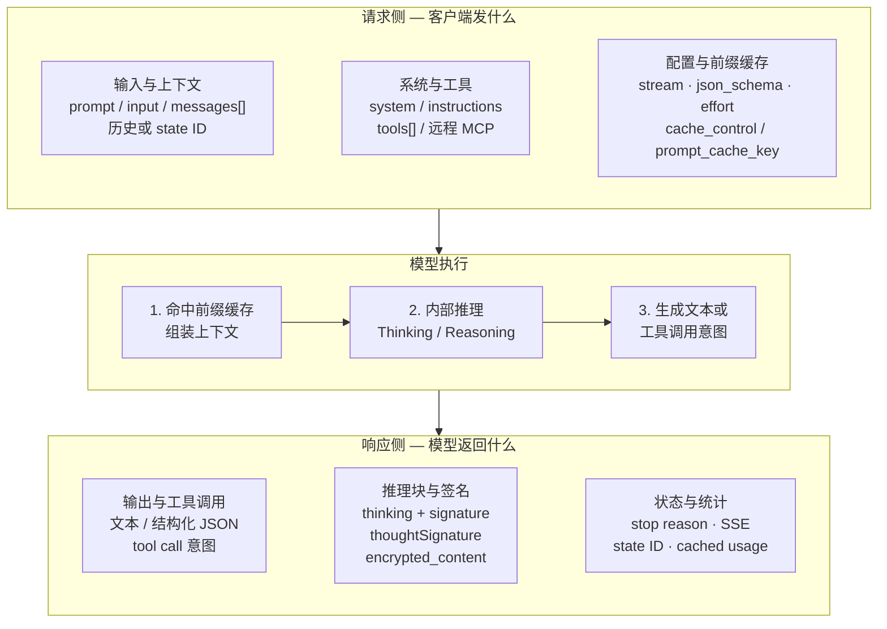

梳理主流 LLM HTTP/SSE 线上接口（Wire Protocol）的请求/响应结构、调用模式，以及各厂商与自托管引擎的协议差异，方便选型和自研 Harness 对接时快速对照。（关于工具执行层与 Harness / Function Calling / MCP / CLI / Skills 的分层协作，见同专题 [Agent 工具体系与接入规范](2025-04-04-agent-tools.md)。）



## 不同 API 对照表 — 云端 LLM 厂商原生接口

| 功能 | 请求侧结构 | 响应侧结构 | OpenAI Completions<br>(更早的遗留接口) | OpenAI Chat Completions<br>(OpenAI 经典聊天) | OpenAI Responses<br>(OpenAI 新一代) | Anthropic Messages<br>(Anthropic / Claude 系) | Gemini GenerateContent<br>(Gemini 原生稳定) | Gemini Interactions<br>(Gemini 状态化 Agentic) |
| --- | --- | --- | --- | --- | --- | --- | --- | --- |
| Endpoint / 方法 | URL path 或 SDK method | URL path 或 stream method | `/v1/completions` | `/v1/chat/completions` | `/v1/responses` | `/v1/messages` | `:generateContent` / `models.generate_content` | `/v1beta/interactions` / `interactions.create` |
| 单轮生成 | `prompt` / `input` / `contents` | text / message | `prompt` | `messages` | `input` | `messages` | `contents` | `input` |
| 多轮对话 | 历史数组或状态 ID | 下一轮 assistant/model 输出 | ✗<br>**手动拼 prompt** | `messages[]`<br>客户端自己维护 | `input[]` 或 state | `messages[]` | `contents[]` | `previous_interaction_id` |
| system prompt | system / instructions 字段 | 通常不单独返回 | ✗<br>手动拼 prompt | `role=system/developer` | `instructions` | 顶层 `system` | `system_instruction` | instruction/config 类字段 |
| 角色区分 | message/content role | assistant/model role | ✗ | `system/user/assistant/tool` | item role | `user/assistant` | `user/model` | interaction role/items |
| 多模态输入 | block / part / item | text 或结构化输出 | ✗ | 部分支持 | content items | content blocks | `parts[]` | 支持多模态 input |
| 结构化输出 | `json_schema` / format | 严格匹配 schema 的 JSON | 弱<br>靠 prompt | `response_format` (`json_schema`, `strict`) | `text.format` (`json_schema`, `strict`) | `output_config.format` (`json_schema`) | `response_mime_type` + `response_schema` | 支持结构化输出配置 |
| 流式生成 | `stream` 或 stream endpoint | SSE / chunk / events | `stream` + SSE | `stream` + SSE `delta` | response stream events | `stream` + content events | `streamGenerateContent` | interaction streaming |
| 工具声明（客户端函数） | `tools[]` / declarations | 模型可见工具 schema | ✗ | `tools` (`type: "function"`) | `tools` (`type: "function"`) | `tools` | `functionDeclarations` | `tools` |
| 服务端工具 / 原生 MCP | 远程 MCP / 内置工具配置 | 模型端直连执行或返回调用轨迹 | ✗ | ✗（通常客户端接 MCP 后转 `tools`） | 内置工具 + 远程 MCP（`tools` 中 `type: "mcp"`） | 顶层 `mcp_servers` + `tools` 中 `mcp_toolset` | 部分内置工具；远程 MCP 多由客户端接 | 原生支持 MCP / 服务端工具 |
| 工具调用 | 响应返回 tool call | tool call item/block | ✗ | `tool_calls` | output tool call items | `tool_use` block | `functionCall` part | tool/function events |
| 工具结果回填 | 下一轮带 tool result | 模型继续回答 | ✗ | `role=tool` | tool result item | `tool_result` | `functionResponse` | tool result/input item |
| 推理块与状态回传 | reasoning/thinking 配置 + 原块回传 | 思维内容 / 加密签名 | ✗ | 多仅返回摘要或隐藏，不回传原始思维链 | `reasoning` 配置；无状态（`store: false`）通过 `include: ["reasoning.encrypted_content"]` 取回并回传 | `thinking` + `output_config.effort`；多轮须原样回传 `thinking` 块及 `signature` | thinking 配置；响应带 `thoughtSignature`，多轮 tool call 丢失会报错 | `thinking` 项随交互状态流转 |
| 前缀缓存 & Token 计数 | cache key / 缓存断点 / count 接口 | usage 中 cached tokens 统计 | ✗ | 自动前缀缓存 + `prompt_cache_key` 路由粘性 | 自动前缀缓存 + `prompt_cache_key` 路由粘性 | 显式 `cache_control: {"type": "ephemeral"}` / 自动缓存 + `/v1/messages/count_tokens` | 显式 `cachedContent`（带 TTL）+ Gemini 2.5+ 隐式缓存 | 复用后端上下文/隐式缓存机制 |
| 服务端状态 | state/thread/response id | 返回新 state id | ✗ | ✗<br>客户端维护 | `previous_response_id` / conversation | ✗，通常客户端维护 | ✗，SDK chat 多为客户端/SDK history | `Interaction` + `previous_interaction_id` |
| 长任务 / 后台任务 | background / async | task/run/interaction id | ✗ | ✗ | background / async 能力 | ✗ | ✗ | 支持后台/长任务方向 |
| 实时语音/视频 | WebSocket / WebRTC session | audio/text/tool events | ✗ | ✗ | 另用 Realtime | ✗ | 另用 Live API | 另用 Live / interaction 能力 |

## 五种基本调用模式

### 单轮文本生成

```text
Client ──request──> LLM Server ──response──> Client 显示
```

### 多轮对话（客户端维护历史）

```text
Client 本地保存 history
  │  messages: [user, assistant, user]
  ▼
LLM Server
  │  {role: assistant, content: "..."}
  ▼
Client append 到本地 history
```

### 多轮对话（服务端维护状态）

```text
第一次:
  Client ──{input: "我叫 Alice"}─────────────────────> Server
  Server ──{response: "好的，记住了", response_id: "resp_123"}─> Client

第二次（带上 response_id，服务端自动找回上下文）:
  Client ──{input: "我叫什么？", previous_response_id: "resp_123"}──> Server
  Server ──{response: "你叫 Alice"}───────────────────────────────> Client
```

### 工具调用闭环

```text
Client
  │  {input: "查 AAPL 价格", tools: [get_stock_price]}
  ▼
LLM Server
  │  {tool_call: get_stock_price("AAPL"), id: "call_1"}
  ▼
Client 执行工具
  │  {tool_result: call_1, "AAPL = 189.32"}
  ▼
LLM Server
  │  {output_text: "AAPL 最新价格是 189.32"}
  ▼
Client 显示结果
```

### 流式生成

```text
Client
  │  {stream: true}
  ▼
LLM Server
  │  event "这" ──> event "是" ──> event "一段" ──> event done
  ▼
Client 边收边显示
```

## 协议对接避坑补充

- **多轮推理签名不可丢弃**：自研 Harness 或多模型路由层如果在入库/裁剪历史时把 `thinking` 块剥掉，Anthropic（`signature` 校验失败）、Gemini（缺 `thoughtSignature` 报 `400`）和 OpenAI 无状态模式（`reasoning.encrypted_content`）都会中断推理连贯性或直接报错。
- **前缀缓存要求字节级稳定**：无论依赖显式断点（`cache_control` / `cachedContent`）还是自动前缀缓存（`prompt_cache_key`），动态时间戳、随机排序的工具定义只要插在前面，整段 KV cache 就会失效。

## 本地/托管协议支持

| 引擎 / 托管层 | 支持的 API 类型与注意点 |
| --- | --- |
| **vLLM** | 原生支持 OpenAI `/v1/chat/completions`、`/v1/responses`，以及 Anthropic `/v1/messages` + `/v1/messages/count_tokens`；Anthropic SDK / Claude Code 可直接改 `base_url` 接入，引擎层内置前缀缓存与 tool-call parser |
| **SGLang** | 原生支持 OpenAI `/v1/chat/completions`、`/v1/responses`，以及 Anthropic `/v1/messages` + `/v1/messages/count_tokens`；自动复用底层 chat template、reasoning parser 与 tool-call parser |
| **llama.cpp (`llama-server`)** | 原生支持 OpenAI `/v1/chat/completions`（含 structured outputs、tool use、vision）及 Anthropic `/v1/messages` + `/v1/messages/count_tokens`，可直接指向本地 GGUF 模型 |
| **Ollama** | 自有 `/api/generate`（单轮）+ `/api/chat`（多轮），并兼容 OpenAI 及 Anthropic `/v1/messages` 子集（注：不支持 `/v1/messages/count_tokens` 与强制 `tool_choice`） |
| **AWS Bedrock Converse** | AWS 统一 Converse 协议，向上兼容 messages / tool use / structured output 等多厂商模型 |
| **多协议网关（LiteLLM / OpenRouter 等）** | 在 OpenAI / Anthropic / Gemini 协议之间做双向 schema 转换，适合需要跨厂商统一 SDK 或按状态/费用路由兜底的场景 |
