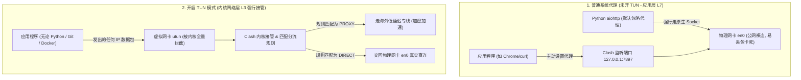

## 一、查看物理网卡（en0）与虚拟网卡（utun）的常用命令

在 macOS 终端中，可以通过以下命令快速识别当前生效的物理网卡、TUN 虚拟网卡以及系统默认路由。

### 1. 快速列出本机所有网卡接口

```bash
ifconfig -l
```

- **输出示例**：`lo0 en0 en1 bridge0 utun0 utun1 utun7 ...`
- **含义**：
  - `en0`（或 `en1`）：物理网卡（Wi-Fi 或有线网卡）。
  - `utunX`（如 `utun7`）：虚拟隧道网卡（VPN 或 Clash Verge 开启 TUN 模式后创建）。
  - `lo0`：本地环回接口（`127.0.0.1`）。

### 2. 查看网卡与硬件设备的对应关系（最直观）

```bash
networksetup -listallhardwareports
```

- **作用**：会明确标注出 `Hardware Port: Wi-Fi -> Device: en0`、`Ethernet -> Device: en4` 等，方便确认哪块是真实物理网卡。

### 3. 查看特定网卡详细信息

```bash
# 查看物理网卡状态与 IP
ifconfig en0

# 查看 TUN 虚拟网卡详情（若开启了 TUN 模式）
ifconfig utun7
```

### 4. 核心命令：如何正确验证流量是否被 TUN 接管？

> [!WARNING] 注意：不要直接查 `route get default`！
> Clash/VPN 的 TUN 模式为了**防止断网和死循环**，特意**保留了**系统的兜底默认路由（`default -> en0`）。
> 它是通过**“最长前缀匹配原则”**，注入了覆盖整个公网的细分路由（如 `128.0/1`、`32/3` 指向 `utun7`）。

因此，验证 TUN 是否接管，必须查询一个**真实公网 IP**（如 Google DNS 或 AWS IP）：

```bash
# 验证公共外网 IP
route get 8.8.8.8 | grep interface
# 输出：interface: utun7 （说明已被 TUN 成功接管！）

# 验证 DNS 是否被 TUN 接管。很多时候路由表走了 utun，但 DNS 泄露走运营商路由器，导致域名依然解析失败或被污染
scutil --dns | head -n 25
# 输出：首个解析器是 Fake-IP 198.18.0.2 说明接管成功

# 快速区分 Clash 混合端口（7897） 与 SSH 动态隧道（1080） 的归属
lsof -iTCP -sTCP:LISTEN -P -n | grep -E 'clash|verge|ssh'

# 验证 WorldQuant 所在的 AWS 弗吉尼亚 IP
route get 54.146.208.3 | grep interface
# 输出：interface: utun7 （说明 AWS 流量同样被 TUN 拦截并分流！）
```

- **判定结论**：
  - 若查询具体公网 IP 返回 `interface: utun7`，证明 **TUN 模式正完美生效**！
  - 若查询具体公网 IP 依然返回 `interface: en0`，说明 TUN 模式未开启或崩溃。

---

## 二、普通代理 vs TUN 模式的本质区别

| 工作模式       | 工作层级       | 运作机制                                   | 对“不自觉应用”（如 Python aiohttp / Docker）的处理      |
| :--------- | :--------- | :------------------------------------- | :------------------------------------------ |
| **普通系统代理** | **L7 应用层** | 仅在本地监听端口（如 `127.0.0.1:7897`），属于“愿者上钩”。 | **完全无视**。应用若未显式读取环境变量，直接绕过代理走原生网卡裸连。        |
| **TUN 模式** | **L3 网络层** | 操作系统底层插入虚拟网卡（`utun`），系统默认网关强行指向它。      | **强制接管**。内核将所有发出的 IP 包捕获送入 TUN，无视应用是否配置了代理。 |



> [!IMPORTANT] 
> macOS 系统的“系统代理 (System Proxy)”开关天然对 Terminal（zsh/bash）完全无效。终端发出的curl/python命令也属于**"不自觉应用"**。终端必须依赖环境变量或 TUN 强制接管。


---

## 三、全景对照表：什么情况下是直连？什么情况下走 Proxy？

很多网络误判（如“*我明明没配代理，为什么也能访问？*”或“*明明能访问，为什么换台机器就超时？*”）都源于混淆了**应用自身行为**与**系统 TUN 接管**。

下表涵盖了开发中的 8 种组合：

| 场景序号 | TUN 模式<br>(L3 网络层) | 应用主动配代理<br>(传输协议/端口/代理隧道) | Clash 规则设置<br>(目标域名) | 本机流转机制 | 最终物理出海路径 | 判定结论与典型生产案例 |
| :------: | :----------------: | :-----------------------: | :-------------------------: | :----------------------------: | :----------------: | :------------------------------------------------------------------------------------------------------------- |
| **场景 1** | **已开启 (ON)** | ✔️ **主动配置** | 命中 **`PROXY`** | 绕过 TUN，直连 `127.0.0.1:7897` | 🔀 **出口 A (海外专线)** | **【双保险 / 黄金组合】**<br>应用跳过本地 DNS 查询，锁定 HTTP 隧道协议（免疫 socks5 bug），经专线高速出海。 |
| **场景 2** | **已开启 (ON)** | ✔️ **主动配置** | 命中 **`DIRECT`** | 走 `127.0.0.1:7897` 入 Clash 后放行 | 🌐 **出口 B (中枢直连)** | **【经审计直连】**<br>虽然配置了代理环境变量，但目标为国内白名单，Clash 审计后放行至本地物理网卡。<br>👉 **典型代表**：配置全局代理时访问国内 `aliyuncs.com` / `ts.net`。 |
| **场景 3** | **已开启 (ON)** | ❌ **未配 / 忽略** | 命中 **`PROXY`** | 被 `utun7` 虚拟网卡强行拦截抓取 | 🔀 **出口 A (海外专线)** | **【透明接管 / 伪直连】**<br>应用自以为直连，但内核将包塞入专线。毫秒级响应，却极易让人产生“直连真快”的错觉。 |
| **场景 4** | **已开启 (ON)** | ❌ **未配 / 忽略** | 命中 **`DIRECT`** | 被 `utun7` 拦截后查验放行至 `en0` | 🌐 **出口 B (中枢直连)** | **【透明分流直连】**<br>普通未配代理的应用访问国内网站，TUN 拦截后查规则放行回真实宽带。<br>👉 **典型代表**：浏览器访问普通国内网页。 |
| **场景 5** | **未开启 (OFF)** | ✔️ **主动配置** | 命中 **`PROXY`** | 直连 `127.0.0.1:7897` 进入 Clash | 🔀 **出口 A (海外专线)** | **【传统应用层代理】**<br>无全局虚拟网卡，但应用主动向 Clash 端口建立 HTTP CONNECT 隧道，绕过公网阻断，稳定秒开。 |
| **场景 6** | **未开启 (OFF)** | ✔️ **主动配置** | 命中 **`DIRECT`** | 走 `127.0.0.1:7897` 入 Clash 后放行 | 🌐 **出口 B (中枢直连)** | **【应用层直连放行】**<br>即使未开 TUN，通过端口转发也能正确识别直连规则并走本地网卡。<br>👉 **典型代表**：业务脚本访问局域网 MongoDB。 |
| **场景 7** | **未开启 (OFF)** | ❌ **未配 / 忽略** | 命中 **`PROXY`**<br>*(但完全无用)* | **完全绕过 Clash**，直冲物理网卡 | ⚡ **出口 C (纯公网裸连)** | ⚠️ **【最危险的陷阱 / 规则失效】**<br>**Clash 规则哪怕写了 PROXY，但因为没开 TUN、应用也没配代理，数据包根本进不了 Clash 的门！** |
| **场景 8** | **未开启 (OFF)** | ❌ **未配 / 忽略** | 命中 **`DIRECT`** | 完全绕过 Clash，直冲物理网卡 | ⚡ **出口 C (纯公网裸连)** | **【纯物理原生网络】**<br>无代理、无 TUN 介入，完全由本地 ISP 运营商公网路由决定成败。 |

---

## 四、实际问题与处理方式

| 序号  | 平台 / 问题                                                           | 故障原因                                                                                                                                                                                                                                                           | 应用程序配置                                                                                                                                                                                                                                                                    | Clash 配置                                                                                                                                                                                                                                                                                                           |
| :-: | :---------------------------------------------------------------- | :------------------------------------------------------------------------------------------------------------------------------------------------------------------------------------------------------------------------------------------------------------- | :------------------------------------------------------------------------------------------------------------------------------------------------------------------------------------------------------------------------------------------------------------------------ | :----------------------------------------------------------------------------------------------------------------------------------------------------------------------------------------------------------------------------------------------------------------------------------------------------------------- |
|  1  | WorldQuant Brain API <br>在 MacBook 上可以，在 Mac mini 上不通             | 1. aiohttp 默认忽略代理环境变量<br>2. Mac mini 未开启 TUN<br>3. Runner 缺少代理环境变量                                                                                                                                                                                             | 1. 在 `api/__init__.py` 中统一设置 aiohttp `trust_env=True`<br>2. 给 Shell / Runner 配置 HTTP 代理环境变量<br><br>MacBook：**场景 3 → 场景 1**<br>Mac mini：**场景 7 → 场景 5**                                                                                                                    | 将请求分流至 `WorldQuant` 组，自动选择低延迟专线                                                                                                                                                                                                                                                                                    |
|  2  | OpenAI / ChatGPT <br>模型连接断流与风控拦截                                  | 1. 香港出口触发地区限制<br>2. 机场“公告类文本节点”污染<br>3. 普通节点抖动、丢包                                                                                                                                                                                                              | **1. 在 Clash Verge 预处理脚本中实现全自动过滤清洗链**：<br>① 过滤**机场“公告类文本节点”污染**<br>② 过滤不支持的“香港”节点，专线优先<br>③ 加入探测接口（`https://api.openai.com/v1/models`）的健康检查组<br>**2. 规则分流覆盖**：将 `chatgpt.com`、`openai.com`、`oaistatic.com`、`oaiusercontent.com`、`arkoselabs.com` 等全部域名与关键字强绑定至 `OpenAI` 组 |                                                                                                                                                                                                                                                                                                                    |
|  3  | OpenCode <br>平台连接断流与流式输出卡死                                        | 1. 香港出口被 Cloudflare 拦截<br>2. SOCKS5 代理环境变量不兼容<br>3. 推理静默期间连接不稳<br>4. 模型配置缺失                                                                                                                                                                                    | 在 `oc-go.sh` 中主动配置 HTTP 代理，覆盖 SOCKS5 环境变量<br><br>MacBook：**场景 1**<br>Mac mini：**场景 7 → 场景 5**                                                                                                                                                                             | **在 Clash Verge 预处理脚本中实现全自动过滤清洗链**：<br>① 过滤机场“公告类文本节点”<br>② 过滤“香港”节点，专线优先<br>③ 将探测接口改为 `https://opencode.ai/cdn-cgi/trace`                                                                                                                                                                                         |
|  4  | GitHub SSH <br>连接超时 (代码推送 / `git@...`)                            | 1. 22 端口被阻断或限速<br>2. SSH 协议天然不读取 HTTP 代理环境变量                                                                                                                                                                                                                   | **在 `~/.ssh/config` 中主动配置代理**：<br>① 改用 `ssh.github.com:443`<br>② 配置 `ProxyCommand nc -X 5 -x 127.0.0.1:7897 %h %p`<br>③ 配置连接保活                                                                                                                                            | —                                                                                                                                                                                                                                                                                                                  |
|  5  | GitHub HTTPS <br>连接报错 (`https://...`)<br>如 `pi update` / 包管理器插件更新 | 1. 外部包管理器拉取公开插件默认走 HTTPS 协议（**完全绕过 `~/.ssh/config`**）<br>2. 终端若残留继承了 `socks5://127.0.0.1:1080`，与 Clash Fake-IP 冲突<br>3. 本地解析出假 IP（`198.18.0.x`）发往 GCP 代理，远端拒收抛出 `LibreSSL SSL_ERROR_SYSCALL`                                                                   | 1. **临时修复**：运行前执行 `unset ALL_PROXY HTTPS_PROXY HTTP_PROXY`<br>2. **永久免疫**：配置全局 Git 走 Clash HTTP 混合端口：<br>`git config --global http.https://github.com.proxy http://127.0.0.1:7897`                                                                                        | 由 Clash Verge TUN 模式或 7897 混合端口自动走海外规则秒级出海                                                                                                                                                                                                                                                                         |
|  6  | Pi Agent <br>终端鉴权超时                                               | 1. SOCKS5 代理环境变量不兼容<br>2. 未固定代理配置                                                                                                                                                                                                                              | 1. 在 `~/.pi/agent/settings.json` 中设置 `httpProxy` 为 `http://127.0.0.1:7897`<br>2. 统一 Shell 代理环境变量为 HTTP 协议                                                                                                                                                                 | —                                                                                                                                                                                                                                                                                                                  |
|  7  | pi update <br>终端版本更新超时                                            | 1. Node.js 默认忽略系统代理，未配环境变量时仅走 TUN<br>2. 订阅混入“剩余流量”等公告节点，自动选优沦为黑洞<br>3. 请求在黑洞中静默丢包，触发内部 10s 硬超时                                                                                                                                                                 | 显式配置 HTTP 代理环境变量：<br>`HTTP_PROXY="http://127.0.0.1:7897" HTTPS_PROXY="http://127.0.0.1:7897"`<br><br>普通终端：**场景 3 → 场景 1**                                                                                                                                                 | **在 Clash Verge 预处理脚本中清洗假节点**：<br>过滤“流量/到期/重置/剩余/公告”等文本节点，杜绝自动选优跌入黑洞，恢复 BGP 专线选优                                                                                                                                                                                                                                   |
|  8  | Web 浏览器 <br>网页加载卡顿 / 国内页面假死（如 talents-ai）                         | 1. 浏览器默认开启 QUIC (UDP 443)，代理节点丢弃 UDP 导致等待 2~3s 超时回退<br>2. 国内网页（如 talents-ai）`<head>` 同步外链 Google Fonts 跌入黑洞阻塞渲染                                                                                                                                                | —                                                                                                                                                                                                                                                                         | **1. 规则首部强制阻断 QUIC (UDP 443)**：<br>注入 `AND,((DST-PORT,443),(NETWORK,UDP)),REJECT`，使浏览器 0ms 瞬间降级稳定 TCP 链路<br>**2. 清洗公告假节点**：<br>确保 Google Fonts 等公共静态资源走正常代理专线秒级加载                                                                                                                                                  |
|  9  | Gmail SMTP <br>每日邮件任务正常触发，却一直收不到报告                                | 1. Python `smtplib` 未主动配代理，但被 TUN 透明接管<br>2. `smtp.gmail.com` 命中宽泛的 gmail 代理规则<br>3. 当前代理通路关闭 SMTP 465/587 连接，465 报 `SSL: UNEXPECTED_EOF_WHILE_READING`                                                                                                        | 保留 `SMTP_SSL`、原有账号与定时配置，不关闭 TLS 证书校验，也不硬编码 Gmail IP<br><br>**场景 3 → 场景 4**；先验证握手，再验证邮箱登录                                                                                                                                                                                  | **精确域名分流**：在持久化预处理脚本 / prepend 规则中加入 `DOMAIN,smtp.gmail.com,DIRECT`，优先于 `DOMAIN-KEYWORD,gmail,...`；热加载后核验实际连接命中 `DIRECT`。只让 SMTP 直连，Gmail 网页、IMAP 与其它 Google 流量保持原有分流                                                                                                                                              |
| 10  | agy-bridge / Antigravity CLI <br>Google API 地区与出口校验               | 1. Google API 对地区与出口有校验，普通代理出口不一定可用<br>2. 本地 MCP 连通不等于远端模型 API 可用<br>3. 包装脚本若全局 export SOCKS5，子进程继承会导致 Python 生态严重分歧：<br> - **aiohttp** 不原生支持 SOCKS，发 HTTP CONNECT 报 `ServerDisconnectedError`<br> - **requests / HuggingFace** 本地解析 DNS 遇阻断，超时报 `SSLEOFError` | **清空对终端全局环境变量的网络注入**，恢复子进程干净环境：<br>① `/Users/wenliu/bin/agy` 去除全局 export，避免毒化子进程<br>② `~/.pi/agent/mcp.json` 保持进程私有注入（仅 agy-bridge 进程独享）<br>MCP 设置 `timeout: 420` 不用默认的 60s<br>重建文件描述符耗尽的 1080 隧道。<br>在AGY 启动脚本及 MCP 私有环境中设置 `GODEBUG=http2client=0`，防止和opencode配置冲突。     | **在 Clash Verge 预处理脚本中实现链式接管**：<br>将 `127.0.0.1:1080` 注册为本地上游代理节点 `GCP-1080`，通过 `Google-GCP` 策略组将 `*.googleapis.com`、`*.google.com`、`gemini` 等域名全自动引流至 GCP<br>预处理脚本将 `GCP-1080` 从其它业务候选池排除减少无关流量。<br>**两台**：在 Merge 的 `tun.route-exclude-address` 中排除 `<GCP_SERVER_IP>/32`，让 SSH 外层走 `en0`，并重建隧道；TUN 与 GCP 最终出口不变。 |


---

## 五、全局流量分流与出海拓扑示意

```text
════════════════════════════════════════════════════════════════════════════════════════════════════════════════
【第一层：客户端接入方式 (Ingress)】
────────────────────────────────────────────────────────────────────────────────────────────────────────────────
  ┌───────────────────────────────┐                  ┌────────────────────────────────────────┐
  │  主动配置代理的环境 / 客户端  │                  │       系统级透明接管应用 / 终端        │
  │  (OpenCode / Python / 浏览器) │                  │  (agy / Antigravity / curl / smtplib)  │
  └───────────────┬───────────────┘                  └───────────────────┬────────────────────┘
                  │ HTTP CONNECT 握手                                    │ 未配置代理变量，直冲公网
  ┌───────────────┴───────────────┐                                      │
  │  Git 命令行 (通过 nc -X 5)    │                                      │
  └───────────────┬───────────────┘                                      │
                  │ SOCKS5 握手                                          │
                  ▼                                                      ▼
  ┌───────────────────────────────┐                  ┌────────────────────────────────────────┐
  │    本机 127.0.0.1:7897        │                  │           TUN 虚拟网卡 (utun)          │
  │ (Clash Verge 混合双模监听端口)│                  │          (三层 IP 包全局透明捕获)      │
  └───────────────┬───────────────┘                  └───────────────────┬────────────────────┘
                  │                                                      │
                  └──────────────────────────┬───────────────────────────┘
                                             │
═════════════════════════════════════════════╪══════════════════════════════════════════════════════════════════
【第二层：Clash 规则引擎裁决 (Routing)】     │
─────────────────────────────────────────────┼──────────────────────────────────────────────────────────────────
                                             ▼
                               ┌───────────────────────────┐
                               │   Clash 内核分流规则引擎  │
                               └─┬───────────┬───────────┬─┘
                                 │           │           │
         命中 Google/Gemini 规则 │           │ 命中 GitHub/海外规则  │ 命中 Gmail SMTP/国内白名单
                                 │           │           │
═════════════════════════════════╪═══════════╪═══════════╪══════════════════════════════════════════════════════
【第三层：出海节点通道与落地 (Egress)】── 此时三者才完全属于同级！
─────────────────────────────────┼───────────┼───────────┼──────────────────────────────────────────────────────
                                 ▼           ▼           ▼
                      ┌────────────────────┐ ┌────────────────────┐ ┌────────────────────┐
                      │ 策略组: Google-GCP │ │ 策略组: 海外专线   │ │  策略组: DIRECT    │
                      │ (指向节点 GCP-1080)│ │ (指向机场专线节点) │ │  (本地直连放行)    │
                      └─────────┬──────────┘ └─────────┬──────────┘ └─────────┬──────────┘
                                │                      │                      │
                                │ 投递给本地 SOCKS5    │ 建立加密代理连接     │ 绕过代理
                                ▼                      ▼                      │
                      ┌────────────────────┐ ┌────────────────────┐           │
                      │   127.0.0.1:1080   │ │ 机场服务端中转节点 │           │
                      │ (autossh 隧道映射) │ │ (Trojan/SS :443)   │           │
                      └─────────┬──────────┘ └─────────┬──────────┘           │
                                │                      │                      │
                                │ 底层 SSH :22 隧道    │ 专线 BGP / 跨境隧道  │ 原生物理网卡 en0 直连
                                ▼                      ▼                      ▼
                      ┌────────────────────┐ ┌────────────────────┐ ┌────────────────────┐
                      │    GCP 海外云主机  │ │   机场海外落地机   │ │   本地 ISP 宽带网关│
                      │  <GCP_SERVER_IP>   │ │ (香港 / 日本 / 美区│ │  (国内公网 IP 出口)│
                      └─────────┬──────────┘ └─────────┬──────────┘ └─────────┬──────────┘
                                │                      │                      │
                                ▼                      ▼                      ▼
                      ┌────────────────────┐ ┌────────────────────┐ ┌────────────────────┐
                      │ Google API 机房出口│ │ GitHub / 海外目标站│ │ 局域网/国内直连服务│
                      │ (纯净原生美区出口) │ │ (高速访问海外公网) │ │ (Gmail SMTP 直连)  │
                      └────────────────────┘ └────────────────────┘ └────────────────────┘
```
