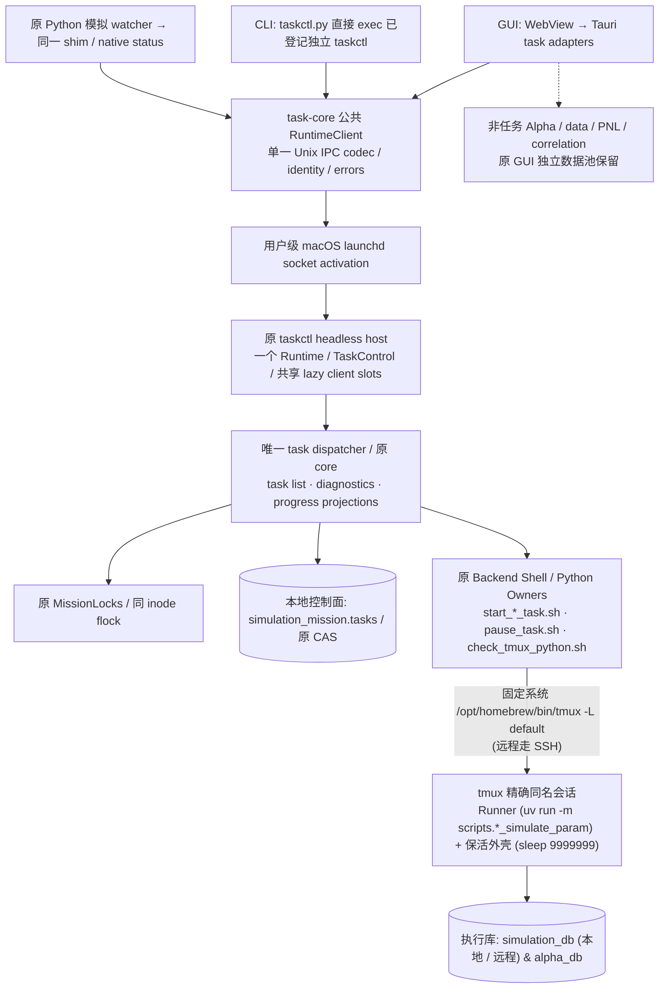
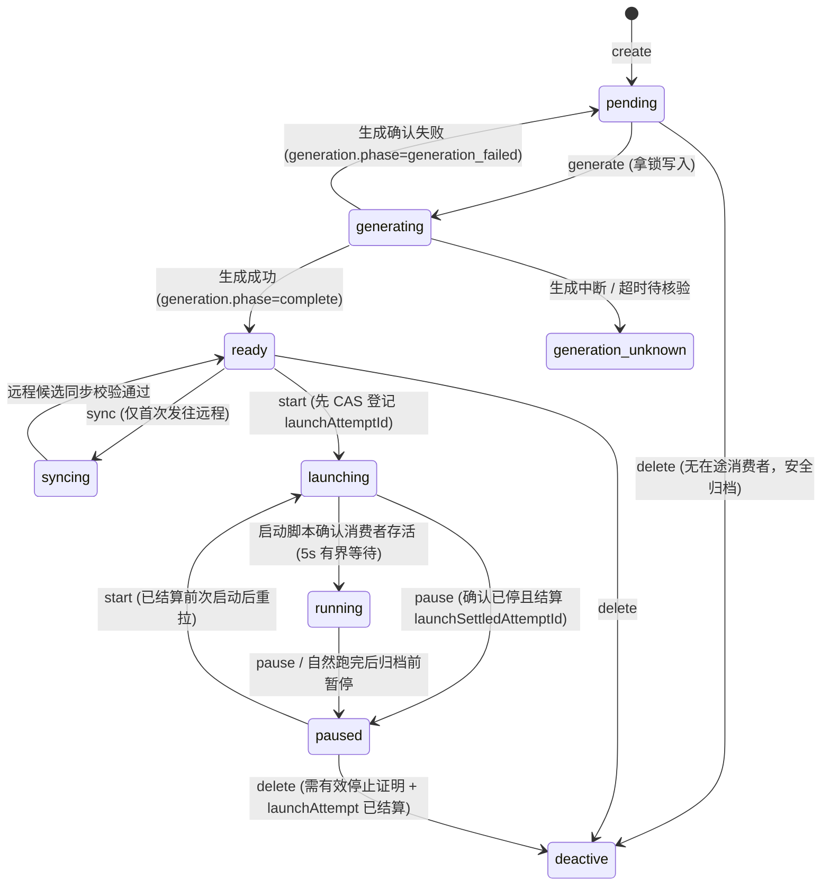

## 为什么必须设计成gui/cli统一架构？为什么不能直接操作底层脚本?

### 1. gui的操作比想象中复杂: 终结双脑分叉（Split-Brain），消除破坏性操作隐患

- **历史痛点**：GUI 由 Tauri (Rust) 直连 MongoDB 编写，CLI 由 Python `taskctl.py` 编写。两套代码、两套边界判定。正如会话中发现的，GUI 的删除直接执行物理 `drop`，而 CLI 走的是带有停止证明、未决回执保护和原子重命名的安全归档。如果使用者或 Agent 在不同端操作，会导致数据不一致甚至毁灭性误删。
- **架构方案**：将所有任务管理动作（创建、生成、同步、启动、暂停、删除、对账）的权威业务逻辑全部收拢到单一的 Rust 核心 crate：`quantnight-task-core`。两端不再各自解释状态。

### 2. 人工和agent需要互不干扰: 人工操作（GUI）与 Agent 自治（CLI）的“平权控制”

- **定位对齐**：
  - **人（Human）** 习惯使用桌面端 GUI（Tauri + Vue），依赖可视化大屏、图表、直观的运行/停止折叠详情和按钮手动恢复；
  - **智能体（Agent / Worker / Coordinator）** 没有图形界面，必须依赖结构化、非阻塞、具备确定退出码和 JSON 回执的 CLI 命令。
- **平权一致性**：如果 GUI 和 CLI 是两套逻辑，Agent 调度的任务在 GUI 里可能显示为无法识别的异常状态（例如 `unknown` 或一直卡在 `generating`）；反之，人在 GUI 上暂停任务，Agent 的后台 watcher 就会误报退出。两者必须是平级的调用客户端，操作的是同一个底层状态机与 CAS 语义。

### 3. 需要保证多端调用性能: 根治 Python 子进程冷启动延迟，保障 GUI 极致流畅

- **性能红线**：若像常规做法那样，让 Tauri Rust 前端去 `spawn` 调用 Python 脚本来实现统一，每点一次刷新或操作，操作系统都要经历：创建子进程 → 加载 Python 解释器 → 导入巨大依赖库 → 建立数据库连接 → 查询退出。这会引入几百毫秒甚至数秒的明显延迟，极易让桌面应用出现卡顿或等待转圈。
- **架构方案**：控制面直接用纯 Rust 实现。GUI 内部通过内存级异步调用，毫秒级响应；同时独立的 native CLI 工具也是编译好的纯 Rust 二进制（`crates/taskctl`），启动即执行，毫秒级返回 JSON 回执。

---

## 1. 四层控制拓扑与职责边界

GUI（Tauri 前端）与 CLI（`taskctl.py`）**共享同一个 Rust 控制核心 `quantnight-task-core`**，不再维护两套状态机。`taskctl.py` 仅作 `os.execv` 薄转发（开发态读取 `.quantnight/taskctl-dev-binding.json` 指向本地前端编译产物）。在已登记 runtime 的模式中，GUI 与 CLI 升级为同一 headless host 的平级客户端，通过 Unix IPC 接入。

### 1.1 各层唯一归属（基础设施复用边界）

| 层级 | 代码位置 | 职责 | 严禁越界行为 |
|---|---|---|---|
| **UI / CLI 入口** | `TaskManager.vue`、`commands.rs`、`crates/taskctl` | 参数收集、进度展示、错误提示（单次包装，不重复嵌套 `stage=`） | 不自行推断任务停止或绕过 `task-core` 直接改库 |
| **公共 transport / runtime** | `crates/task-core/src/runtime/`（`RuntimeClient` / `TaskEndpoint`） | 统一 Unix IPC 协议、身份/错误实现，host 持有单一 Runtime 与 lazy client slots | 不私建持久 transport 账本或重放队列 |
| **控制协调核心** | `crates/task-core/src/{create_generate,start,pause,cleanup_sync,inspection,maintenance_ops}.rs` | 持 `MissionLocks` 文件锁、校验 `_id`/执行端/启动世代、执行 MongoDB CAS 与归档编排 | 不重新实现 `tmux` socket 探测或回测 HTTP 逻辑 |
| **执行端脚本** | `scripts/start_task.sh`、`start_super_task.sh`、`priority_task_config.py`、`pause_task.sh`、`check_tmux_python.sh` | 在固定系统 `tmux -L default` 拉起/检查/关停精确同名会话，输出结构化回执 | 不直接修改本地控制面 `tasks.status` |
| **回测 Runner 与恢复器** | `scripts/*_simulate_param.py`、`util/mission_recovery.py`、`util/super_recovery.py`、`api/simulation.py` | 消费待测项、写入 `simulatorRuntime`、按回执状态机恢复未决项（普通/SUPER/MCP 共用 API 不以本地 SUPER Pool 为准入前提） | 不自动跨主机迁移任务、不对未确认回执盲目重发 `POST` |
| **GUI 非任务数据功能** | `datas.rs/metrics.rs` 与原配置/文件能力 | 原 Alpha/data/PNL/correlation 功能与独立 GUI 数据池，端点仍来自原 MongoConfig | 不误称所有 GUI Mongo 都迁入 host，不强迫非任务 namespace 等于 backend 默认值 |

---

## 2. 任务控制状态机与核心字段字典

### 2.1 顶层 `status` 流转图

### 2.2 多端任务竞态管理: mission锁和CAS

1. **Mission 锁**：同一个任务，不能同时做两套操作. 由操作系统的**文件锁**管理
2. **CAS(Compare And Swap)**: **允许符合条件的后续操作继续，旧结果回来时用 CAS 核对身份，比较后再更新, 防止写错数据库**. 
   - 比如 `generating` 里面, 可能在第一轮 generate fail 的回执到达之前, 我们就有其他方法(本地超时)判断需要开启第二轮 `generating` 了. 此时第一轮的回执就不允许触发状态更新.

### 2.3 让人容易困惑的 5 个关键安全字段

| 字段名 (`simulation_mission.tasks`) | 作用（为什么存在） | 何时写入 / 收敛 |
|---|---|---|
| `generation` (`{id, phase, producerPid, ...}`) | 将**生成结果**与**任务控制状态**解耦：生成失败时顶层 `status` 退回 `pending`（允许重跑 `generate`），同时 `generation.phase="generation_failed"` + `lastError` 保留失败原因供界面展示 | `generate` 启动写 `writing`，成功写 `complete`（顶层转 `ready`），确认失败写 `generation_failed`，进程失联由列表刷新对账（见 §4.1） |
| `launchAttemptId` | 每次执行 `start` 在真正调 shell 前生成的唯一启动批次号，防止启动脚本超时或崩溃时出现“幽灵启动”而控制面毫不知情 | `start` 前置 CAS 写入，同时把 `status` 置为 `launching`、`launchSettledAttemptId` 置为 `null` |
| `launchSettledAttemptId` | 标记哪一次 `launchAttemptId` 已彻底尘埃落定（要么确认已跑起来，要么确认已停止且无在途启动器）。**未相等时禁止直接重发 `start` 或 `delete`** | ① `start` 拿到启动回执写 `= launchAttemptId`；② 启动前校验拒绝未调用脚本时当场写 `= launchAttemptId`；③ `pause` 确认已停止且无在途启动器时写 `= launchAttemptId` |
| `tmuxContext` | 记录固定系统 `tmux -L default` 的 `binary`、`sessionId`（如 `$118`）、`sessionCreatedAt`、`taskId`、`launchAttemptId`，防止误杀同名外部会话 | `start` 成功或 `check_tmux_python.sh --inspect-execution` 核实归属后提供 |
| `stopConfirmedAt` / `stopConfirmationBasis` | `delete` 归档前的停止凭证：`runners_exited`（V1：亲手停掉捕获进程并确认退出）或 `session_absent`（V2：确认精确会话不存在或已清理保活外壳） | `pause` 完成主机侧复核后通过 CAS 写入 |

---

## 3. 16 个标准任务控制操作速查表

所有修改类操作均先获取 `.quantnight/mutators/<task>.lock` 本地互斥锁，再按 `_id` + `isRemote` + 当前状态做 MongoDB CAS 更新。

| 分类 | 命令 (`taskctl` / `TaskControl`) | 核心语义与约束 |
|---|---|---|
| **创建与生成** | `create` | 校验模板目录绑定（`templates.catalog`），写入 `status="pending"`，不执行模板生成代码 |
| | `generate` | 调 `backend.mongodb.mongo_datum` 1:1 落库候选（900s 预算）；确认失败退回 `pending` 并保留 `generation_failed` 诊断 |
| | `sync` | 初次远程任务将本地候选集安全同步到远程库；已有运行回执后禁止通过开关强改本地/远程执行端 |
| **启动与暂停** | `start` | 先核验执行端状态（幂等识别 `already_running`、清理已结算的 `owned_residue`），再发布配置、调 `start_*_task.sh` 并在 5s 窗口内确认 Python/uv 消费者存活 |
| | `pause` | 先只读探测执行端身份，再通过 `pause_task.sh` 发送 `Ctrl-C`（10s 宽限）→ `kill-session`（2s 宽限），复核进程清空后写入 `paused` 并结算 `launchSettledAttemptId` |
| | `resume` | 为暂停任务准备续跑条件（默认不重置 `UNKNOWN`/超时未决回执，交由启动恢复核验） |
| | `priority-update` | 在不重启 Priority 会话的前提下校验并热更新 `tmp_config_<task>.json` + `reload_trigger_<task>` |
| **归档与维护** | `delete` | **安全归档而非物理销毁**：要求已暂停、启动已结算、消费者缺失；将候选集合重命名为 `<task>__archive_<taskId>`，生成统计快照，保留 `alpha_results` 正式结果，顶层置为 `deactive` |
| | `observe-accepted` | 针对 SUPER 已受理未决项启动有限时（540s）只读 GET 观察，收敛后关闭观察标记 |
| | `priority-prune` | 按阈值清理已完结的 Priority Root Pool 检查点，保留 `UNKNOWN` 未决状态 |
| | `watch` | 绑定 `(missionId, launchId, remote)` 启动唯一有界后台 watcher（`watch_quant_task.py`），轮询间隔自适应且不阻塞前台会话 |
| **只读查询** | `list` / `status` / `results` | 聚合控制面状态、候选进度投影（`pending`/`running`/`done`/`failed`/`unknown`）与 `alpha_results` 指标；本地同名任务遮蔽远程只读缓存行 |
| | `verify-registration` / `archive-research` | 校验冻结候选注册一致性、导出研究归档统计回执 |

---

## 4. Runtime 合并与常驻宿主规范

在登记 runtime 的模式中，任务控制由独立常驻的 headless host 统一持有：

1. **常驻宿主（Headless Host）与生命周期解耦**：
   - 用户级 macOS `gui/<uid>` launchd socket 首次需求时启动独立 host；
   - host 单一持有 Runtime、TaskControl 与共享 client slots；
   - **GUI 关闭或 CLI 退出只结束客户端等待或订阅，不关 host，更不影响 tmux 内运行的 runner**。
2. **断连与无重放（No-Replay）合同**：
   - 首次尝试写 Call 后，无论半帧还是未收回包，**绝不自动重接重放，也不退直连**，避免并发重复触发；
   - host 在内存签发 Call ID 并管理 inflight JoinHandle，客户端断线不中止已接管的 core future，保证业务 CAS 正常收尾；
   - 不落持久 transport 账本或重放队列，MongoDB `simulation_mission.tasks` 依然是唯一的控制面真源。
3. **数据域隔离**：
   - 任务生命周期、列表、诊断走 host；
   - GUI 独立数据池（Alpha/data/PNL/correlation）保留原端点与功能，两者明确解耦。

---
