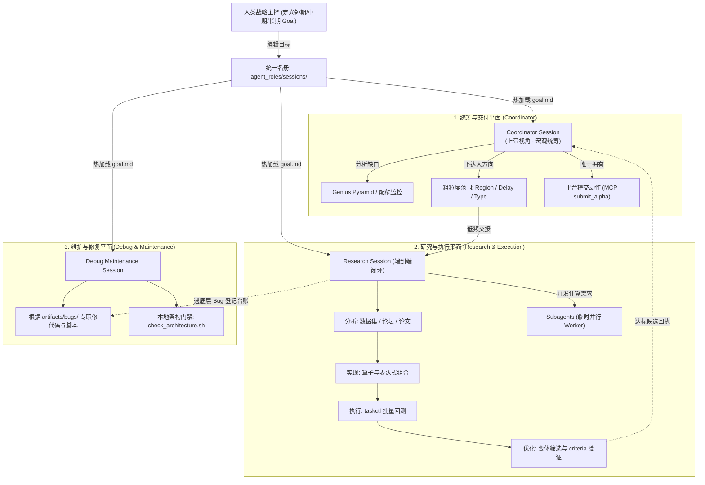

> 本文是 QuantNight 项目的智能体治理与多 Session 协同架构案例，重点剖析在量化回测底座跑通后，如何建立严密的 Agent 分权约束、集中式 Goal 目标管理、热加载插件（`pi-goal-feedback`）以及端到端自治研究闭环。  
> 很多自动化项目在跑通底层执行后，往往陷入“放手就失控、收紧就瘫痪”的治理困境。本文结合真实调教历程，详细阐述为什么必须设计这套多 Session 权责硬隔离体系与 Goal 热加载机制，为复杂工程场景下的多 Agent 协作提供可落地的治理范式。

---

## 1. 案例概览与治理挑战

在完成底层 Runtime 合并（Rust `task-core`、Headless Host、Unix IPC、系统 tmux 守护与 CAS 防覆）之后，QuantNight 的单机执行底座已坚如磐石，回测不会掉线、不会锁死、更不会因为前台断开而异常终止。

然而，当系统从“单任务脚本化”迈向“多 Agent 自主协作”时，立刻撞上了**智能体层面的组织混乱**：

1. **高危动作越权失控**：平台每日提交配额极其稀缺且不可逆。执行端 Agent 容易产生盲目拟合的幻觉，一旦持有提交权，极易擅自消耗宝贵配额提交次品；
2. **私自篡改系统底座**：执行端 Agent 在回测受阻或门禁报错时，倾向于“走捷径”去魔改底层 Python 脚本、放宽测试断言或修改长期 Skill；
3. **目标（Goal）漂移与管理僵化**：没有明确、可执行的 Goal 约束，Agent 容易在会话中越跑越偏；而传统的 `/goal` 命令必须停机重启，无法适应盘面与战术策略的动态微调；
4. **角色过度碎片化（流水线空转）**：试图把“数据分析”与“回测实验”拆成两个独立 Session，导致 Agent 之间整天在“发消息、等消息、解释消息”，真正干活的时间全被高昂的“跨会话等待税”吞噬。

为了终结这些乱象，系统确立了**“三权分立、目标集中、热加载驱动、闭环内自治”**的多 Session 协同架构。

### 1.1 通用机制在本案例中的映射

| 通用治理机制 | QuantNight 的具体对象与实现 | 核心目的与硬性红线 |
| --- | --- | --- |
| **名册与角色发现** | 根目录集中维护 `agent_roles/project.yaml` 与 `agent_roles/sessions/` | 集中登记已知 Session，不猜归属，消灭散落各处的启动碎片 |
| **高危权限硬隔离** | 原生 MCP `submit_alpha` 工具仅对已登记的 `coordinator` Session 放行 | 杜绝执行端 Agent 误操作或幻觉导致配额报废，提交权物理收拢 |
| **系统代码防篡改** | 仅 `debug-maintenance` Session 拥有写代码权限，执行 Session 默认只读 | 严禁执行端为“刷绿指标”而私自修改底层代码与测试门禁 |
| **目标动态注入** | 统一采用 `goal.md`，通过 `pi-goal-feedback` 插件在对话回合中**热加载** | 人类可随时修改目标，Agent 自动对齐，无需频繁杀进程重启会话 |
| **单链路端到端闭环** | 研究 Session 负责“分析→实现→回测→优化→验证”全流程，不拆分流水线 | 消除跨 Agent 异步等待与解释税，保持量化研究内循环的高效吞吐 |
| **人工最终仲裁** | 短期/中期/长期 Goal 仅由人类定义；重大策略调整与异常由人类拍板 | 拒绝 Agent 自作主张解释战略时间跨度，主权始终在人 |

---

## 2. 多 Session 架构拓扑与三权分立

为了防止 Agent 既当裁判又当运动员，QuantNight 建立了清晰的**三权分立**拓扑：



### 2.1 严格的角色权限矩阵

| Session 角色 | 核心职责 | 平台提交 (Submit Alpha) | 源码修改 (Git/Python/Rust) | 回测任务控制 (Taskctl) | 长期 Skill 维护 |
|---|---|---|---|---|---|
| **`coordinator`（统筹者）** | 分析平台缺口、配额核算、派发大方向目标、核验证据并执行最终提交 | 🟢 **唯一独占授权** | 🔴 严禁修改 | ⚪ 仅查状态，不派回测 | 🔴 严禁修改 |
| **`debug-maintenance`（维护者）** | 专职排查修复 Bug、重构底座架构、运行架构门禁测试 | 🔴 严禁调用 | 🟢 **唯一放行** | ⚪ 仅限回归测试调用 | 🟢 经授权可维护 |
| **`regular-alpha-exploration`（研究者）**| 探索数据集、实现表达式、批量回测、迭代优化与对照标准验收 | 🔴 严禁调用（无权限） | 🔴 严禁修改（只读） | 🟢 **核心业务权限** | 🔴 严禁修改（只读） |

---

## 3. 为什么需要这样设计架构？（核心深层动因）

### 3.1 提交权为什么必须由统筹 Session 严格独占？

> **用户现场指令**：  
> *“不同 session 的权限不同，比如我就不允许执行 session 提交 alpha... 解锁 submit-alpha，让 coordinate session 可以提交 alpha；coordinate session 不许自行优化 alpha、执行回测、改代码，只许分析目标、执行统计功能、接收平台和其他 agent 的通知、更改其他 session 的 goal。”*

- **配额稀缺性与不可逆性**：WorldQuant Brain 每天的提交次数极少（普通用户仅个位数，高阶顾问亦受每日限额约束），提交结果永久记入考核。一旦浪费，当日无法挽回；
- **防范执行端乐观幻觉**：执行端 Agent 长期浸泡在局部参数优化中，容易将“过拟合的假象”当成达标成果。如果开放提交接口，Agent 在跑出一个看似漂亮的夏普比率后便会盲目提交，极易触犯平台的低质处罚；
- **统一把控全局节奏**：统筹 Session 站在全局视角，掌握当前季度的整体 Pyramid 结构缺口（例如：今天最缺的是 GLB 还是 USA？是 Delay 1 还是 Delay 0？）。只有统筹者能决定哪个候选最具提交价值。

### 3.2 为什么必须将“提交标准”与“提交动作”从概念上彻底解耦？

> **用户现场发现**：  
> *“毕竟现在叫 submit-alpha 的 skill 写的是提交优化条件不是提交动作... 改下技能名字。”*

- **命名混淆引发误解**：原先的技能名为 `submit-alpha`，但里面 90% 的正文都在讲“如何检查相关性、如何算 Fitness、如何算 Margin”。这导致 Agent 在阅读该技能后，误以为自己拥有提交任务的授权，或者试图在代码中寻找提交按钮；
- **解耦方案**：
  1. 将技能重命名为 [`alpha-submission-criteria`](file:///Users/wenliu/Code/python/quantnight/.agents/skills/alpha-submission-criteria/SKILL.md)（提交标准判定），开篇明确红线：**“本技能只负责提交资格判定，不执行提交动作，也不授予提交权限”**；
  2. 真正的提交动作收敛为底层的原生 MCP 工具 `submit_alpha`，并在 MCP 鉴权层按 Session ID 进行硬拦截。从语义和工具上斩断混乱。

### 3.3 为什么执行端绝对禁止写代码与修改 Skill？

> **用户现场指令**：  
> *“允许 debug session 改代码，但是不允许执行 session 改代码和 skill。”*

- **防范“作弊式解法”**：在回测实验中，如果执行 Agent 拥有修改系统代码的权限，当它遇到回测崩溃或门禁报错时，它最容易采取的行为不是“反思策略”，而是去把测试断言改掉、把超时放大，甚至私自绕过校验逻辑；
- **隔离故障扩散**：让执行端保持纯粹的业务探索者身份。遇到系统级故障，统一沉淀事实到 `artifacts/bugs/`，由独立的 Debug Session 集中修复，避免每个人都在底座上随意打补丁导致代码腐化。

### 3.4 为什么统筹 Session 绝对不能下场跑回测？

- **防止上下文爆炸（Context Saturation）**：量化回测的日志、参数网格和报错极其冗长。如果统筹者亲自去调回测，其会话上下文会在一小时内被海量技术细节淹没，迅速耗尽窗口并产生严重的记忆遗忘；
- **防止调度机制瘫痪**：统筹者一旦陷入局部任务的纠缠，整个多 Session 体系就会群龙无首，无法及时接收外部事件与分配新战场。

---

## 4. 目标（Goal）热加载与动态治理体系

### 4.1 为什么人类必须垄断“短期 / 中期 / 长期 Goal”的定义权？

> **用户现场纠偏**：  
> *“不是。短期/中期/长期 是我定义，不是你定义的。”*

- **拒绝 Agent 篡夺战略规划**：很多系统试图让 Agent 自己规划“下半年方向”或“本月目标”，这在现实中往往演化为天马行空的胡思乱想。量化的战略目标（例如“本周重点突围 EUR 区域”、“本月完成 Pyramid 第四层”）必须 100% 由人类根据外部现实定义；
- **架构职责归位**：架构的作用是**忠实承载与对齐人类目标**，提供版本追踪与热加载机制，绝不替人类预设战略。

### 4.2 消除文档碎片化：集中收敛至 `agent_roles/`

> **用户现场指令**：  
> *“统一都用 goal.md，不要 docs/agents_roles，应该放在项目直属 quantnight/agent_roles 下面维护... 为什么要分出一个 start.md 我就不明白。”*

在早期演进中，启动与目标文档散落在 `artifacts/sessions/`、`artifacts/bug_maintenance/START.md` 等各个角落，导致“新会话开工找不到真源，老会话读错历史目标”。最终架构彻底收敛：

```text
quantnight/agent_roles/
  ├── README.md               # 角色与治理索引
  ├── project.yaml            # 全局 Session 名册与权威绑定
  └── sessions/
      ├── coordinator/
      │   ├── session.yaml    # 统筹身份、权限声明与输入输出合同
      │   └── goal.md         # 统一目标正文（短期/中期/长期）
      ├── debug-maintenance/
      │   ├── session.yaml    # 维护身份与代码修改权限
      │   └── goal.md         # 维护目标正文
      └── regular-alpha-exploration/
          ├── session.yaml    # 研究身份与无提交/只读代码约束
          └── goal.md         # 探索目标正文
```

彻底废弃多余的 `start.md`，每个 Session 只认自己目录下的 `goal.md`，一目了然。

### 4.3 为什么必须支持“热加载（Hot-reloading）”？

> **用户现场决策**：  
> *“不。我不想再执行 /goal。我的意思是 goal 应该运行中可以中途修改，应该是热加载，应该写成通用插件，不是绑定这个项目。”*

- **解决会话重启的高昂代价**：如果每次人类调整策略（例如：把目标相关性从 0.7 调紧到 0.65，或者切换重点数据集），都需要把正在运行的 Agent 杀掉、重新建会话、重新读取庞大上下文，无人值守将名存实亡；
- **落地 `pi-goal-feedback` 扩展**：
  - 插件在 Agent 每轮对话开始前，轻量检查对应 `goal.md` 的修改时间；
  - 一旦检测到文件变化，在**不重启会话、不重置上下文**的前提下动态注入最新目标增量；
  - 人类只需在 Obsidian 或编辑器中随手保存 `goal.md`，后方的 Agent 会话立刻自动对齐最新指令。

### 4.4 真实故障治理：杜绝 Goal 全文灌入导致的上下文雪崩

在插件上线初期，系统曾遇到严重的运行时故障：

> **现场故障**：`pi-goal-feedback` 频繁报 HTTP 400 错误，会话中出现大面积文字复读。  
> **根因定位**：插件在每个交互回合中，把上万字的 `goal.md` 全文不加过滤地反复重复塞进 System Prompt，导致上下文迅速突破模型限制，触发 API 拒绝并引发死循环复读。  
> **用户现场督促**：*“两方面都需要修改：1. 插件行为需要修改；2. goal 的正文也需要保持精简。”*

- **优化治理**：
  1. 插件改造为仅提取核心约束与增量反馈，杜绝全文机械倾倒；
  2. 规范 `goal.md` 书写范式：去除冗余寒暄与废话，严格保留“硬边界、验收阈值、当前批次”，将单文件体积控制在健康范围内。

---

## 5. 业务闭环哲学：为什么坚决反对把“分析”与“回测”切成两个 Session？

在会话的第 917～927 行，曾有一场极其深刻的架构设计辩论：

> **现场思辨**：  
> - Agent 曾建议：按照标准软件工程流水线，拆分为“研究分析角色（看论文、读帖子、剖析数据字典）”与“实验探索角色（写表达式、调回测、跑优化）”，两者互相交接。  
> - **用户的坚定拍板**：  
>   *“但是我决定还是不分开。分析和回测验证基本是一条通路，如果把主 session 分开可能不方便。具体探索的 region/delay/alpha 类型由 coordinate session 提供，确定类型之后就独立探索，不需要频繁和 coordinate 交互。”*

### 为什么“过度微服务化”在量化 Agent 中是灾难？

1. **消灭致命的“跨会话等待税”与流水线空转**：
   - 如果硬性拆分，分析 Agent 提出一个假设后，必须把思路打包成消息发出去，然后陷入漫长等待；实验 Agent 拿到后调环境跑回测，跑完再发回分析 Agent……
   - 这种模式下，**Agent 会花费大量计算资源与 Token 在互相解释对方的意图上**。一旦某个环节理解偏差，整条流水线瞬间卡死。
2. **量化研究天然需要“紧耦合内循环”**：
   - 优秀的量化研究从来不是单向流水线，而是**高频紧凑的实验闭环**：看了一眼字段特征 → 写出一个初步表达式 → 回测 20 秒看相关性 → 发现夏普不好立刻调算子 → 再测一次；
   - 这种高频尝试在**同一个 Session 的连贯上下文内完成是最快、成本最低的**。
3. **宏观解耦：粗粒度派发，低频交互**：
   - 统筹 Session 只做**宏观战略约束**（输入：`Region: USA`, `Delay: 1`, `Target: Momentum`, `Theme: Sentiment`）；
   - 执行 Session 拿到大方向后，在内部完全自治进行完整闭环，不需要每换一个字段都向主控请示。只有当产出达标候选，或者彻底卡死需要调整战略时，才与统筹 Session 进行低频交接。

---

## 6. 状态、证据与知识落盘

所有的治理逻辑不搞口头约定，全部物理固化在仓库结构中：

```text
quantnight/
  ├── agent_roles/                        # 智能体治理总指挥部
  │   ├── README.md                       # 职责说明与发现规范
  │   ├── project.yaml                    # 权威名册与 Session ID 映射
  │   └── sessions/                       # 核心会话专属工作空间
  │       ├── coordinator/goal.md         # 统筹总目标与每日提交计划
  │       ├── debug-maintenance/goal.md   # 基础设施与架构维护目标
  │       └── regular-alpha-exploration/  # 研究执行目标（闭环探索）
  ├── artifacts/
  │   ├── bugs/                           # 共享缺陷台账（执行端登记，Debug 端处理）
  │   └── alpha_optimization/<task>/      # 每轮实验的交付物与可审计证据
  └── .agents/skills/
      └── alpha-submission-criteria/      # 仅做资格判定，不含提交动作
```

---

## 7. 案例结论与治理启示

QuantNight 的演进清晰地展示了一个复杂 AI 自动化系统的两阶段跃迁：

```text
阶段一：底座稳定性建设 (L1～L2) ──► 阶段二：智能体组织治理 (L3～L4)
  · 统一 Rust task-core 内核         · 统筹 / 维护 / 研究 三权分立
  · Headless Host 与 Unix IPC        · 提交权与改码权物理硬拦截
  · tmux 进程守护与 CAS 防旧覆新       · pi-goal-feedback 目标热加载
  · 切断自杀式全局 Shutdown            · 业务端到端内循环（坚决不乱拆）
```

### 核心治理启示

1. **权限靠系统硬拦截，不靠 Prompt 口头叮嘱**：  
   永远不要寄希望于在 Prompt 里写“请不要提交”或“请不要改底层代码”。只有通过独立的 Session 隔离与 MCP 工具级调用鉴权，才能确保高危动作万无一失；
2. **目标靠动态热加载，不靠重启会话**：  
   人类的战略随着市场与配额随时变化。建立基于通用插件的 Goal 热加载通道，才能实现真正的随需应变与人机敏捷协同；
3. **闭环靠内循环高吞吐，不搞形式主义流水线**：  
   紧密相关的业务环节坚决不拆分。粗粒度下达方向，放手让执行 Agent 内部闭环自治，才能最大化量化研究的产出效率。

---
