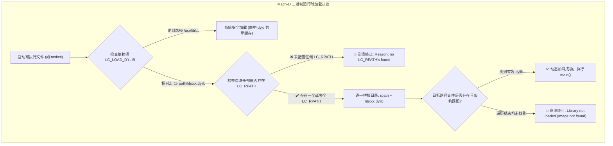

> **背景：关于 `libiconv` 与本次依赖引入**
> - **核心功能**：`libiconv` 是 POSIX 标准的跨字符集转码库（负责 GBK / Latin-1 ↔ UTF-8 等互转，避免乱码与解析崩溃）。
> - **为什么被链接**：`taskctl` 虽为纯 Rust 编写，但其依赖的 MongoDB 驱动（`mongodb` / `bson`）在执行 SCRAM 认证与国际化文本处理（`stringprep` 协议）时需要该转码符号；编译期链接器捕获了 Miniforge 环境的 `-liconv`，从而动态挂载了该库。

---

## 一、macOS 动态链接路径前缀本质区别

在 Mach-O 体系中，有三种特殊的动态加载宏路径：

| 动态路径宏 | 展开基准点 (Anchor Point) | 设计初衷 | 典型应用场景与优劣 |
| :--- | :--- | :--- | :--- |
| **`@executable_path`** | 当前**主进程可执行文件**所在的物理绝对目录 | 保证独立可分发应用程序自身内部组件的相对稳定 | **macOS App Bundle 黄金标准**。<br>例如指向 `.app/Contents/MacOS/../Frameworks`。即便 App 被移动到任何文件夹，内部相对寻址始终有效。 |
| **`@loader_path`** | 当前**正在发起加载的 Mach-O 文件**所在的物理目录 | 解决插件、动态依赖库嵌套加载次级依赖时的相对寻址 | **插件/依赖级联寻址**。<br>当 A 库由主程序加载，A 又需要加载同目录下的 B 库时使用。若放在可执行文件上，行为与 `@executable_path` 相同。 |
| **`@rpath`** | 动态回退机制，依次遍历调用者头部声明的所有 **`LC_RPATH`** | 解耦库文件与调用者的物理路径硬绑定，实现多路径搜索 | **复杂工程/Conda/通用分发利器**。<br>调用者必须显式声明至少一个 `LC_RPATH` 记录；若未声明，`dyld` 拒绝查找并立即抛错退出。 |



---

## 二、全景对照表：按运行调用方式划分的配置需求与底层原因


下表按**实际运行调用方式**划分，详细拆解每种方式所需的配置组合及底层成因：

| 序号 | 运行调用方式 | 所需配置：动态库引用、LC_RPATH 与本机软链接 | 决议表现与为什么需要（底层原因） | 判定结论与典型场景 |
| :---: | :--- | :--- | :--- | :--- |
| **1** | **终端原生直接调用**<br>(`qn status` / `./taskctl`) | • **动态库引用**：`@rpath/libiconv.2.dylib`<br>• **必需 LC_RPATH**：`/usr/local/lib`<br>• **必需软链接**：<br>  `/usr/local/lib/libiconv.2.dylib`<br>  `-> /Users/wenliu/miniforge3/lib/libiconv.2.dylib` | **【底层原因】**：原生执行时无任何外部环境变量兜底，`dyld` 纯靠 Mach-O 自身头部的 `LC_RPATH` 寻址并跳转软链。<br><br>**【分支表现对照】**：<br>• 🟢 **配置齐全**：命中内嵌 RPATH 并通过软链跳转至 Miniforge，正常输出 JSON。<br>• 🔴 **缺少 LC_RPATH**：当场报错 `Reason: no LC_RPATH's found` 闪退（最初事故现场）。<br>• 🔴 **缺少软链接**：虽有 RPATH 但目标丢失，报错 `Reason: image not found` 闪退（说明软链接目前不可删）。 | **【日常开发标准 / 最终修复方案】**<br>通过 `crates/taskctl/build.rs` 注入 `-Wl,-rpath,/usr/local/lib`，确保脱离 Cargo 在终端独立运行时也能稳定加载。 |
| **2** | **Cargo 内部环境**<br>(`cargo test` / `cargo run`) | • **动态库引用**：`@rpath/libiconv.2.dylib`<br>• **LC_RPATH**：非必需（即使二进制为空也能运行）<br>• **必需软链接**：存在于 `/usr/local/lib` | **【底层原因】**：Cargo 拉起子进程时会自动注入 `DYLD_FALLBACK_LIBRARY_PATH=/usr/local/lib:...` 环境变量作为兜底回退。<br><br>**【实际表现】**：只要 `/usr/local/lib` 存在软链接，即使二进制完全未内嵌 RPATH，测试也能全部通过 (PASS)。 | **【测试陷阱 / 易误判】**<br>Cargo 内部垫付了环境变量，掩盖了二进制独立运行时缺失 `LC_RPATH` 的致命缺陷。 |
| **3** | **Shell 环境变量临时垫付**<br>(`export DYLD_LIBRARY_PATH`) | • **动态库引用**：`@rpath/libiconv.2.dylib`<br>• **LC_RPATH**：非必需（被环境变量覆盖）<br>• **软链接 / 库**：需在环境变量指定的路径中 | **【底层原因】**：强行由当前 Shell 环境变量接管动态库搜寻目录。<br><br>**【实际表现】**：当前终端可运行；但受 macOS SIP 保护机制影响，派生子进程或后台守护进程（launchd）时环境变量会被静默剥离导致失效。 | **【临时止血 / 易污染】**<br>仅限当前终端临时验证，不能作为工程交付或守护进程的长期方案。 |
| **4** | **macOS GUI 打包发布**<br>(`QuantNight.app` 双击启动) | • **动态库引用**：`@rpath/libiconv.2.dylib`<br>• **必需 LC_RPATH**：`@executable_path/../Frameworks`<br>• **本机软链接**：**完全无需**（物理库打包进 App 沙盒） | **【底层原因】**：生产级独立分发规范。打包脚本（`scripts/build-macos.sh`）将 Homebrew 物理库拷贝至 `.app/Contents/Frameworks/`，并用 `install_name_tool` 重写依赖为相对自身路径。<br><br>**【实际表现】**：App 内部自闭环，完全免疫宿主机器的环境差异。 | **【生产打包隔离标准】**<br>不依赖开发者的 Conda 环境或系统的 `/usr/local/lib` 软链接，可分发给任意 Mac 运行。 |
| **5** | **系统原生命令调用**<br>(标准系统绝对路径程序) | • **动态库引用**：绝对路径（如 `/usr/lib/libSystem.B.dylib`）<br>• **LC_RPATH**：无需配置<br>• **本机软链接**：无需软链接 | **【底层原因】**：系统动态库由 macOS dyld 共享缓存（dyld shared cache）全局托管。<br><br>**【实际表现】**：直接根据绝对路径匹配加载，完全不介入 RPATH 搜索逻辑。 | **【系统原生纯净链接】**<br>系统原生动态库的标准加载方式，零动态搜寻负担。 |

---

## 三、典型故障与治理方案

| 序号 | 故障场景 / 问题 | 典型特征 | 深层根源 | 排查命令与治理方案 |
| :---: | :--- | :--- | :--- | :--- |
| **1** | **Miniforge/Conda 污染系统编译链**<br>(`libiconv` 相对引用) | 终端提示 `(base)`；在编译含有 C 依赖的 Rust/C++ 项目时，自动链接 Conda 库，且动态库 ID 为 `@rpath/libxxx.dylib`。 | 1. `/usr/local/lib/libiconv.2.dylib` 软链接指向 Miniforge。<br>2. Conda 库的 Install Name 默认设为 `@rpath/` 以支持跨目录迁移。<br>3. `pkg-config` 输出了 `-L/Users/wenliu/miniforge3/lib`。 | **排查命令**：<br>`ls -l /usr/local/lib/libiconv*`<br>`otool -D ~/miniforge3/lib/libiconv.2.dylib`<br><br>**构建期根治**：<br>在项目的构建声明（如 `build.rs`）中主动声明 `-Wl,-rpath,/usr/local/lib`，确保生成的产物自带寻路指令。 |
| **2** | **多 Crate 拆分时 CLI 模块遗漏构建参数** | GUI 宿主（Tauri）能跑，但独立编译的 CLI（`taskctl`）原生调用即崩溃；但 `cargo test` 却能通过。 | 抽离 CLI 时仅在 `src-tauri` 配置了 RPATH，未给 `crates/taskctl/build.rs` 注入链接参数；测试时 Cargo 自动补全了 fallback 变量掩盖了问题。 | **治理方案**：<br>在 `crates/taskctl/build.rs` 中补齐链接注入：<br>`println!("cargo:rustc-link-arg=-Wl,-rpath,/usr/local/lib");`<br><br>**验收标准**：<br>`otool -l <bin> \| grep -A 2 LC_RPATH` 必须包含 `/usr/local/lib`。 |
| **3** | **macOS App 打包分发后动态库丢失** | 在开发机编译通过，但移动到其他 Mac 或作为 App Bundle 运行时提示找不到依赖。 | 依赖库未内嵌进 App Bundle，且可执行文件未配置指向 App 内部 Frameworks 的相对 RPATH。 | **生产打包规范（脚本流水线）**：<br>1. 将外部 dylib 拷贝进 `YourApp.app/Contents/Frameworks/`<br>2. `install_name_tool -id @rpath/libiconv.2.dylib "$FRAMEWORKS_DIR/libiconv.2.dylib"`<br>3. `install_name_tool -change "$SRC" "@rpath/libiconv.2.dylib" "$EXEC_PATH"`<br>4. `install_name_tool -add_rpath "@executable_path/../Frameworks" "$EXEC_PATH"`<br>5. 重新对 dylib 与可执行文件进行 `codesign` 签名。 |
| **4** | **本地软链接失效 / 误删引发次生故障** | 虽已内嵌 `LC_RPATH /usr/local/lib`，但手工删除软链接后 `qn` 再次报错。 | 当前 RPATH 指向 `/usr/local/lib`，若移除该软链接，`dyld` 在该目录下找不到目标库文件。 | **报错现象**：<br>`Reason: image not found`<br><br>**应对策略**：<br>1. **现状**：保留 `/usr/local/lib/libiconv.2.dylib` 软链接。<br>2. **彻底解耦**：在 `build.rs` 中直接加入 Homebrew 物理路径（`/opt/homebrew/opt/libiconv/lib`）或 Conda 环境变量路径（`$CONDA_PREFIX/lib`），不再经 `/usr/local/lib` 中转，即可安全删除软链接。 |

---

## 四、编译与运行时动态解析全景流转拓扑

```text
════════════════════════════════════════════════════════════════════════════════════════════════════════════════
【第一阶段：编译链接期 (Build & Link Time)】
────────────────────────────────────────────────────────────────────────────────────────────────────────────────
  Cargo / rustc 编译 C 依赖源码
          │
          ▼
  系统链接器 (ld64) 介入
          ├── 扫描 /usr/local/lib 或 Conda lib
          ├── 发现 libiconv.2.dylib 的 install name 为: @rpath/libiconv.2.dylib
          │
          ▼
  检查构建脚本 (build.rs) 是否声明 link-arg:
          ├── ❌ 未声明 ─────────────► 生成的 Mach-O 头部: 无 LC_RPATH
          └── ✔️ 声明 -Wl,-rpath,... ─► 生成的 Mach-O 头部: 包含 LC_RPATH /usr/local/lib
════════════════════════════════════════════════════════════════════════════════════════════════════════════════
【第二阶段：二进制存储态 (Mach-O Binary Structure)】
────────────────────────────────────────────────────────────────────────────────────────────────────────────────
  taskctl 可执行文件头部结构:
  ┌────────────────────────────────────────────────────────────────────────┐
  │ Load Command: LC_LOAD_DYLIB -> @rpath/libiconv.2.dylib                 │
  ├────────────────────────────────────────────────────────────────────────┤
  │ Load Command: LC_RPATH      -> /usr/local/lib (由 build.rs 固化植入)   │
  └────────────────────────────────────────────────────────────────────────┘
════════════════════════════════════════════════════════════════════════════════════════════════════════════════
【第三阶段：运行时动态加载 (Runtime Execution by dyld)】
────────────────────────────────────────────────────────────────────────────────────────────────────────────────
  用户在终端直接执行: qn status / ./taskctl
          │
          ▼
  dyld 读取可执行文件 Mach-O 头部
          │
          ├── 遇到 @rpath/libiconv.2.dylib
          │
          ▼
  dyld 展开 LC_RPATH 候选清单:
          │
          ▼
  尝试路径: /usr/local/lib/libiconv.2.dylib
          ├── 软链接指向: /Users/wenliu/miniforge3/lib/libiconv.2.dylib
          ├── 架构校验通过 (arm64)
          │
          ▼
  ✅ 动态符号解析完成，顺利进入 main()，输出业务结果！
```

---

## 五、关键认知与避坑准则

1. **不要相信 `cargo test` 跑通就等于二进制能独立运行**：
   - Cargo 为了方便开发测试，在拉起测试子进程时会自动注入一系列隐式的加载环境变量（包括向 `DYLD_FALLBACK_LIBRARY_PATH` 追加常用开发目录）。
   - **验证真实二进制健康度的唯一标准**：直接在无任何包裹参数的裸 Shell 下执行 target 目录下的二进制文件，或者用 `otool -l` 审查 Mach-O 头。

2. **`install_name_tool` 是打补丁，`build.rs` 才是源码真源**：
   - 任何用命令行对编译产物手动执行的 `install_name_tool -add_rpath`，都会在下一次 `cargo build` 或代码改动触发重编时被覆写抹除。
   - 凡是本地开发依赖非系统目录动态库的，必须沉淀在 `build.rs` 中，做到“拉下代码即编译，编译完即可用”。

3. **慎用全局环境变量，保持子进程纯净**：
   - 全局设置 `DYLD_LIBRARY_PATH` 会毒化整个终端派生出的所有子进程（Python、Node、Git、Go），极易引发跨架构（如 Rosetta x86 混跑）或版本符号冲突的诡异暗病。
   - 始终坚持将寻路权留给二进制自身的 `LC_RPATH`。
