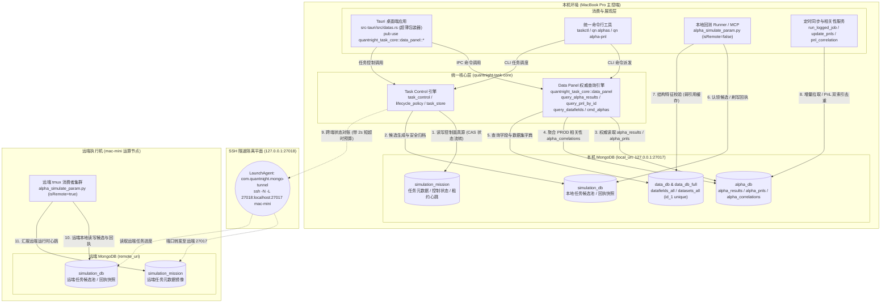
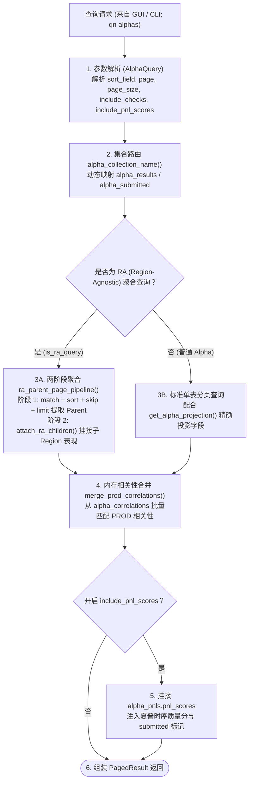
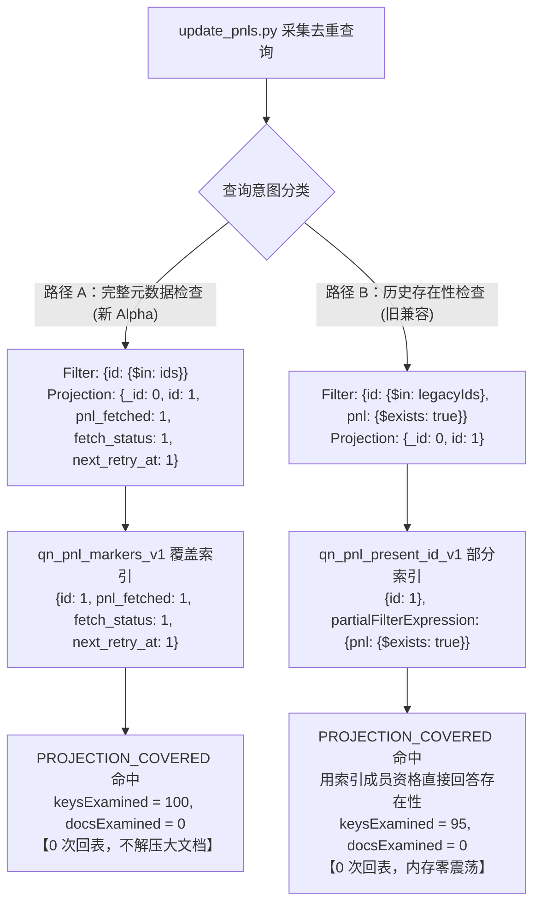
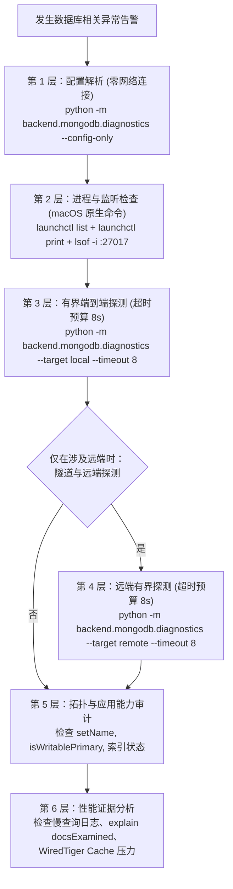

本文档系统性剖析 QuantNight 量化系统的 **MongoDB 存储拓扑、逻辑库/集合职责划分、数据流平面、`quantnight-task-core` 对 Alpha 仓储与数据面板的权威读取体系、PnL 双覆盖索引优化、定时采集调度体系与只读分层运维基线**。

在量化研究与大规模高并发回测体系中，MongoDB 既承担着**控制面任务状态机**与**数百任务数十万待测项**的高频并发读写，又承载着**全量 Alpha 详情、年度统计、高维时序 PnL、相关性矩阵与字段字典**的海量仓储。若存储层边界模糊、索引失效或网络拓扑混乱，系统极易陷入“前端列表卡死、WiredTiger 内存耗尽持续换页、远端隧道超时、任务状态死锁”的泥潭。

---

## 1. 双端存储拓扑与业务角色分离

QuantNight 在物理部署上采用**“本机主控 + 远端执行机（mac-mini）”**的混合架构。二者通过安全 SSH 隧道连接，在逻辑上严格解耦为 `local` 与 `remote` 两大业务角色。

### 1.1 核心拓扑架构图



### 1.2 拓扑设计铁律与防踩坑原则

1. **`local` 与 `remote` 是业务配置角色，不是 MongoDB 副本集复制关系**：
   - 本机 MongoDB 与远端 mac-mini 上的 MongoDB 是**两套物理隔离的独立实例**，各自可以具有独立的副本集名称（例如各自均被命名为 `rs0`，或一端为 standalone）。
   - **绝对红线**：绝不能因为两端集合或副本集名相同，就假定它们存在数据同步复制链。
2. **消费端配置独立，禁止跨端穿透猜测**：
   - Python 后端服务统一读取工作目录下的 `credentials.yaml`（`local_uri` 通常为 `mongodb://127.0.0.1:27017/?directConnection=true`）。
   - Tauri 桌面端根据启动参数读取独立的 `config.toml`。
   - **严禁互代**：Python 端连接测试通过，绝不代表前端配置正确；反之亦然。
3. **客户端工厂安全约束（[`backend/mongodb/mongo_config.py`](../../backend/mongodb/mongo_config.py)）**：
   - 统一入口：业务代码必须通过 `get_mongo_config().get_sync_client(target=...)` 或 `get_async_client(target=...)` 获取客户端，严禁私自硬编码连接字符串。
   - 缺失保护：当 `remote_uri` 未配置且请求远端角色时，显式抛出异常或返回 `NOT_CONFIGURED`，**严禁静默回退到 `local_uri` 制造“远端成功”的假象**。
   - 探针安全：`use_remote=True` 的只读健康探测绝不能调用可能触发 Atlas accessList HTTP POST 的工厂方法，必须使用原生客户端进行有界探测。

---

## 2. 五大逻辑数据库与核心集合职责图谱

QuantNight 将业务领域模型划分为五大逻辑数据库，实施严格的读写权限与生命周期边界隔离：

| 逻辑数据库 (`logical_db`)                     | 部署物理端                                  | 核心集合 (`collection`)                                                                                                          | 唯一职责、生命周期与关键索引约束                                                                                                                                                                                                                                                                                                                                                                                                        |
| ---------------------------------------- | -------------------------------------- | ---------------------------------------------------------------------------------------------------------------------------- | ----------------------------------------------------------------------------------------------------------------------------------------------------------------------------------------------------------------------------------------------------------------------------------------------------------------------------------------------------------------------------------------------------------------------- |
| **`simulation_mission`**                 | Local (控制面真源)<br/>Remote (远端任务镜像)      | `tasks`<br/>`priority_consumer_capabilities`<br/>`priority_root_limits`<br/>`priority_root_stages`<br/>`priority_root_pools` | **任务生命周期与进化控制面**：<br/>• `tasks`：记录任务 ID、名称、所属账号、控制状态（`draft`/`generating`/`ready`/`running`/`paused`/`archived`）、心跳 `simulatorRuntime`。<br/>• `priority_*`：Priority 闭环进化阶段账本与原 Consumer 能力心跳租约。<br/>• 索引约束：复合索引 `(name, status, _id)` 支持高频原子 CAS 流转。                                                                                                                                                                    |
| **`simulation_db`**                      | Local / Remote<br/>(按任务 `isRemote` 归属) | `<task_name>`<br/>`<task_name>__archive_<task_id>`                                                                           | **回测候选与运行时快照库**：<br/>• 动态表命名：每个回测任务独占一个与任务同名的集合。<br/>• 文档结构：存放待测项 `pending`（含静态特征 `feat`）、处理中 `processing`（含批次映射 `batchBackendIds` 与发包标记 `campaign_post_attempted`）、实测成功 `success`（含完整 IS 指标）。<br/>• **防误删归档**：任务删除时禁止物理 `drop`，由 `quantnight-task-core` 统一原子重命名为 `__archive_<id>`，永久保留审计证据。                                                                                                                            |
| **`alpha_db`**<br/>(按 `auth_profile` 映射) | Local                                  | `alpha_results`<br/>`alpha_submitted`<br/>`alpha_pnls`<br/>`alpha_correlations`                    | **Alpha 资产与权威仓储库**：<br/>• `alpha_results`：全量回测成果详情与 IS 指标。<br/>• `alpha_submitted`：已提交到 Brain 平台的 Alpha 追踪表。<br/>• `alpha_pnls`：**高维时序 PnL 独立集合**，避免大文档回表污染主表。<br/>• `alpha_correlations`：本地 `os_correlation` 计算结果与平台 PROD 相关性缓存。<br/>• **核心读取者**：统一由 **`quantnight-task-core::data_panel`** 提供分页、筛选、RA 子聚合、PROD 相关性与 PnL 评分提取（GUI 与 CLI 双端复用）。<br/>• **核心写入者**：定时采集器 `mongo_pull_result_incremental` 与 `update_pnls`。 |
| **`data_db`** / **`data_db_full`**       | Local                                  | `datafields_all`<br/>`datasets_all`<br/>`operators`                                                                          | **平台数据字典与元数据底座**：<br/>• 存放平台全量字段、数据集分类与算子元数据。<br/>• 强制索引：`{"id": 1}` 唯一索引，为 `adaptive/features.py` AST 解析与模板校验提供毫秒级弱引用缓存。<br/>• 查询入口：`quantnight_task_core::data_panel::query_datafields` 与 `query_datasets`。                                                                                                                                                                                                           |
| **`submit_db`**                          | Local                                  | `alphas_to_submit`                                                                                                           | **提审预备池**：<br/>• 存放通过多维度硬门禁筛选出的高潜 Alpha，仅供统筹 Session 人工决策提审，**严禁任何自动化脚本直接出库提交**。                                                                                                                                                                                                                                                                                                                                        |

---

## 3. 候选生成与结果持久化数据流

### 3.1 模板生成与幂等入库（[`backend/mongodb/mongo_datum.py`](../../backend/mongodb/mongo_datum.py)）

当执行模板展开生成待测候选时，`make_simulation_datum` 通过以下机制保证生成质量与跨运行幂等：

```python
# 核心生成与入库逻辑截选 (backend/mongodb/mongo_datum.py)
if replace:
    # 1. 替换模式：文档全部在内存生成成功后才清空集合，避免因生成中途崩溃毁坏旧数据
    deleted = await collection.delete_many({})
    await collection.insert_many(documents)
else:
    # 2. 追加/默认模式：跨运行严格幂等！
    # 同一 settings + regular 表达式只在首次生成时写入
    # $setOnInsert 保护已测记录的 status/result，绝不把运行中或已完成记录洗回 pending
    result = await collection.bulk_write([
        UpdateOne(
            {"settings": doc["settings"], "regular": doc["regular"]},
            {"$setOnInsert": doc},
            upsert=True,
        )
        for doc in documents
    ], ordered=True)
```

- **静态特征提取（Write-Once `feat`）**：
  在入库前调用 `adaptive.features.extract_feat(code, settings, sync_client)` 解析 AST，提取包含字段大类、算子链拓扑、分组配置的静态字典 `feat`。该特征一次写入、永久有效，为后续在线 LightGBM 调度提供极速零开销训练样本。
- **防止断管崩溃（`disablable_progress`）**：
  生成过程通常在后台 tmux 或无头管道中运行。`mongo_datum` 实现了标准错误断管探测：一旦 `sys.stderr` 断开，自动静默禁用 `tqdm` 进度条，避免 `BrokenPipeError` 打崩几十万条候选的落库事务。

---

## 4. 统一 Core 底座的数据面板体系：`quantnight-task-core::data_panel`

过去的历史文档中，常常把 `datas.rs` 描述为 Tauri 独有的数据查询入口。**但在现代 QuantNight 架构中，所有对 `alpha_results`、`alpha_submitted`、`alpha_pnls` 和字段字典的读取逻辑，均已被全面收拢至 Rust 核心库 `quantnight-task-core`**。

### 4.1 双脑归一演进：为什么 Alpha 查询必须进 Core

- **历史痛点**：桌面 GUI 在 `datas.rs` 用原生 Rust 驱动查询 MongoDB，而 CLI 开发者与自动化脚本又通过 Python（如 `pnl/alpha_correlation.py` 或各种单测脚本）重复手写查询。导致两端的分页规则、字段投影、RA 树形聚合与相关性合并算法完全分叉。
- **重构解法**：在 `quantnight-task-core` 中开辟 **`data_panel`** 模块：
  1. **Tauri 桌面端退化为超薄封装**：[`src-tauri/src/datas.rs`](../../../quantnight-frontend/src-tauri/src/datas.rs) 全文只有薄薄一层命令映射，直接 `pub use quantnight_task_core::data_panel::*;`。
  2. **统一 CLI 命令集成**：CLI 工具 `qn alphas`、`qn alpha-pnl`、`qn datafields`、`qn datasets` 直接调用 `task_core::data_panel::cmd_*` 接口，使自动化流水线与 GUI 获得 100% 字节级一致的查询体验。

### 4.2 核心查询与聚合能力一览

位于 [`crates/task-core/src/data_panel.rs`](../../../quantnight-frontend/crates/task-core/src/data_panel.rs)：



#### （1）多集合透明路由（`alpha_collection_name`）
统一 DTO 模型抽象：调用方只需传入参数，`data_panel` 即可透明调度 `alpha_results`（模拟结果）、`alpha_submitted`（提审库）或特定的归档集合，无需上层业务关心底层表名映射。

#### （2）RA（Region-Agnostic）树形聚合管道（`ra_parent_page_pipeline`）
WorldQuant Brain 平台的 Region-Agnostic Alpha 具有 Parent-Children 树形层次关系：
- 传统查询若先拉父节点再循环查子节点，会引发严重的 $N+1$ 次 MongoDB 查询开销。
- `data_panel` 实现了高度优化的聚合管道：在 MongoDB 引擎内完成父节点分页与排序，并在外层通过 `attach_ra_children` 批量提取匹配的子模拟记录，一次网络往返即可完成整页树形结构的组装。

#### （3）PROD 相关性与 PnL 评分原地富化
- 在拉取到当前分页的 `AlphaResult` 列表后，`prod_correlation_ids` 提取该批次所有 Alpha ID，向 `alpha_correlations` 集合执行批量查询。
- 通过 `merge_prod_correlations` 将平台最新计算的 `prod` 相关性数值就地注入返回对象，消除了前端或 CLI 单独发起二次请求的延迟。
- 配合 `--include-pnl-scores`，自动关联 `alpha_pnls` 中的离线时序评估分，直接为 `select-promising-alphas` 等高潜筛选技能提供完整的特征向量。

#### （4）字面空 Filter 的 `_id_` Hint 精确计数优化
在包含数十万文档的 `alpha_results` 表中，执行无条件的 `count_documents({})` 极其耗时。
`data_panel` 内置了计数优化器（[`alpha_count_options`](../../../quantnight-frontend/crates/task-core/src/data_panel.rs#L1434)）：
```rust
pub fn alpha_count_options(filter: &Document, mut options: CountOptions) -> CountOptions {
    if filter.is_empty() {
        // 强制使用 _id_ 索引覆盖，避免触发全表元数据扫描！
        options.hint = Some(Hint::Name("_id_".to_string()));
    }
    options
}
```
当检测到字面空筛选时，强制通过主键索引树计算总条数，使数据面板在初次加载时的总数统计耗时从数十秒骤降至毫秒级。

---

## 5. PnL 时序仓储解耦与双覆盖索引优化（Zero-Document-Read）

### 5.1 核心痛点与大文档物理陷阱

在 QuantNight 运行过程中，随着回测和提审规模扩大，`alpha_pnls` 集合积累了超过 12 万条时序记录，逻辑数据量达 15GB（物理压缩后约 5.8GB）。
- **历史严重病灶**：在传统采集流程中，为了判断一个 Alpha 是否已经抓取过 PnL，程序会执行 `collection.find({"id": alpha_id}, {"pnl": 1})`。
- **WiredTiger 内存穿透**：即使查询只读一两个字段，但由于缺少覆盖索引，MongoDB 必须执行 `FETCH` 阶段，将包含数千天浮点数组的整篇大文档从磁盘读入 WiredTiger 内部 Cache 解压。这瞬间挤占了全部 2GiB 缓存空间，导致正常回测任务的元数据写入被频繁换页（Eviction）阻塞，系统整体 I/O 陷入雪崩。

### 5.2 双覆盖索引解耦架构（Dual Covered Indexes）

在 [`backend/mongodb/mongo_dump.py`](../../backend/mongodb/mongo_dump.py) 中，系统通过落地**双覆盖索引**与**严格计划门禁**彻底终结了该问题：



#### （1）双索引结构定义
1. **全字段覆盖索引（`qn_pnl_markers_v1`）**：
   ```javascript
   { id: 1, pnl_fetched: 1, fetch_status: 1, next_retry_at: 1 }
   ```
   投影字段全部包含在索引键中。查询采集状态、重试时间戳时无需回表读取实际 `pnl`。
2. **存在性部分索引（`qn_pnl_present_id_v1`）**：
   ```javascript
   { id: 1 } // partialFilterExpression: { pnl: { $exists: true } }
   ```
   利用 MongoDB Partial Index 特性：**只要某个文档存在 `pnl` 字段，它就会被纳入该索引；不存在则不在索引中**。因此，查询 `{id: {$in: ids}, pnl: {$exists: true}}` 配合 `{_id: 0, id: 1}` 时，执行引擎仅通过扫描索引树成员资格就能 100% 确认存在性，实现 `docsExamined = 0`。

#### （2）计划强制门禁（`guard_pnl_storage_plan`）
在执行批量拉取前，[`backend/mongodb/mongo_dump.py#L538`](../../backend/mongodb/mongo_dump.py#L538) 会调用 `explain("executionStats")` 检查执行计划：
- 只要发现执行树中存在 `FETCH`（回表）或 `COLLSCAN`（全表扫描），立即判定索引未就绪并阻断采集任务。
- 严禁为了迁就错误索引而篡改业务谓词（例如强行删去 `pnl: {$exists: true}`）。

---

## 6. 定时数据采集体系与未决安全闩

为了保证本地 `alpha_db` 与 WorldQuant Brain 平台的数据一致性，系统通过 macOS LaunchAgent 守护调度核心采集服务，统一由 [`scripts/run_logged_job.py`](../../scripts/run_logged_job.py) 承载。

### 6.1 常驻采集服务矩阵

| LaunchAgent 标识 (Label) | 采集业务目标 | 执行周期 | 运行参数与安全规范 |
|---|---|---|---|
| `com.alpha.fetcher` | Regular 与 Submitted Alpha 增量拉取 | 1800s | 调用 `mongo_pull_result_incremental.py`；按 `dateCreated` 与 `dateModified` 推进水位 |
| `com.yearly_stats.fetcher` | 已提交 Alpha 的年度表现统计同步 | 1800s | 带 `--once`；4 workers 并发拉取；404/410 写入 6h 退避 |
| `com.pnl.fetcher` | 回测 Alpha 的时序 PnL 采集 | 1800s | 带 `--once`；前置核验双覆盖索引就绪状态 |
| `com.os_pnl.fetcher` | 已提交 Alpha 的 OS PnL 采集 | 1800s | 带 `--once`；每批次上限 100 个 ID，周期上限 200 个新 Alpha |

### 6.2 调度安全与未决安全闩（Safety Guard）

1. **内核级 `flock` 串行互斥**：
   - 每个 Job 启动时获取非阻塞独占文件锁，杜绝单服务重复并发。
   - 各服务之间共享同一把跨进程排他锁（最大内核等待 900s），严格保证同一时间只有一个采集任务对本地磁盘执行大量 I/O 写入。
2. **增量可恢复窗口（Incremental Window Resilience）**：
   - 严禁将“数据库中的最大日期”视为事务完成水位。
   - 采集网络请求保留 24 小时 Overlap 重叠容错窗口；遇到网络中断退出时，下一次启动依然从上一轮已确认的下界推进，GET 与 ID Upsert 严格保持幂等。
3. **未决安全闩（`.quantnight/pnl-storage-maintenance.json`）**：
   - 在管理员或脚本显式执行 `--pnl-storage-maintenance prepare` 构建大索引期间，系统会在磁盘写入绑定具体 UUID 与 Checkpoint 的安全闩文件。
   - 只要安全闩存在且未决，**所有的常规采集进程与新准备命令全部主动挂起**。即使运维进程意外掉线或超时，安全闩依然有效，防止普通读写在后台索构建期间并发冲垮数据库。对账完成后由原 owner 安全解除。

---

## 7. WiredTiger 缓存预算与生产运维基线

### 7.1 缓存上限调优实战（2GiB 黄金预算）

在生产环境中，MongoDB 的默认策略会尝试分配物理内存的 50% 减去 1GB 作为 WiredTiger 内部缓存。在 16GB/32GB 的开发机或运算节点上，这会导致 mongod 进程常驻内存（RSS）过大，引发严重的系统级 Swap 换页。

- **配置持久化（`/usr/local/mongodb/mongod.conf`）**：
  ```yaml
  storage:
    wiredTiger:
      engineConfig:
        cacheSizeGB: 2
  ```
- **生产无缝热调优（Runtime Reconfig）**：
  在不重启 MongoDB 实例的前提下，通过运行期管理命令实现秒级热调整并同步落盘：
  ```javascript
  db.adminCommand({
    "setParameter": 1,
    "wiredTigerEngineRuntimeConfig": "cache_size=2G"
  })
  ```
- **实测表现与依据**：
  在落地 PnL 双覆盖索引后，日常回测与增量同步的实际 Cache 占用仅维持在 `0.85GiB ~ 1.2GiB` 之间，Cache 等待空间超时计数恒为 `0`。将缓存限制在 2GiB，不仅完全满足回测高频索引命中，还为主机保留了充裕的 OS 文件缓存与 Python 运算内存空间。

---

### 7.2 只读分层安全排障纪律（[`backend/mongodb/diagnostics.py`](../../backend/mongodb/diagnostics.py)）

当遇到“Python 连接失败、前端列表空白、任务进度不更新或 SSH 隧道中断”时，严禁使用盲目重启、重建副本集或杀进程等破坏性手段。必须遵循 [`check-local-mongodb`](../../.agents/skills/check-local-mongodb/SKILL.md) 技能规范进行**只读有界分层排查**：



#### 分层排查关键诊断命令集

```bash
# 1. 仅解析配置真源 (脱敏打印，不建立任何网络连接)
.venv/bin/python -m backend.mongodb.diagnostics --config-only

# 2. 验证本地 MongoDB 有界连通性 (8s 硬超时保护，父进程超时自动回收 worker)
.venv/bin/python -m backend.mongodb.diagnostics --target local --timeout 8

# 3. 验证远端 SSH 隧道端点 (绝不调用 Atlas accessList，纯原生探测)
.venv/bin/python -m backend.mongodb.diagnostics --target remote --timeout 8

# 4. 验证前端实际加载的 TOML 配置文件
.venv/bin/python -m backend.mongodb.diagnostics --consumer frontend --config /path/to/config.toml --target local --timeout 8

# 5. 查看本地 mongod 真实运行参数与 cache 占用
mongosh "mongodb://127.0.0.1:27017" --eval "db.serverStatus().wiredTiger.cache"
```

- **安全审计红线**：
  - 探针通过 `stdin` 向子进程传递连接凭据，严禁出现在命令行 `argv` 或进程列表中。
  - `launchctl list` 的第二列非零并不代表当前失败（它仅记录上次退出码），必须结合 `launchctl print` 查看实际驻留 PID。
  - 发现异常时先留存现场证据，**严禁为了“试一下”启动第二份 mongod 抢占端口，严禁擅自执行 `rs.initiate()` 破坏既有副本集元数据**。

---

## 8. 开发者与运维工程规范（Checklist）

1. **统一客户端工厂与统一 Core 查询**：
   - Python 代码必须通过 `backend.mongodb.mongo_config` 获取客户端，严禁直接在代码中编写 `MongoClient("mongodb://...")`。
   - 所有面向 `alpha_results`、`alpha_submitted` 与数据字典的展示与聚合查询，必须统一经由 `quantnight-task-core::data_panel`（或其提供的 CLI `qn alphas`），严禁在应用层散落自定义的手写 Mongo 查询。
2. **禁止物理删除任务候选**：
   - 回测任务的取消或清理必须调用任务控制核心的归档接口（重命名为 `__archive_<task_id>`），绝不允许直接调用 `collection.drop()`。
3. **保持 PnL 大文档与主表隔离**：
   - 任何涉及 PnL 数据的读写必须走 `alpha_pnls` 独立集合；新编写的 PnL 存在性查询必须经过 `guard_pnl_storage_plan` 验收，确保 `docsExamined = 0`。
4. **大表批量操作必须使用游标分页**：
   - 扫描超过 10,000 条的集合时，严禁使用 `skip(n).limit(m)`，必须使用基于 `{"_id": {"$gt": last_id}}` 的前向分段游标，防止触发驱动层 5 分钟网络超时。
5. **字典集合必须维护唯一索引**：
   - `datafields_all` 与 `datasets_all` 必须确保 `id_1` 唯一索引存在，保证特征提取模块 `extract_feat` 的查询延迟在 1ms 以内。
6. **定时服务遵守内核排他锁**：
   - 新增定时采集脚本必须接入 `run_logged_job.py` 并注册锁资源，绝不允许脱离锁保护裸起常驻死循环后台进程。
7. **配置变更必须持久化与运行期双同步**：
   - 调整 WiredTiger 缓存或连接参数时，必须同时修改 `mongod.conf` 文件并执行运行期 `setParameter` 命令，避免机器重启后参数意外回退。
