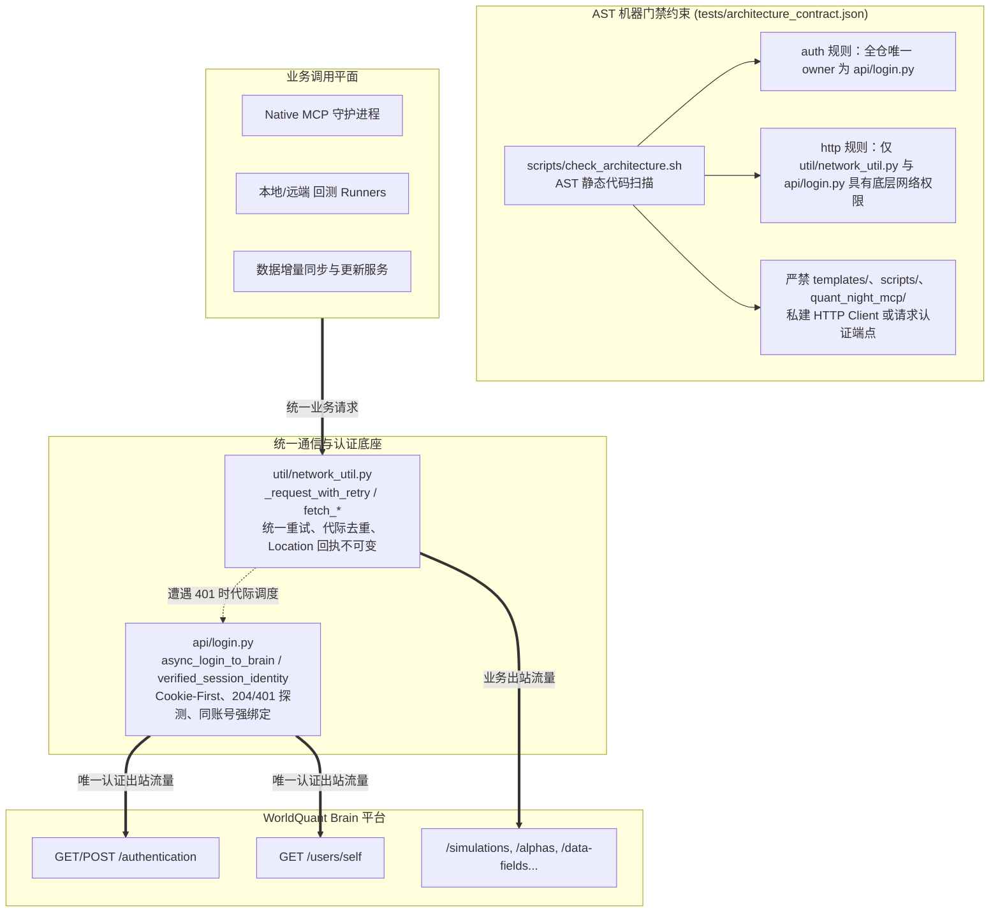
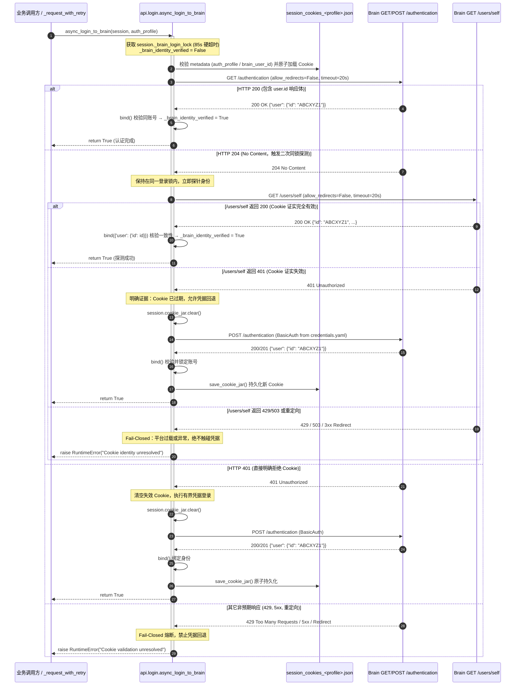
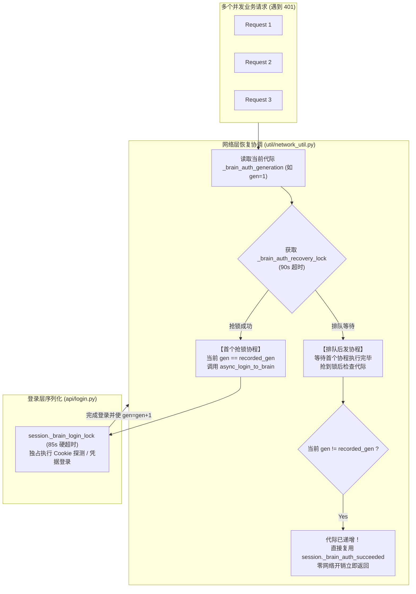
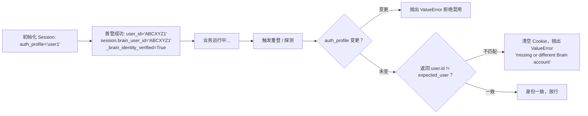

本文系统性剖析 QuantNight 量化系统的**底层平台通信与认证安全架构**，深入拆解 **Cookie-First 优先认证、204/401 两阶段有效性探测与恢复流程、代际防惊群会话锁治理、同账号身份强绑定机制、网络重试与回测回执保护解耦，以及 AST 机器门禁单真源约束**。

实际搭建时遇到的问题：
1. **多 Worker 并发重登惊群（Thundering Herd）**：瞬时并发请求遭遇 401 时同时发起账号密码登录，瞬时击穿平台频控（429）或触发安全风控（2FA/CAPTCHA 封号）；
2. **204 语义混淆与盲目覆盖**：平台认证端点在携带 Cookie 时常返回 `204 No Content`，若盲目视为成功或失败，会导致无用户身份或无意义的凭据反复刷新；
3. **跨账号凭据与 Cookie 漂移**：多 profile（如 `user1`、`user2`）切换或并发时，Cookie 与凭据混乱，导致回测与资产归属污染；
4. **认证刷新破坏写操作幂等**：网络中断或 401 恢复时盲目重试，将已提交成功的 `POST /simulations` 再次重复提交，耗尽每日回测配额；
5. **架构旁路丛生**：各业务脚本私建 HTTP 客户端或硬编码 BasicAuth，导致日志泄漏密码、代理规则失灵。

QuantNight 通过 `api/login.py` 与 `util/network_util.py` 的精细分层协作，彻底解决了上述工程隐患。

---

## 1. 认证安全威胁模型与单真源（SSOT）门禁

在 QuantNight 架构中，通信与认证层确立了绝对的**单真源（Single Source of Truth, SSOT）**与**零旁路（No Bypass）**原则。



### 1.1 AST 门禁契约约束
在 `tests/architecture_contract.json` 中，通过 AST 静态语法树严格锁定底层依赖边界：
* **认证唯一权**：`"auth": { "owners": ["api/login.py"] }`。全工程除 `api/login.py` 外，任何模块不得出现认证端点 URL、不得使用 `aiohttp.BasicAuth`、不得直接加载/解析 Cookie 密钥。
* **HTTP 底座约束**：`"http": { "owners": ["api/login.py", "util/network_util.py"] }`。业务代码严禁私自调用 `requests` 或裸调 `aiohttp.ClientSession`。
* **禁止反向依赖（`forbidden_imports`）**：`api/login.py` 与 `util/network_util.py` 严禁反向导入任何业务层模块（如 `templates`、`api.simulation`、`scripts`、`quant_night_mcp` 等），杜绝循环引用与逻辑污染。

---

## 2. Cookie-First 优先认证架构与元数据防御

频繁向平台发送明文凭据（HTTP BasicAuth）是极高危行为，极易触发平台验证码或每日登录限流。QuantNight 核心采用 **Cookie-First（本地 Cookie 优先复用）** 机制。

### 2.1 Cookie 文件结构与元数据校验
本地 Cookie 按账号 profile 独立持久化存储为 `session_cookies_<profile>.json`：
```json
{
  "cookies": [
    {
      "key": "session",
      "value": "s%3A...",
      "domain": ".worldquantbrain.com",
      "path": "/"
    }
  ],
  "metadata": {
    "auth_profile": "user1",
    "brain_user_id": "ABCXYZ1"
  }
}
```

在加载持久化 Cookie 时，`api/login.py` 实施三道**原子级元数据前置检查**：
1. **Profile 一致性校验**：检查文件内 `metadata.auth_profile` 是否与调用方传入的 `auth_profile` 严格一致；
2. **账号 ID 一致性校验**：若会话对象已有绑定的 `brain_user_id`，比对文件内 `metadata.brain_user_id`；若不匹配，坚决拒绝读取并抛出 `ValueError`，防止在多 profile 混用场景下 Cookie 串用；
3. **格式全量预校验**：在触碰活体 `session.cookie_jar` 之前，必须在内存中全量校验所有 Cookie 项的 `domain`、`path` 与 URL 合法性。任意一项损坏均回退，杜绝中间态污染。

---

## 3. 204 / 401 两阶段有效性探测与恢复流程（核心时序）

WorldQuant Brain 平台的认证接口存在独特的 HTTP 语义特征：**当请求携带有效 Cookie 访问 `GET /authentication` 时，平台通常返回 `204 No Content`，而不返回任何用户信息响应体**。

若仅看状态码，`204` 既不包含用户信息以供校验，也不能排除 Cookie 处于受限状态。若直接当作失败回退账号密码，会导致高频暴力登录；若直接当作成功，系统又丢失了当前登录的真实 `user_id`。

QuantNight 设计了精密的 **204 / 401 两阶段有效性探测机制**：

### 3.1 认证探测与恢复时序图



### 3.2 流程深度剖析与边界防护
1. **严格禁止重定向（`allow_redirects=False`）**：
   平台在认证失败或遇到 SSO 拦截时，常常会 302 重定向到前端登录落地页。如果客户端自动跟随重定向，将收到 HTTP 200 的 HTML 页面，导致 JSON 解析崩溃或误判登录成功。QuantNight 显式禁止跟随重定向，一旦探测到重定向历史（`response.history`），立即熔断。
2. **Fail-Closed 闭环哲学**：
   只有在探测收到**明确的 HTTP 401** 时，才被视为“凭据已过期且允许刷新”。如果收到 `429 Too Many Requests`、`503 Service Unavailable` 或网络超时，系统坚决认定为“平台侧或网络侧瞬态异常”，**严禁降级执行凭据回退**！这一设计彻底避免了在平台限流时用明文密码反复发起攻击，保护账号安全。

---

## 4. 并发治理与代际防惊群（Anti-Thundering Herd）

在回测与数据抓取的大规模并发场景下，十数个协程可能同时在执行请求。一旦原 Cookie 在某个时刻失效，所有协程将在同一微秒收到 HTTP 401。

QuantNight 实现了**双层锁机制 + 代际计数器（Generation Counter）**，完美杜绝了惊群重登风暴：



### 4.1 会话级登录锁（`_brain_login_lock`）
在 `api/login.py` 中，每个 `aiohttp.ClientSession` 绑定一个 `_brain_login_lock`，外覆 `asyncio.timeout(85)` 硬超时保护。它确保在单个 ClientSession 内部，无论多少上层任务并发调用 `async_login_to_brain`，实际执行探测与登录的永远只有一个协程，其余协程排队等待。

### 4.2 网络层代际机制（`_brain_auth_generation`）
在 `util/network_util.py` 中，单纯排队还不够——如果排队的 10 个协程在锁释放后依次再去调一遍登录，仍然会造成多达 10 次不必要的网络登录。
为此，引入了代际计数器机制：
1. 协程进入恢复前，记录当前 `generation = getattr(session, '_brain_auth_generation', 0)`；
2. 首个抢到 `_brain_auth_recovery_lock` 的协程完成登录后，将结果写入 `_brain_auth_succeeded`，并将代际递增：
   ```python
   session._brain_auth_succeeded = success
   session._brain_auth_generation = generation + 1
   ```
3. 后续排队的协程被唤醒并拿到锁后，对比当前代际与进入时的代际：
   ```python
   if getattr(session, '_brain_auth_generation', 0) != generation:
       # 代际已变，代表前任协程已成功/失败完成了修复，直接复用其结论！
       success = getattr(session, '_brain_auth_succeeded', False) is True
   ```
这一机制将并发 401 发生时的登录网络请求数**从 $O(N)$ 彻底压缩为 $O(1)$**。

---

## 5. 同账号身份强绑定与防漂移（Identity Pinning）

自动化量化系统中最隐蔽、后果最严重的 Bug 之一，是在配置切换、重登或凭据更新时，**会话上下文悄悄变成了另一个账号的身份**。这会导致 Alpha 被提交至错误账户，或使用错误账户的配额，甚至导致跨账户持仓信息泄露。

QuantNight 实现了全链路的**身份固定（Identity Pinning）**保护：



### 5.1 验证态方法门卫（`verified_session_identity`）
在 `api/login.py` 中，提供权威函数 `verified_session_identity(session)`：
```python
def verified_session_identity(session):
    identity = (getattr(session, 'auth_profile', None), getattr(session, 'brain_user_id', None))
    if (getattr(session, 'closed', True)
            or getattr(session, '_brain_login_in_progress', False)
            or getattr(session, '_brain_identity_verified', None) is False
            or not all(isinstance(value, str) and value.strip() for value in identity)):
        raise ValueError('Verified authenticated Brain session identity required')
    return identity
```
业务层和网络重试层在处理敏感操作前，通过调用此函数，能够以纳秒级速度核实当前会话是否处于“认证进行中”或“身份未验证”状态，彻底拦截未决状态下的脏读与脏写。

---

## 6. 与网络重试层及回测回执的解耦协作

认证层与网络传输层（`util/network_util.py`）有着极其精妙的协作边界：**网络层全透明处理认证失效，但认证层绝对不碰回执与业务幂等**。

### 6.1 401 透明捕获与单次静默恢复
在 `_request_with_retry` 中，业务发起 `GET` / `POST` 请求。若平台返回 401：
* 网络层标记 `auth_attempted = True`，并在整个请求生命周期内**仅允许触发一次**自动认证恢复；
* 恢复成功后，网络层以完全相同的新 Cookie 状态原地重试当前请求，业务方完全无感知；
* 若重试依然 401，立即向上抛出 `FetchFailedError(status=401)`，坚决不再循环自旋。

### 6.2 回执不可变性与写操作防重（No Duplicate POST）
在回测任务派发（`POST /simulations`）时，平台的交互逻辑是：接受回测请求后返回 `HTTP 201 Created`，并在响应头中包含 `Location: /simulations/<sim_id>`。
* **回执神圣不可侵犯**：一旦客户端收到了 `Location`，该回执就被视为不可逆的业务契约并立即持久化。
* **严禁因 401 重发 POST**：如果在获取 `Location` 后的轮询进度阶段遇到了 401 或网络中断，系统在刷新认证后，**只能沿原 `Location` URL 发起 `GET` 查询**，绝对禁止重新发起 `POST`！这从物理上杜绝了回测任务重复提交与资源浪费。

---

## 7. 异常分类、错误诊断与信息安全脱敏

在长周期自治系统中，日志既是排错的唯一抓手，也是密钥泄露的最大隐患。

### 7.1 智能异常分类（区分网络与凭据）
`api/login.py` 实现了 `looks_like_network_error(exc)`：
* 精确识别 `ConnectionRefusedError`、`TimeoutError`、`ServerDisconnectedError`、DNS 解析失败与代理异常；
* **清晰分流**：当由于代理挂掉或网络波动导致请求断开时，系统在诊断中明确标记为网络类错误，绝不误报为“用户凭据失效”或“账号被封”，避免诱导管理员去改动正确的密码配置。

### 7.2 日志脱敏流水线（Redaction Engine）
在 `util/network_util.py` 中，内建了高性能脱敏正则与上下文过滤：
```python
_LOG_CREDENTIAL = re.compile(
    r"(?i)([\"']?\b(?:authorization|cookies?|password|passwd|secret|"
    r"app[_ -]?secret|api[_ -]?key|access[_ -]?token|refresh[_ -]?token|token)"
    r"[\"']?\s*[:=]\s*)"
    r"(?:\"(?:\\.|[^\"\\])*\"|'(?:\\.|[^'\\])*'|(?:Bearer|Basic)\s+[^\s,;}&]+|[^\s,;}&]+)")
```
* **全要素清洗**：所有打印到终端、日志文件或上报监控的 URL、请求头、错误堆栈中，凡是包含 BasicAuth、Bearer Token、Cookie、飞书 Webhook Key 等字段的内容，统一被替换为 `<redacted>`；
* **堆栈干净打印**：`exception_stack(exc)` 在递归解析异常链时，只保留帧文件与行号，剥离局部变量字典，杜绝配置对象泄露。

---

## 8. 生产验收与架构演进启示

通过 `bash scripts/check_architecture.sh`，QuantNight 将这套认证通信设计固化为自动门禁：

```bash
=== 架构边界门禁检查 ===
[HTTP Check] 扫描全仓 HTTP 调用...
  -> 验证 util/network_util.py 与 api/login.py 唯一所有权: PASS
[Auth Check] 扫描全仓认证调用...
  -> 验证 aiohttp.BasicAuth 仅在 api/login.py 中调用: PASS
[Import Check] 扫描核心底座反向依赖...
  -> api/login.py 与 util/network_util.py 无非法业务反向导入: PASS
所有门禁校验通过！
```

### 核心架构总结

| 机制模块             | 解决的痛点               | 实现手段                                                            |
| ---------------- | ------------------- | --------------------------------------------------------------- |
| **Cookie-First** | 频繁明文传输密码触发平台 429/风控 | 本地独立 profile Cookie 持久化与元数据前置校验                                 |
| **204 同锁探测**     | 平台返回 204 无响应体导致身份丢失 | 同一登录锁内立即探测 `GET /users/self`，401 降级，429/5xx Fail-Closed         |
| **代际恢复锁**        | 高并发下 401 引发惊群重登风暴   | `_brain_auth_recovery_lock` + `_brain_auth_generation`，单次重登多方复用 |
| **身份强绑定**        | 长期运行或并发时账号串号漂移      | `verified_session_identity` 门卫，校验 `profile` 与 `user_id` 双重一致性   |
| **回执保护**         | 认证恢复后重复提交消耗配额       | 严格区分数据平面与控制平面，`Location` 回执不可逆，绝不因 401 重发 POST                  |
| **AST 契约门禁**     | 业务代码随意旁路认证引发混乱      | 静态扫描禁止任何模块绕过 `api/login.py` 与 `util/network_util.py`            |

QuantNight 的通信与认证架构表明：**真正高可靠的量化系统，其稳固性并非来自对平台“一切正常”的理想假设，而是来自对网络抖动、平台反爬语义、并发竞争与会话漂移等极端边界场景下，极其克制、严密且 Fail-Closed 的防御性时序设计。**
