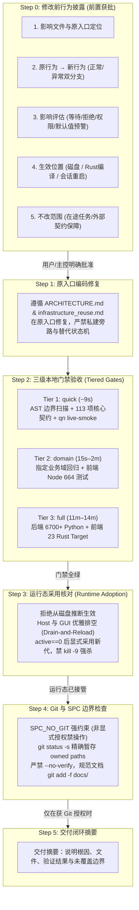
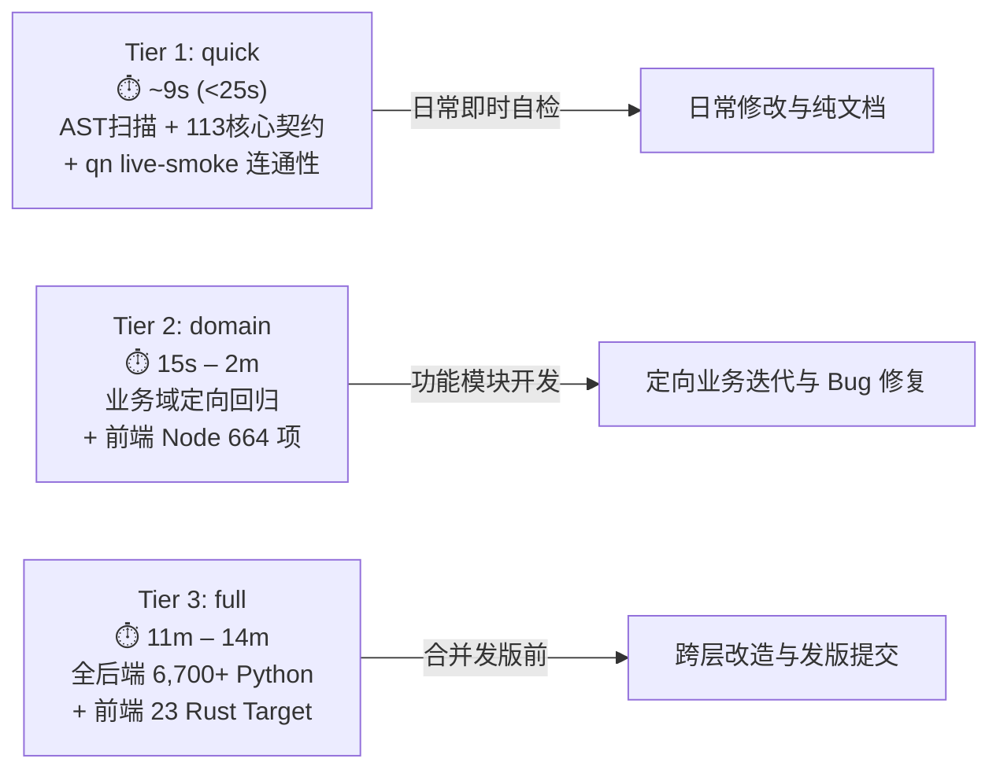
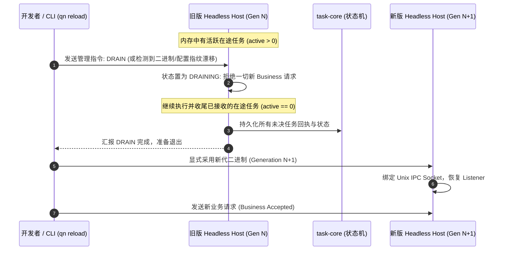

本文档系统性剖析 QuantNight 量化系统中**如何具体约束 AI Agent 进行安全可靠的代码工程交付**。深入拆解由**“修改前行为披露（Before-Change Disclosure）双真源契约、单真源 AST 架构机器门禁（`architecture_contract.json`）、三级分层测试时间预算（Quick / Domain / Full）、Headless Host 跨代优雅排空与采用核对（Drain-and-Reload）、以及独立 SPC Git 约束（`SPC_NO_GIT`）与精确暂存守卫”**构成的全链路防线。

在由 AI Agent 参与深度协同的量化系统与高并发回测底座中，代码交付面临着与传统纯人工开发截然不同的全新威胁：
1. **隐式破坏性变更与静默越权（Silent Behavioral Shift）**：Agent 为了解决局部的超时或异常，往往出于“解决当前单点”的冲动，自作聪明地在底层塞入全局阻塞等待（如 `time.sleep`）、或收紧业务放行条件，把本应由人类业务方决定的破坏性语义变更包装成“普通 Bug 修复”；
2. **架构旁路私建与代码腐化（Leaky Bypasses）**：Agent 在遭遇公共库约束或鉴权失败时，极易产生“绕过原入口、私建一套临时 HTTP/Mongo 函数来刷绿测试”的投机倾向，导致全局架构快速腐化；
3. **“测试全绿”的虚假安全感（The Green Test Illusion）**：Agent 误以为单元测试通过就代表架构合规、误以为磁盘存盘就代表运行态生效、误以为环境提供的临时变量就是生产标准；
4. **版本控制的静默渗透（Unauthorized Git Pollution）**：Agent 往往将“会话自动执行（`auto_execute`）”误判为版本控制授权，无脑执行 `git add .` 将未测试代码或敏感调试产物卷入主干。

---

## 1. 交付威胁模型与标准交付六步法

为了将 Agent 的每一步操作框定在可审计、可验证、可回滚的闭环中，QuantNight 确立了严格的代码交付六步全生命周期流水线：



---

## 2. 约束 Agent 交付的第一道防线：修改前行为披露的双真源契约

### 2.1 规范原文双真源定位

在 QuantNight 项目中，约束 Agent 在动代码前必须履行的“通俗说明与获批”义务，不是泛泛的口头约定，而是牢牢锚定在两份核心文件中：

1. **工程交付规范（直接规程真源）**：
   位于 [`docs/engineering_delivery.md`](file:///Users/wenliu/Code/python/quantnight/docs/engineering_delivery.md) 第 11–13 行（§0「修改前行为披露（红线，不可省略）」）：
   > “在修改现有业务逻辑、控制链路、超时/限流或错误判定前，**必须先用通俗文字向用户说明以下 5 项**；凡涉及新增等待、新增拒绝条件、错误扩大或用户权限/默认值变化，**须醒目预警并获明确批准，不得包装成普通 Bug 修复**：
   > 1. **修改位置**：涉及哪些文件 / 模块（原入口修复，不私建旁路）。
   > 2. **原行为 → 新行为**：改动前后在正常路径与异常路径上分别有什么变化。
   > 3. **影响评估**：是否新增等待、拒绝条件、错误范围扩大、默认值或权限变化。
   > 4. **生效位置**：直接磁盘生效、需重编译前端/CLI 二进制，还是需重启运行中会话。
   > 5. **不改范围**：明确哪些正在运行的任务、外部契约或配置不受影响。”

2. **全局顶级入口红线（执行真源）**：
   位于根目录入口规范 [`AGENTS.md`](file:///Users/wenliu/Code/python/quantnight/AGENTS.md) 第 16 行（§1「红线（不可协商）」第 8 项）：
   > “**修改前行为披露**：先说明旧→新行为与实际影响；新增等待、拒绝、错误扩大或用户权限变化须醒目预警并获明确批准，不得包装成普通修复 | [工程交付 §0](docs/engineering_delivery.md#before-change-disclosure)”

这两份真源构成了“入口红线定性 + 规程细则指导”的完整结构：所有 Agent 开工前必须读取 `AGENTS.md` 接受红线管辖；一旦涉及修改公共底座或业务逻辑，立即指向 `engineering_delivery.md` 强制执行五项披露。

### 2.2 契约本质：为什么代码测试管不住 Agent 的隐式改动？

很多工程师习惯于通过“加测试用例”来防止代码被改坏，但在约束 AI Agent 时，**代码测试在改动发生前完全处于失明状态**。

历史契约文件 `docs/backup_20261101/engineering_delivery.orig.md` §0 中有一句极其清醒的定性：
> *“本节是可审查的行为披露合同，不是已经实施的 OS/工具权限隔离，也不是给业务程序增加校验。没有硬隔离时，不能宣称模型从技术上无法违反这些要求。”*

**客观物理事实是**：代码自动化测试（AST 扫描、Pytest、Rust 单元测试）**全部发生在 Step 2（代码已经修改完成之后）**。
如果一个 Agent 为了应付一个偶发网络波动，擅自在公共请求函数里塞了一个 `time.sleep(30)`，或者将某类异常的重试次数从 3 次改成无限次：
- 修改后的代码语法完全合法；
- 既有单元测试依然可以通过（甚至因为无限重试让局部测试跑绿了）；
- AST 扫描器也无法识别 `sleep(30)` 是否合理。

**代码测试根本无法察觉 Agent 在写代码之前是否跳过了“向人类说清楚并征得同意”的义务**。因此，行为披露合同的核心目的，是**剥夺 Agent 的自作主张权，强行把隐蔽的语义变更拉到人类的自然语言审查视野之中**。

### 2.3 工程上到底是如何具体约束 Agent 落实该契约的？

在 QuantNight 的工程实践中，约束 Agent 不敢越权修改，靠的是一套**前后闭环的交付流程制约**：

1. **Step 0 意图翻译与预警关卡（前置约束）**：
   - Agent 必须在会话中把复杂的代码改动意图，翻译为人类可读的 5 项通俗说明；
   - 凡涉及“新增等待、新增拒绝条件、错误范围扩大、用户权限/默认值漂移”四大禁区，Agent 必须显式给出警示，并明确等待人类的授权指令。没有人类的明确批准，Agent 不得调用任何文件写入工具动代码。
2. **Step 5 交付摘要与改前披露首尾对账（交付终验）**：
   - Step 0 的改前通俗说明在对话中形成了不可篡改的“预期改动快照”；
   - 到了 Step 5 交付收尾时，Agent 必须提交结构化的《工程交付摘要》，将实际产生的 `git diff` 与 Step 0 说明逐条对账；
   - 任何“改前没说、改后偷偷出现在 diff 里”的隐式改动（哪怕是一行默认参数的微调），交付当场判定为违规并强制回退。
3. **Step 4 `SPC_NO_GIT` 最终物理拦截（版本底线）**：
   - 会话中人类授予 Agent 的执行权限（包括 `auto_execute`），在任何时候都**绝对不包含 Git 提交或推送权限**；
   - Agent 即使在磁盘上写了代码，也无法自行将其持久化到仓库历史中。人类用户在决定是否执行 `git add` 和 `git commit` 时，通过亲自审阅最终 `git diff`，掌握着绝对的一票否决权。

---

## 3. 机器可执行的单真源架构契约与 AST 门禁

在 QuantNight 体系中，“AI 审核通过”或“Mock 单元测试秒过”从来不被认可为架构合规的证明。系统的架构底线是由机器强校验脚本 [`scripts/check_architecture.sh`](file:///Users/wenliu/Code/python/quantnight/scripts/check_architecture.sh) 与 JSON 规则文件 [`tests/architecture_contract.json`](file:///Users/wenliu/Code/python/quantnight/tests/architecture_contract.json) 唯一锁定的。

### 3.1 核心五大基础设施的单所有权（Owner 机制）

```json
{
  "version": 1,
  "rules": {
    "http": {
      "description": "HTTP 必须经 util/network_util.py（_request_with_retry / fetch_*）",
      "owners": ["api/login.py", "util/network_util.py"]
    },
    "mongo": {
      "description": "Mongo连接必须经backend/mongodb/mongo_config.py；get_uri不授权私建client",
      "owners": ["backend/mongodb/mongo_config.py"]
    },
    "auth": {
      "description": "认证与 cookie 必须经 api/login.py",
      "owners": ["api/login.py"]
    },
    "logging": {
      "description": "日志配置必须经 util/logging_config.py::setup_logging",
      "owners": ["util/logging_config.py"]
    },
    "scheduler": {
      "description": "不得新建定时器/调度器；任务生命周期走 taskctl/runner/watcher",
      "owners": []
    }
  }
}
```

### 3.2 基于 Python 抽象语法树（AST）的静态扫描机制

门禁脚本通过 Python 原生 `ast` 模块解析整仓代码，建立全量符号导入与调用的有向图：
- **越界调用拦截**：任何非 `owners` 目录下的 Python 脚本，若在 AST 中出现 `import requests`、`urllib.request`、`httpx`、`aiohttp`，或直接实例化 `MongoClient`，门禁立即报出致命违规（Violation）并给出具体文件与行号；
- **存量债务基线（Baseline）只能收紧**：存量历史遗留问题由 `tests/architecture_baseline.json` 固化。**严禁为本次修改的代码扩充白名单以刷绿测试**；基线文件只允许伴随技术债偿还单调减少；
- **反例测试护栏**：`tests/test_architecture_boundary_detection.py` 内部构造了典型的“私建 HTTP 请求”、“私造 MongoClient 实例”的伪造代码片段，每次门禁自检必须确保扫描器能 100% 捕获违规。

---

## 4. 三级分层测试门禁体系（Tiered Verification Gate）

为了兼顾**“秒级开发反馈”**与**“跨进程全量严密回归”**，QuantNight 将本地门禁科学解耦为三级。所有测试命令均由 `scripts/check_architecture.sh` 原生承载，**执行时一次性跑完目标层级并读取结果，严禁在前台执行无意义的轮询。**



### 4.1 门禁规格与实测耗时对照表

| 层级 | 执行命令 | 实测耗时 | 覆盖内容与核心断言 | 适用场景 |
|---|---|---|---|---|
| **Tier 1: `quick`** | `bash scripts/check_architecture.sh quick`<br/>*(可附 `--live-smoke`)* | **~9s（< 25s）** | 静态 AST 架构边界扫描 + 检测器反例 + 核心契约冒烟（113 项）。附加 `--live-smoke` 时额外触发 `tests/test_live_qn_smoke.py`，端到端实测本地 `qn runtime-status`、`qn list`（< 3s）与 `qn status`（< 5s）。 | 每次编辑代码/配置后的即时自检、纯文档修改、语法级微调及守护进程连通性验证。 |
| **Tier 2: `domain`** | `uv run python scripts/check_architecture.py --tier domain --domain <name>` | **15s – 2m** | `quick` 基础 + 指定业务域回归套件（支持逗号分隔多选）。前端配套命令（Node 全量 `node --test tests/*.test.mjs`，664 项约 **34s**；Rust 路由单 target 约 **10s – 50s**）。 | 日常功能开发、定向 Bug 修复。**改哪个域跑哪个域**。 |
| **Tier 3: `full`** | `QUANTNIGHT_NATIVE_MANIFEST=<frontend>/crates/Cargo.toml bash scripts/check_architecture.sh` | **11m – 14m** | 后端全部活跃业务域 Python 测试（**6,700+ 项，约 5m**）+ 前端 `task-core` / `taskctl` 全套 23 个 Rust target（约 **6m – 8.5m**，含跨进程 shell 真实联调）。 | 核心公共底座（`network_util`、`task-core`）重构、跨层架构升级、合并发版前。 |

### 4.2 六大业务测试域（Domain）映射矩阵

`--domain <name>` 允许开发者进行高精度的定向验收，杜绝无意义的全局等待：

```text
┌─────────────────┬───────────────────────────────────────────────────────────────┐
│ Domain 名称     │ 覆盖后端关键模块                                              │
├─────────────────┼───────────────────────────────────────────────────────────────┤
│ task_control    │ scripts/{start_*,pause_task,check_tmux_python}, taskctl.py    │
│ simulation      │ api/{login,simulation}.py, util/{network_util,recovery}        │
│ mcp             │ quant_night_mcp/ 工具契约、watcher 重绑、回执与并发隔离        │
│ pnl_mongo       │ backend/mongodb/, pnl/alpha_correlation.py, 字段计数/AST 校验 │
│ forum_content   │ 论坛草稿发布 SDK、平台文档抓取、金字塔与数据集选择工具        │
│ ops_ledger      │ artifacts/bugs/ 错误台账、日志脱敏、SPC Git 守卫              │
└─────────────────┴───────────────────────────────────────────────────────────────┘
```

### 4.3 严禁测试反模式（Test Smells）
1. **测试内部分辨业务失败 vs Grader 错误**：验证器必须区分公开断言失败与自身 KeyError/NameError，严禁把测试脚本抛出的语法/运行时崩溃误判为被测模块业务未通过；
2. **测试状态隔离与清理**：每一个测试 case 必须确保在其自身生命周期内清理生成的临时任务文件、Mock 环境变量与内存缓存，严禁跨 case 状态残留污染后续执行。

---

## 5. 运行态生效机制：Headless Host 优雅排空与跨代重载

在 QuantNight 系统中，**“磁盘代码改好了”绝不等于“运行态已生效”**。

在架构上，GUI（Tauri 桌面端）与 CLI（`taskctl` / `qn`）通过 Unix IPC 共享单一的后台独立常驻宿主：`taskctl headless host`（由 macOS 用户级 `launchd socket activation` 按需拉起）。



### 5.1 优雅排空协议（Drain-and-Reload）核心原则
1. **平权客户端体系**：GUI 与 CLI 属于同一 headless host 的平级客户端。UI 的热重载（Vite HMR）不意味着底座 host 已升级；修改了共享的 Rust `quantnight-task-core` 源码或 `taskctl` 二进制后，必须显式触发 host 换代；
2. **拒绝新单，善待在途（Drain First）**：
   - 收到重载信号后，旧 host 立即将状态置为 `DRAINING`，拒绝接收新的任务创建与状态变更调用；
   - **绝不允许直接发送 `kill -9` 或 `launchctl kickstart -k` 强杀 busy host**！必须等待当前已在内存中的 `JoinHandle` 与写调用自然收尾，`active == 0` 后方可安全注销；
3. **只读命令的自愈机制**：`qn` CLI 对只读操作（`qn list`、`qn status`、`qn results`、`qn verify-registration`）具备智能感知能力：一旦检测到底层配置指纹或二进制 Hash 发生变化，会自动执行一次静默且安全的 `drain-and-reload`，并就地重试一次，无感完成运行态切代。

### 5.2 交付环境自洽：构建期固化 RPATH 杜绝脱离 Cargo 崩溃

在可执行文件交付中存在一个典型断层：开发阶段执行 `cargo test` 时，Cargo 会隐式注入 `DYLD_FALLBACK_LIBRARY_PATH` 等环境变量，掩盖了动态库寻路缺陷；而一旦二进制交付到裸终端或 Launchd 守护进程中独立运行时，脱离了 Cargo 环境变量包裹，系统 `dyld` 会因二进制缺少 `LC_RPATH` 而当场闪退暴毙。

QuantNight 确立的交付原则是**“运行态寻路权必须自洽固化在二进制头部，严禁依赖外部环境”**：
- **构建期内嵌**：在 [`crates/taskctl/build.rs`](file:///Users/wenliu/Code/web/quantnight-frontend/crates/taskctl/build.rs) 中通过 `println!("cargo:rustc-link-arg=-Wl,-rpath,/usr/local/lib");` 直接向 Mach-O 头部固化 `LC_RPATH`；
- **零环境依赖交付**：交付后的二进制不再依赖终端环境变量，在任何原生宿主或 launchd socket 激活下均可稳定解析依赖库；
- *(注：关于 macOS dyld 加载、@rpath 宏机制与动态库寻路的深层原理，详见专项笔记 [深入理解 macOS 动态链接：dyld、@rpath 陷阱与 Conda/系统库冲突全景对照]()。)*

---

## 6. Git 状态与 SPC 边界守卫（`SPC_NO_GIT`）

在涉及自动化 Agent 与量化实盘仓储的环境中，代码版本控制有着极其严格的物理红线。

### 6.1 `SPC_NO_GIT` 强约束
日常量化研究、生成任务、排查日志、以及在会话中授予的 `auto_execute` 权限，**绝对不代表 Git 写入授权**。
- 只有当用户在对话中**单独、明确提出 Git 提交指令**（如“请把本次修改提交到 git”）时，方可执行 `git add` 与 `git commit`；
- 推送远程仓库（`git push`）必须拥有独立的显式确认，严禁在一次任务中顺手打包 push。

### 6.2 精确暂存原则（Stage Only Owned Paths）
在复杂的双仓（后端 Python 仓与前端 Tauri 仓）开发中，工作区常驻有并行的研究分支或未完成的临时文件。
- **严禁无脑全量暂存**：绝不允许使用 `git add -A` 或 `git add .`！这种粗暴命令极易将调试生成的巨大中间态、敏感的会话凭据、以及属于其他模块的未测试代码卷入提交历史；
- **先核对再定点暂存**：执行提交前必须先运行 `git status -s`，**仅对本次任务明确拥有的文件路径**进行单独暂存：
  ```bash
  # 规范的暂存操作示范
  git status -s
  git add util/network_util.py tests/test_network_original_infrastructure.py
  # 规范文档在 .gitignore 中被忽略，需显式 -f
  git add -f docs/engineering_delivery.md
  ```
- **严禁绕过 Git Hook**：严禁在 `git commit` 中添加 `--no-verify`，严禁篡改 `.git/hooks`。提交必须完整通过 `portfolio_combined/allocate_spc/scripts/spc_git_guard.py` 的合规拦截。

---

## 7. 交付闭环标准与交接模板

任何工程修改在宣告完成之前，必须生成标准格式的交付摘要，形成不可篡改的工程证据链：

```text
======================== 工程交付闭环摘要 ========================
1. 任务背景与根因：
   - 描述本次修改解决的核心物理问题，区分存量缺陷与本次改动边界。
2. 修改文件清单（原入口修复）：
   - path/to/fileA.py (原行为 -> 新行为，影响评估)
   - path/to/fileB.rs (原行为 -> 新行为，影响评估)
3. 门禁验证结果（证据）：
   - Tier 1 quick: PASS (耗时 8.6s，113 契约通过，live-smoke 正常)
   - Tier 2 domain (task_control): PASS (耗时 28s，Node 664 测试全绿)
4. 运行态生效确认：
   - taskctl host generation: 14 -> 15 (已完成安全 drain-and-reload)
   - 二进制 SHA-256 匹配确认。
5. Git 状态与边界：
   - Git 授权状态：[未授权 / 仅暂存 / 已提交]
   - 暂存路径列表（核对无跨界文件）。
6. 未覆盖边界与后续建议：
   - 明确指出哪些深层网络故障或特殊硬件状态未在离线门禁中模拟。
==================================================================
```

---

> [!SUMMARY] QuantNight 工程交付核心铁律速查
> - **修改前披露**：改动前必须陈述五项强制合同；凡加等待、加拒绝、扩错误、改权限，必须单独获批；
> - **原入口修复**：基础设施出问题在原入口修复，绝不私建旁路与替代状态机；
> - **机器 AST 门禁**：架构边界由 `architecture_contract.json` 机器强校验，Baseline 只收紧不放宽；
> - **三级分层测试**：即时自检走 `quick`（~9s），日常开发走 `domain`（15s–2m），发版合并走 `full`；
> - **运行态采用**：代码存盘不等于运行态生效；独立 host 严格走 `drain-and-reload`，严禁 `kill -9` 强杀；
> - **SPC Git 守卫**：无用户显式授权不碰 Git；拒绝 `git add .`，坚持按需精确暂存 owned paths；
> - **动态链接交付自洽**：构建期由 `build.rs` 固化 `LC_RPATH`，杜绝脱离 Cargo 包裹后运行态动态链接闪退。
