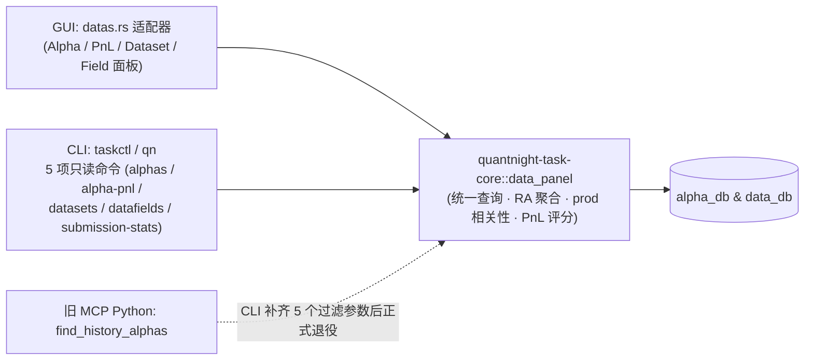
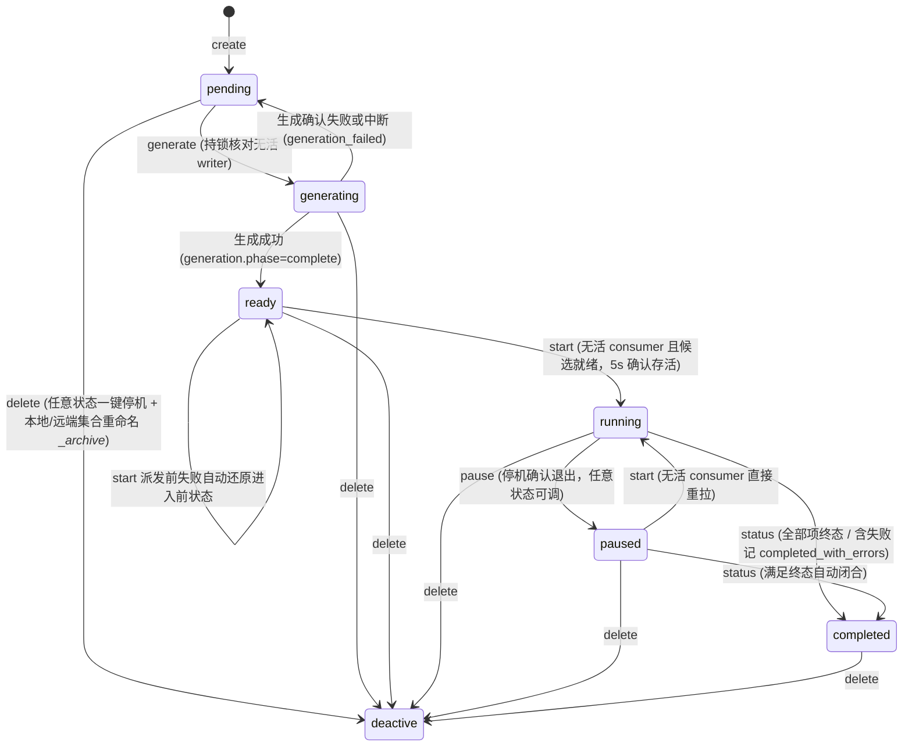

> 本文是 QuantNight GUI/CLI 统一架构系列的第二篇（接前篇 [《回测系统任务控制生命周期：入口、证据、故障分支与行为验收》（alpha20）](2026-10-31-alpha20.md)）。  
> 前篇确立了“GUI 与 CLI 共用 `quantnight-task-core` + 常驻 headless host + Unix IPC”的基础拓扑，方向本身是对的；但在随后由 GPT 主导的多轮维护中，系统逐步走偏——堆出了 9+ 状态、20+ 历史证明字段、27 字段快照比对和满篇防御性八股的 `SKILL.md`，反而造成任务频繁卡死。  
> 与其说这是一次“架构进化”，不如说是一次**把控制面从 GPT 过度防御的歪路上拉回正轨的纠偏与大扫除**（2026-11-17–19：初轮 AGY 诊断 → Pi 失败的重构尝试 → AGY 推倒收口），同时顺带将只读数据面板统一进 `task-core::data_panel`。关于开发与 AI 维护过程中暴露出的工程陷阱，详见配套复盘 [《用 AI 维护复杂控制面基础设施：六大工程陷阱》](2026-11-19-agent-infrastructure-pitfalls-2.md)。

---

## 1. 纠偏动因：从“走偏的防御体系”拉回正轨

在 `alpha20` 之后，GUI 与 CLI 虽然已经接到了同一个 Rust 核心，但长期由 GPT 增量修补出来的控制面反而越走越偏，积累了三类结构包袱：

1. **控制面状态与证明字段过度膨胀**：`launching`、`generation_unknown`、`syncing`、`deleting` 等中间态叠加 `stopConfirmedAt`、`launchSettledAttemptId`、V1/V2 暂停回执与 27 字段 CAS 快照，导致 `delete` / `pause` / `generate` 动辄因某项历史凭证缺失或超时读统计而卡死。
2. **只读数据面板与历史查询双端分裂**：任务控制虽然收拢进了 `task-core`，但 Alpha 查询、PnL、数据集面板仍分散在 GUI 独立数据池与 MCP Python 重写实现（`find_history_alphas`）中，同一查询长期维护两套逻辑。
3. **双仓构建与常驻宿主生命周期不透明**：macOS 下双 Cargo 工作区编译产物膨胀至 **56 GB**，`cargo test` 会覆盖磁盘 `taskctl` 二进制引发 `image_stale`，且旧报错提示与文档存在滞后误导。

---

## 2. 纠偏原则：三条核心铁律

本次重构将整个 `gui/cli/core` 的控制逻辑强行收敛为人类 1 分钟即可核对验收的 **三条铁律**（真源见 `docs/task_control_lifecycle.md`）：

1. **只认“当前真实进程 + 数据集合”，不认历史证明字段**
   - **`start` / `generate`**：只核验当前执行端是否存在存活 `consumer` / `writer` 进程（存在则拒绝或幂等返回 `already_running`；不存在且候选数据就绪即直接启动）。彻底移除 `stopConfirmedAt`、`launchSettledAttemptId`、`acceptedObservation` 等历史门禁；派发前失败自动还原进入前状态。
   - **`pause` / `delete`**：**任意状态下均可直接调用**。持本地 `MissionLocks` 文件锁 → 停掉该任务实际执行进程并确认退出 → `pause` 落为 `paused`（生成中断收敛为 `pending`）；`delete` 直接将远程（若有，含半途中断的 `syncing`）与本地候选集合重命名为 `<task>__archive_<taskId>` 并落为 `deactive`，不再因统计计数超时或缺少历史停止证明而卡死。
2. **顶层状态压缩回 6 个直观状态**
   - 正常生命周期只保留 6 态：`pending` → `generating` → `ready` → `running` → `paused` / `completed`（含 `completed_with_errors`）→ `deactive`。
   - 对数据库中可能残留的旧版状态（`launching`、`generation_unknown`、`syncing`、`deleting`、`generation_failed`），在读取（`list` / `status`）与操作流转中**按当前存活进程与集合实况自动归一**，绝不作为拒单门禁。
3. **并发安全只靠“本地文件锁 + 极简身份 CAS”**
   - 所有修改操作先获取 `.quantnight/mutators/<task>.lock`（同 inode `flock`）。
   - MongoDB CAS 彻底废除 27 字段全快照比对（`task_binding_query`）与 400 行历史事件重放器（`never_started_history`/`never_started_inventory`），只核对核心身份与版本五要素：**`(_id, name, status, isRemote, updatedAt)`**（启动收尾额外核对 `launchAttemptId`，生成过程额外核对 `generation.id`），防止改错同名新任务或并发踩踏。

---

## 3. 纠偏后的架构变化：6 态控制面与数据面板收拢

四层控制拓扑本身（`GUI / CLI / Watcher → RuntimeClient → launchd socket → taskctl headless host → Shell / tmux`）已在前篇 [alpha20 §1](2026-10-31-alpha20.md#1-四层控制拓扑与职责边界) 详述，此处不再重复。本次纠偏与收拢集中在**两处实质改动**：

### 3.1 能力收敛增量：数据面板并入 `task-core`

在 `alpha20` 中，非任务类 Alpha/PnL/Dataset 查询还保留在“GUI 独立数据池”，而 CLI 与 MCP 各自零散实现；本次通过 `quantnight-task-core::data_panel` 完成了**只读数据面的双端平权统一**：

### 3.2 极简 6 态生命周期流转图

- **自动归一机制**：`list` 与 `status` 刷新时若发现处于 `generating` / `generation_unknown` 且无存活 `mongo_datum` writer（并校验 `generation_owner` active scope 缺席），通过 `MissionLocks` + 5 字段身份 CAS 自动收敛为 `pending`（`generation.phase = "generation_failed"`）；旧状态 `launching` 在无存活消费者时呈现并归一为 `paused`。
- **关键字段精简**：控制面核心字段收拢为 **5 要素 CAS**（`_id, name, status, isRemote, updatedAt`）、`generation`（将生成进度与顶层状态解耦）、`launchAttemptId`（启动批次关联 `tmuxContext`）、`tmuxContext`（固定系统 `tmux -L default` 会话身份）与 `cleanup`（归档集合名 `<task>__archive_<taskId>`）。

---

## 4. 纠偏前后对照与后续隔离方向

| 维度 | 笔记（1）`alpha20`（10-31 → 11-08） | 笔记（2）`alpha27`（11-19 收口） |
|---|---|---|
| **核心主题** | 终结 GUI vs Python `taskctl.py` 双脑分叉与冷启动延迟 | 终结控制面历史证明链过载，实现状态简化与数据面统一 |
| **任务状态机** | 9+ 状态 + `launchSettledAttemptId` + `stopConfirmedAt` + 27 字段 CAS | **6 态极简模型** + 真实进程/集合唯一真源 + **5 字段极简身份 CAS** |
| **数据面板与查询** | GUI 非任务数据池保留；外部独立维护 `find_history_alphas` | **`task-core::data_panel` 统一 GUI/CLI 五大数据面板**；下线重复的 `find_history_alphas` |
| **Skill 与文档** | 长篇防御性 `SKILL.md`（399 行）解释内部约束 | `SKILL.md` 瘦身至 **68 行**，参数交由 CLI `--help` 自解释 |
| **工程构建体积** | macOS 默认 debug 碎片累计至 56 GB | `line-tables-only` + `split-debuginfo="off"` 压至 **~4.0 GB** |

### 后续演进点：研发期与研究期运行态隔离

在收尾阶段的 `own_jpn_grid144_auto_20261118` 实例中，虽然底层回测 consumer 独立健康跑完了 `144/144`，但在修改 `crates/task-core/` 源码至完成 reload 的 ~5 分钟窗口内，`server.rs::business_fresh` 的 `source_stale` 拦截导致并发研究会话的 `watch_quant_task.py` 立即 `OSError` 退出。后续有两条清晰的解耦路线：
1. **运行态隔离**：生产研究使用固定版本的 standalone `taskctl` 二进制，不再与工作区开发态 `taskctl-dev-binding.json` 共享同一源码指纹校验；
2. **Watcher 暂态容错**：让 `watch_quant_task.py` 识别 `source_stale` / `image_stale` / `host_draining` 时做有限退避重试，避免宿主重载窗口误杀在途监控。

---

> [!SUMMARY] 开发与收敛时间轴
> - **11-17 上午（AGY 诊断）**：**锁定“历史证明链”总病灶**；审计近 200 份清理回执定位 3 类真故障（远端 SUPER 缺 `status`、22,129 条候选读超时、`9f3fb8b` 已修项），确立“以真实进程存活为唯一真源”的简化方向；
> - **11-17 午后 – 11-18 上午（Pi 失败重构）**：**审计出 8 大跨层阻塞反例，但编码重构失败**；虽然找全了跨层反例并局部打通 `delete` 自动停进程与 `start` 三段结果拆解（隔离复验 55/55），但代码实际**净增 1,600+ 行**、不仅没删中间态和 27 字段 CAS 反而新增 `syncing` 禁删/禁落 `paused` 阻塞，又制造脚本拼接导致测试 220s 超时，最终未更新文档也未重载宿主便半途停工；
> - **11-18 下午 – 晚上（AGY 控制面瘦身与工程收口）**：**彻底落地 6 态模型与三条铁律**（前端 `bb70d9f` / 后端 `6e37e72`）；删掉 27 字段快照与 `never_started_*` 重放器，`delete` 任意状态停机归档、显式拆分 `archive-research`，抽取 `scripts/task_process_inventory.py` 解决 220s 测试超时；配置 `line-tables-only` + `split-debuginfo="off"` 将双端编译目录从 **56 GB 压至 ~4.0 GB**；同步精简 `SKILL.md`（399 → 68 行）及 4 个下游技能、重写 `docs/task_control_lifecycle.md`；
> - **11-19 上午 – 中午（数据面板大统一与工具链修复）**：**完成只读数据面统一并修正 `image_stale` 规范**；由 `task-core::data_panel`（2,862 行）统一 GUI/CLI 五大数据面板，CLI `alphas` 补齐 5 项过滤参数后正式下线 426 行冗余的 Python `find_history_alphas`（前端 `c6cdb41` / 后端 `b9f6854`）；修正 `cargo test` 覆盖二进制引发的 `image_stale` 报错与 `engineering_delivery.md` 虚构的 `qn reload` 描述（前端 `2a24135` / 后端 `832a0fc`），重启常驻宿主并跑通 `task_control`（2,213 项）、Node（741 项）与 live smoke 验收。
