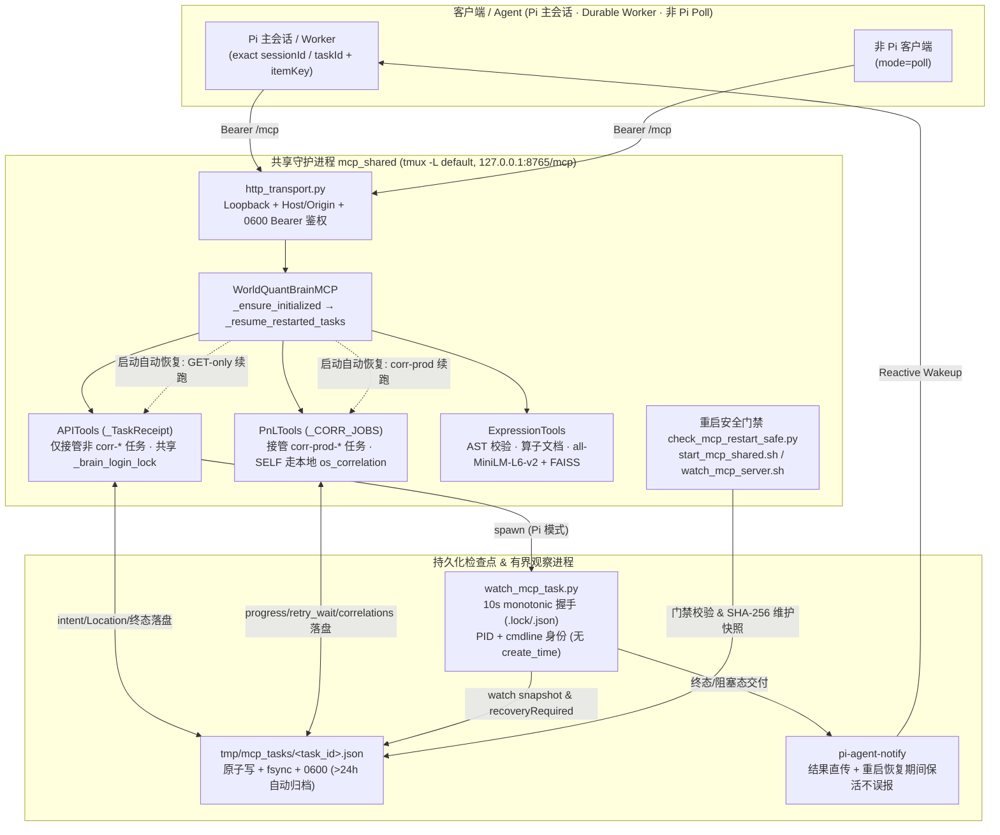
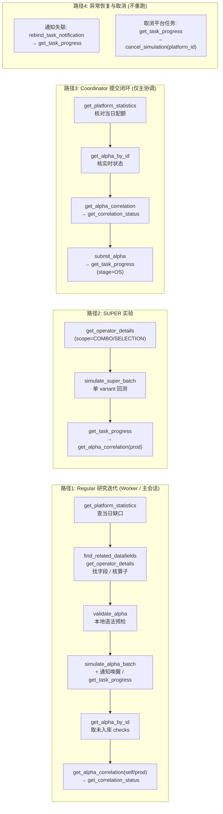

> 本文是 QuantNight 工程架构系列的 MCP 专题篇（与 GUI/CLI 控制面专题 [《任务控制生命周期》（alpha20）](2026-10-31-alpha20.md) 及 [《6 态极简控制面与数据面板统一》（alpha27）](2026-11-19-alpha27.md) 共同构成系统全貌）。  
> `task-core` 统一了桌面 GUI 与 `taskctl` CLI 的本地批处理控制面和只读数据面板，而 **`quant_night_mcp` 承担的则是平台在线交互网关 + Python 向量/AST 语义层 + Agent 事件驱动异步执行底座**。本文记录其定型后的整体架构、通知握手、跨重启无缝续跑机制，以及与 `task-core` 的职责分界。

---

## 1. 总体拓扑：为什么需要单一共享 MCP 守护进程

早期如果让每个 Pi 会话或 subagent 按需拉起独立 `stdio` MCP Server，会同时引发四个问题：每个进程加载 Python + `SentenceTransformer` + FAISS 占用大量内存、多个进程并发读写同一账号 Cookie 产生认证竞态、429 限流退避状态无法跨会话共享、以及会话退出后在途后台观察直接丢失。

因此，当前仓库唯一支持并在线运行的部署形态是：**运行在系统 `tmux -L default`（会话 `mcp_shared`）中的单一 Streamable HTTP 守护进程**（`http://127.0.0.1:8765/mcp`）：

### 核心基础设施约束
- **单一认证与传输复用**：所有平台 HTTP 请求统一经过 `APITools.session` + `api/login.py`（`session._brain_login_lock` 同账号 Cookie-First 认证）+ `util.network_util._request_with_retry`，绝不另起旁路 HTTP 循环或跨账号切换 Session。
- **启动门禁与凭证安全**：[`scripts/start_mcp_shared.sh`](scripts/start_mcp_shared.sh) 在启停前必须校验 `0600` Bearer 凭证文件（`~/.pi/agent/credentials/quantnight-mcp.authorization`）、`lsof` 端口归属与 `check_mcp_restart_safe.py` 业务门禁；源码 watchdog（`watch_mcp_server.sh`）绝不强制中断活跃任务。

---

## 2. 双端职责边界：MCP vs `task-core` (GUI/CLI)

目前 QuantNight 对外提供给 Agent 的工具已经形成非常稳定的**黄金分割线**：**「输入结构复杂 / 需平台实时在线会话 / 需常驻向量模型」走 MCP；「参数扁平 / 返回数据集庞大 / 多步批处理编排」走 CLI (`taskctl`)**。

| 业务域 | `task-core` (`taskctl` CLI / GUI) | 原生 MCP (`quant_night_mcp`) | 边界定型理由 |
|---|---|---|---|
| **回测执行** | `create / generate / sync / start / pause / delete / results`（6 态持久大批量任务） | `simulate_alpha_batch` / `simulate_super_batch` / `cancel_simulation` / `get_task_progress` | 多行 Python/FastExpr 与嵌套 `settings` 走 MCP JSON-RPC 零转义错误；万级候选跑批走 `task-core` + `tmux` |
| **Alpha 详情** | `taskctl alphas` / `alpha-pnl`（纯查本地库，可过滤排序、`--output` 落盘） | `get_alpha_by_id`（本地 4 表省流缓存 + **平台 API 实时兜底**） | 保留 4 表缓存可保护老 Alpha 不打爆平台 429 限流，同时对未入库新 Alpha 透明返回同一原始 JSON Schema |
| **统计面板** | `taskctl submission-stats`（本地 `alpha_submitted` 多月历史趋势） | `get_platform_statistics`（直连平台实时当日提交与 Pyramid 缺口） | 实时配额核对 vs 本地历史聚合，数据源互补 |
| **字段搜索** | `taskctl datasets` / `datafields`（本地 MongoDB 结构化过滤与覆盖率） | `find_related_datafields`（`all-MiniLM-L6-v2` + FAISS 向量语义检索） | Rust 端不适合强塞 PyTorch/FAISS/pickle 依赖；常驻 MCP 进程可一次加载向量模型驻留复用 |
| **独有能力** | — | `submit_alpha`、`validate_alpha`、`get_operator_details`、`get_alpha_correlation` | 提交权限仅在 MCP 配置层对 Coordinator 开放；`self` 固定走本地 `os_correlation`，`prod` 走平台 API 异步退避 |

---

## 3. QuantNight MCP 全量方法特征清单（16 个已注册工具）

当前线上 `quant-night` MCP（Streamable HTTP `http://127.0.0.1:8765/mcp`）共暴露 16 个工具，全量特征如下：

| 类别 | 工具名 | 副作用 / 权限 | 核心输入特征 | 执行模式与返回特征 | 关键工程特征与约束 |
|---|---|---|---|---|---|
| **回测与控制** | `simulate_alpha_batch` | 远端非破坏写（发起回测） | 必填 `settings`（单元素广播或 1:1 映射）+ `expressions` 或 `expression_files` + 必填 `notification` | **异步任务**：立即返回 `task_id` 与通知握手结果；检查点落盘 `tmp/mcp_tasks/<id>.json` | 强校验 Pi 精确订阅（`sessionId`/`taskId`）或显式 `{"mode":"poll"}`；Worker 须先 `arm_notification_wait` 才 `POST /simulations`；支持重启后 GET-only 自动续跑 |
| | `simulate_super_batch` | 远端非破坏写（发起回测） | 必填 `variants`（限 1 个含 `selection` / `combo` / `settings` 的对象）+ `notification` | **异步任务**：返回 `task_id` | 平台硬约束每次仅 1 个 SUPER variant；绕过任务系统配额池手动实验，保留同账号限流与回执保护 |
| | `submit_alpha` | **远端破坏性写（仅 Coordinator）** | 必填 `alpha_id`，可选 `notification` | **异步流水线**：`task_id` 立即返回（完整提交通常耗时 10s~5min） | 自动串联“详情核验 → 描述/Tag 生成 → `POST /submit` → 退避轮询 → `stage=OS` 验证”；Worker 默认隐藏此工具 |
| | `cancel_simulation` | 远端破坏性写 | 严格只接受 `{"simulation_id": "..."}`（平台 1~128 位字母数字 ID） | **同步有界（45s 总预算）**：返回是否受理与是否确认取消 | **绝不接受**本地 `task_id` / `alpha_id` / URL；执行“前检 GET → 单次 DELETE → 验证 GET”，不重投、不清理本地任务或释放配额槽 |
| | `get_task_progress` | 本地只读（可触发有界 GET 对账） | 必填 `task_id` | **同步返回**（含 `status`、`result`、`notificationHealth`、平台仿真 ID 映射） | 对未完成且无活跃 owner 的有效 `progress_url` 回执可做有界 GET-only 对账，绝不补发 `POST` |
| | `rebind_task_notification` | 本地写 | 必填 `task_id` + 完整 `notification`（不可用 poll） | **同步重绑** | 仅修复已存在仿真任务的唤醒订阅，**绝不重跑仿真**；若原 Watcher 仍存活则拒绝双绑 |
| **实时数据与统计** | `get_alpha_by_id` | 只读（本地缓存 + 远端 API） | `alpha_id` 或 `alpha_ids`（`anyOf` 二选一） | **异步 `fetch-*` 任务**：返回 `task_id`，经 `get_task_progress` 取回完整原始文档（去除了 `pnl`） | **先查本地 4 表省流缓存**（`alpha_results` 等），未命中再走共享 Session 批量查 `/users/self/alphas` + 单条 `GET /alphas/<id>`（覆盖 `RA_CHILD` 与新 Alpha）；`>24h` 终态检查点启动自动归档 |
| | `get_platform_statistics` | 只读远端 | 必填 `day` + `timezone_name` | **同步投影**：返回平台按日提交计数、ACTIVE 存量分布与实时 Pyramid 缺口 | **直连平台实时 API**（无本地库 1 天滞后）；不按本地自然日重算平台 `dateSubmitted`；缺证据维持 `UNKNOWN` |
| **表达式与语义** | `validate_alpha` | 本地库校验（只读） | 必填 `expression`，可选 `region`、`universe` | **同步（45s Mongo 超时边界）**：返回 `valid`（`true`/`false`/`null`） | `BYPASS_PERMISSION_CHECK=1` 时显式拒绝；数据库不可用返回 `METADATA_UNAVAILABLE` 而非假通过 |
| | `get_operator_details` | 本地只读（极速冷路径） | `query` / `names` / `expression`（**严格三选一**）+ 可选 `scope`、`limit`、`offset` | **同步分页返回** | 绕过重型初始化锁直接查本地 `data_db.operators`；不执行任意正则（仅字面/双语意图与精确 `^name$`），不替代平台账户权限证明 |
| | `find_related_datafields` | 本地向量 + 库只读 | 必填 `params`（`query` / `region` / `universe` / `dataset` / `type` / `category` / `delay` / `topk`） | **同步返回**带 `similarity` 分数的字段清单 | **核心价值在语义搜索**：常驻进程内缓存 `all-MiniLM-L6-v2` + FAISS 索引做英文描述相似度检索；纯结构化列表推荐改用 CLI `taskctl datafields` |
| | `get_datafield_details` | 本地只读 | 必填 `datafield_id` | **同步返回**字段完整元数据（剔除 `description_embedding` 与 `_id`） | 直接按 `id` 查 `data_db.datafields_all` |
| | `get_available_settings` | 本地只读 | 可选 `region` | **同步返回**各地区合法 `universes` / `neutralizations` / `delays` | 读取本地同步缓存 `available_settings.json` |
| **相关性与探活** | `get_alpha_correlation` | `ppac_os`/`self` 本地计算；`prod` 远端只读轮询+落库 | 必填 `alpha_ids`，`mode`（`ppac_os` / `self` / `prod`），`prod` 可选 `notification` | `self`/`ppac_os` **同步计算返回**；`prod` 返回 `corr-prod-*` **异步 `request_id`** | **项目口径铁律**：`self` 固定走本地 `os_correlation`，不请求平台 `/correlations/self`；`prod` 仅在明确 HTTP 429 时进入 1,200s 持久 `retry_wait` 并在重启后自动续跑 |
| | `get_correlation_status` | 本地只读（可懒恢复后台轮询） | 必填 `request_id` | **同步返回** `correlations`、`poll_count`、`status` | 依次查内存 `_CORR_JOBS` → `tmp/mcp_tasks/<id>.json` → MongoDB `alpha_correlation_requests`；若未过期且中断会自动续跑 |
| | `ping` | 无 | 空对象 `{}` | **同步返回** `"pong"` | 纯连通性探活，不触发任何重型模块初始化 |

### 3.1 真实 Pi 会话中的四大典型 MCP 调用路径

统计近期 Pi 会话日志中的实际工具调用频次（`get_alpha_correlation` 285 次、`get_correlation_status` 76 次、`get_task_progress` 65 次、`simulate_alpha_batch` 57 次、`submit_alpha` 52 次、`get_platform_statistics` 23 次），Agent 在生产中主要走以下四条闭环路径：

---

## 4. 通知与轮询双模生命周期

MCP 支持两种明确互斥的异步观察模式（禁止隐式猜测或静默降级）：

1. **Pi 客户端（精确事件驱动通知）**：
   - `simulate_alpha_batch` / `simulate_super_batch` 必须显式传 `notification`（`itemKey` + 精确 `target.sessionId` 或 `target.taskId`）。
   - `task_notifications.py` 启动独立进程 [`watch_mcp_task.py`](quant_night_mcp/watch_mcp_task.py)，使用 **`time.monotonic() + 10` 单调时钟**等待 `.quantnight/mcp-watchers/<task_id>.lock` 就绪，失败时返回具体 `(reason=...)` 诊断。
   - **Producer 身份验证**：仅依赖 **`PID 存活 + .lock 独占绑定 + 完整 cmdline（含 task UUID）`**，刻意剔除 `psutil` `create_time()` 比对（规避 macOS 长驻进程 `INIT_BOOT_TIME` 在 NTP 校时后 ±1s 漂移引发的全盘握手误杀）。
   - Durable Worker 必须在 **300s 窗口**内调用 `arm_notification_wait` 完成租约交接后，后台才向平台发出 `POST /simulations`。终态唤醒时由 `resolve_results` 直接附带精简结果 JSON，接收方无需二次查库。
2. **非 Pi 客户端（显式 Poll 模式）**：
   - 显式传入 `notification: {"mode": "poll"}`，跳过 Pi 身份校验与 Watcher 拉起，复用同一后台 monitor 与检查点，由客户端通过 `get_task_progress` / `get_correlation_status` 轮询。

---

## 5. 持久化检查点、重启门禁与跨重启无缝续跑

MCP 作为共享常驻服务，开发迭代时需要重启更新代码，线上又经常挂着运行数小时的在途仿真和相关性任务。这套机制核心解决**“改代码重启不能卡死、在途任务不能断或误报失败”**三个实际痛点：

1. **检查点存储与自动归档（解决 I/O 卡顿与 50 秒备份冲突）**
   - **问题**：早期所有异步任务写进单个 68MB JSON 文件，每次 15 秒心跳全量重写拖垮事件循环；拆分为单任务文件 `tmp/mcp_tasks/<task_id>.json` 后，长期运行又积累出 2.4 万+历史文件（含大量详情查询缓存），导致维护重启前做全量 SHA-256 备份耗时近 50 秒，必然撞上活跃任务的 15 秒写入心跳，触发 `checkpoint_changed_during_backup` 失败。
   - **解决**：单任务文件采用“临时文件 + `fsync` + `os.replace` + `0600`”原子更新；守护进程每次启动扫描时自动把**超过 24 小时且已明确结算的终态文件**移入独立归档目录，使活跃目录只保留近期与待恢复记录，重启检查与维护备份耗时稳定压至 **< 1 秒**。

2. **精准重启门禁（解决历史拒收记录永久锁死重启）**
   - **问题**：此前大量历史任务因平台限流被拒收（`NOT_ACCEPTED`）且结束时清零了 `ownerPid`，但因缺少平台终态字段 `terminal_status`，旧版门禁会将其误判为 `unresolved_nonterminal`，导致普通重启与源码热重载长期被永久阻断。
   - **解决**：门禁明确将“已明确终结（`recoveryRequired=False`）”以及“有明确拒收证据且无 `progress_url`”的记录判为已结算；仅当仍有存活进程在跑或存在不可恢复的无主半途任务时才阻断普通重启。若在途期间确实需要升级代码，可通过 `--maintenance-restart` 对活跃回执做只读 SHA-256 备份后安全重启。

3. **在途任务跨重启无缝续跑（解决重启瞬间误报失败与进度丢失）**
   - **问题**：过去一重启 MCP，任务加载器就会把运行中的回测和 `corr-prod-*` 相关性一刀切标成 `failed` / `error`（仿真加载器甚至越界把 `corr-*` 也覆写成重启失败）。外部 `watch_mcp_task.py` 只要扫到 `status="failed"` 就立刻给等待中的 Agent 推送“任务失败”唤醒消息，导致研究 Worker 提前错误退出。
   - **解决**：
     - **检查点分治**：仿真任务加载器启动时完全跳过 `corr-*` 文件，交由相关性模块独立维护。
     - **Watcher 瞬态保活**：`watch_mcp_task.py` 识别到 `errorClass="mcp_server_restart"` 且 `recoveryRequired=True` 时，判定为重启交接瞬态，**继续静默监听，不提前推送失败通知**。
     - **启动后自动后台接管**：新守护进程初始化完成后，后台自动拉起两类续跑——对保留有效 `progress_url` 的在途仿真执行 **GET-only 观察直至平台终态**（绝不重发 `POST`）；对未过截止期的 `corr-prod-*` 任务直接复用已拿到的 `correlations` 字典并继续轮询剩余 Alpha（保留 429 的 1,200s 退避状态）。最终结果落盘后，Watcher 自动发出正常终态唤醒，研究会话全程无感。

4. **代码更新重启后的客户端重载边界（Pi / AGY 是否需要 Reload）**
   - **仅修改服务端内部逻辑（工具名与参数 Schema 未变）👉 无需重载**：Streamable HTTP 服务端重启后旧 `mcp-session-id` 失效，Pi（`pi-mcp-adapter`）与 AGY 在后续调用或健康检查时会自动重建新的 Streamable HTTP 会话并路由到新进程（仅重启瞬间正在等待 HTTP 响应的那一次同步调用需要重试，异步仿真与 `corr-prod-*` 会自动续跑）。
   - **增删工具或修改了参数 Schema / `description` 👉 需要重载**：Pi 执行一次 `/reload` 刷新缓存的工具定义；AGY 则需重新连接 MCP 或开启新会话，使模型上下文获取最新的工具签名。

---

> [!SUMMARY] MCP 架构关键演进时间轴（2026-01 → 2026-11，共 60+ 次迭代）
> - **2026-01-12 (`4d57297`)**：项目首次引入 `quant_night_mcp`，打通基础平台工具调用；
> - **2026-02-06 ~ 02-12 (`b0836aa` / `3428318`)**：接入字段向量检索，并因语义混淆移除 `parse_alpha_expression`（确立“宁缺毋滥，不向 LLM 暴露易混淆工具”原则）；
> - **2026-04-18 ~ 04-29 (`07484ec` / `b97b6dc` / `2ccbe58`)**：收口同账号 `auth_profile` 登录锁与共享 Mongo 客户端，引入异步任务持久化与 `simulate_alpha_batch` 前置校验；
> - **2026-05-02 ~ 06-23 (`1a29dcf` / `f26ac30` / `1faec0e`)**：探索从 `stdio` 迁往 HTTP 协议，接入相关性工具（`self=os_correlation` / `prod`）及批量 `get_alpha_by_id`；
> - **2026-08-04 ~ 08-08 (`4999731`)**：尝试 `Unix Socket (/tmp/quant-night.sock)` 共享进程方案解决多会话内存与 Cookie 竞态；
> - **2026-09-14 (`7198bcf` / `3a9b045`)**：引入基于 `pi-agent-notify` + `watch_mcp_task.py` 的事件驱动通知，并加入重启后状态围栏；
> - **2026-10-05 (`44f48ce`)**：彻底淘汰 Unix Socket 与单表 68MB 注册表，收口为唯一 Streamable HTTP 共享守护进程（`127.0.0.1:8765/mcp`）、`0600` Bearer 鉴权、单任务检查点与终态结果直传；
> - **2026-11-19 (`b9f6854`)**：打通异步 `submit_alpha` 闭环，正式退役冗余的 `find_history_alphas`，确立 MCP 与 `task-core` 双端职责；
> - **2026-11-22 (`c80fe36`)**：移除引发 macOS 误杀的 `create_time()` 校验，改为 10s 单调时钟握手，修复重启门禁历史误阻断，落地 Simulation 与 `corr-prod-*` 跨重启后台无缝续跑及过期检查点自动归档。
