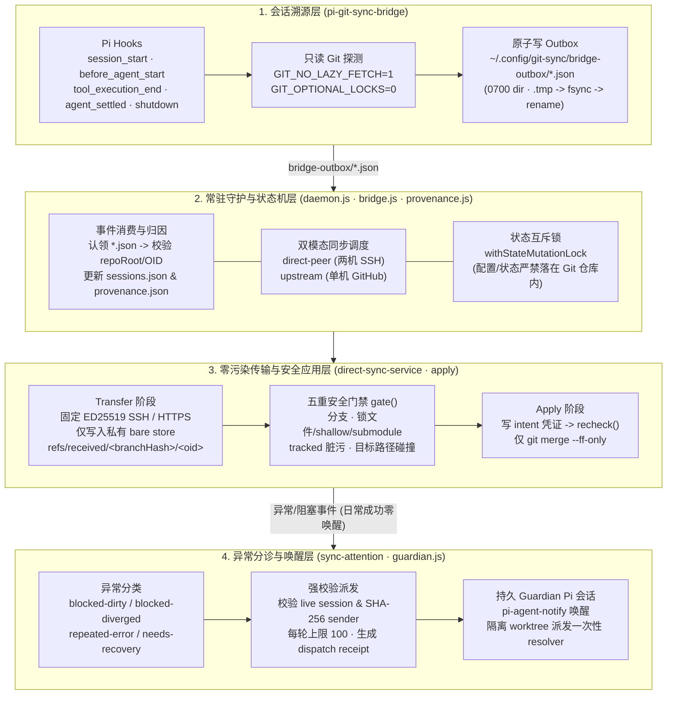
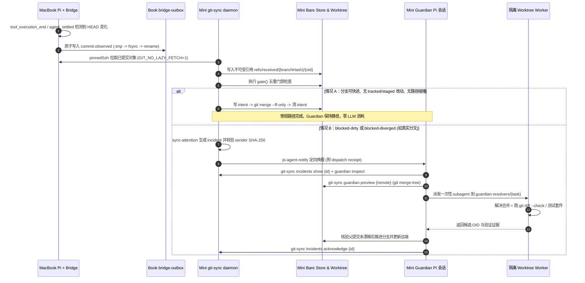

> **写作定位**：本文属于 `agent/extension` 工程实践系列，结合 **Mac mini 开发主会话（`01a0c650`）**、**`git-sync` 与 `pi-git-sync-bridge` 源码**，以及 **Guardian 持久会话 `01a0e057` 跨越两个月（2026-09-27 ~ 2026-11-23）的真实线上运行日志**，完整梳理这套双机 + 上游 Git 协同工作流的设计收敛、底层架构与实战经验。

在 Vibe Coding 和多端协同常态化后，一个越来越明显的痛点是：**同一套本地工具与业务仓库，会被不同机器、不同编程上下文同时修改和维护**——MacBook Pro 上外出写功能，Mac mini 上常驻跑定时/量化任务，外加 ChatGPT/Codex 往 GitHub 分支推提交、本地多个 Pi session 并行改代码、甚至偶尔直接手改提交。如果不加协调，两边代码很快就会版本滞后、各自修补或静默覆盖未提交工作。

`git-sync` 要解决的就是这个问题，并且从设计第一天起就确立了一条底线：**常规同步不依赖大模型，LLM 只作为异常分诊、隔离合并且零覆盖兜底的最后一道防线**。

---

## 一、源码架构拆解：四平面解耦与安全边界

从当前运行的源码（`~/.local/share/git-sync-runtime/.../src/` 与 `~/.pi/agent/git/github.com/roshameow/pi-git-sync-bridge/`）来看，整个系统分为四个严格解耦的平面：

### 1.1 状态隔离与防劫持基线（`safety.js` / `direct-sync-service.js`）
- **路径物理隔离**：所有配置文件（`~/.config/git-sync`）与状态库（`~/.local/state/git-sync`）在启动及 CLI 入口都会经过 `assertAppPathsOutsideGitRepositories` 检查，绝不允许位于任何被管仓库内部或使用符号链接。
- **描述符级防篡改读取（`ownerText`）**：读取 `direct-sync.json`、`upstream-sync.json`、`known_hosts` 和发送脚本时，使用 `O_RDONLY | O_NOFOLLOW | O_NONBLOCK` 打开句柄，校验属主 UID、权限模式（私有文件 `0600`，私有目录 `0700`）、`nlink === 1` 及读取前后两次 `lstat`/`fstat` 文件指纹，防止 TOCTOU 竞争与越权读取。
- **固定对端 SSH（`pinnedSsh`）**：不读取用户的 `~/.ssh/config` 别名猜测地址，而是校验 `known_hosts` 中精确的非通配/非散列 `ssh-ed25519` 公钥及 SHA-256 指纹后，拼出强制参数 `/usr/bin/ssh -F /dev/null -T -p 22 -o BatchMode=yes -o StrictHostKeyChecking=yes -o ProxyCommand=none -o ClearAllForwardings=yes`。

### 1.2 传输（Transfer）与落盘（Apply）严格解耦
这是整个系统能长期在两台开发机同时脏改工作区的情况下不丢提交、不毁现场的核心：
1. **Transfer 只写私有 bare store，永不碰工作目录**：
   `receiveCommittedBranch` 通过固定 SSH（`direct-peer`）或受控 HTTPS（`upstream`）把对端已提交历史拉入 `~/.local/state/git-sync/direct-sync-stores/<key>.git` 的不可变引用 `refs/received/<sha256(branch)>/<oid>`。哪怕接收端工作区有上千个未提交修改，远端已提交的代码依然先安全落地到了本地对象库。
2. **Apply 的五重安全门禁（`direct-sync-apply.js`）**：
   只有在 `applyCleanFastForward: true` 且依次通过以下全部门禁后，才会执行一次标准 `git merge --ff-only`：
   - 必须处于目标分支，非 detached HEAD；
   - Git 目录内不得存在 `index.lock`、`MERGE_HEAD`、`CHERRY_PICK_HEAD`、`rebase-merge` 等 12 类在途操作状态，不支持 shallow 仓库、submodule、`skip-worktree` 及 `filter.*` clean 过滤器（特意把 `config` 检查排在 `git status` 之前，因为连 `status` 都可能触发 clean filter）；
   - 不允许有 tracked 或 staged 未提交改动（`git status --porcelain=v1 -z --untracked-files=no`）；
   - **仅在路径冲突时拦截未跟踪/忽略文件**：用 `git ls-tree -r --name-only HEAD/target` 精确比对目标提交新增路径及其父目录是否与工作区现存未跟踪路径发生碰撞。既避免去全量枚举 `node_modules` 导致缓冲区溢出，又让不冲突的调试脚本和日志能够原位保留；
   - 在 `withStateMutationLock` 内再次 `recheck()` 配置快照、`dev:ino` 身份与分支，先写持久化 `direct-sync-apply-<key>.json` intent 文件再合并；一旦执行中被信号打断或部分写入，intent 不会被静默清理或重放，而是进入显式 `needs-recovery` 状态等待人工/Guardian 核查。
3. **单双模式互斥**：`upstream-sync-service.js` 会读取 `direct-sync.json` 执行 `excludeDirect` 检查，确保同一仓库不会同时启用双机互传与单机上游自动应用。

### 1.3 `pi-git-sync-bridge`：只做事实观察，不抢做唯一归因
[`extensions/index.ts`](file:///Users/wenliu/.pi/agent/git/github.com/roshameow/pi-git-sync-bridge/extensions/index.ts) 共 350 行、零第三方运行时依赖，不注册任何 LLM tool 或命令，只挂接 5 个 Pi 生命周期钩子：
- **`session_start`**：读取 `hostId`（读不到则 fail-closed 静默退出），写 `session.registered`（`confidence: "high"`）。同时用 `git status --porcelain=v2 --branch` 检查 `# branch.oid (initial)` 来精确区分合法的 unborn 空仓库与损坏的 `HEAD`；
- **`before_agent_start`**：刷新当前 `HEAD` 作为本轮基线；
- **`tool_execution_end` / `agent_settled`**：检查 `HEAD` 是否发生跃迁，若变化则用 `git rev-list --reverse <after> --not <before>` 列出新可达 commit，并记录 `toolCallId`、`toolName`、`toolError`，写入 `commit.observed`；同一跃迁在后续 `agent_settled` 不重复落盘；
- **`session_shutdown`**：做最后一次兜底检查后写 `session.unregistered`。

设计上最克制的一点是：**`commit.observed` 的 `confidence` 永远标为 `"medium"`，且 `provenance.js` 中所有归因记录都强制标记 `nonExclusive: true`**。如果一台机器上同时开着三个 Pi 会话和手动终端，bridge 绝不独断宣称“就是某个会话写的”，而是把原始观测留给 `daemon` 与后续人工/Guardian 结合上下文判断。所有内部 Git 读取一律带 `GIT_NO_LAZY_FETCH=1`、`GIT_OPTIONAL_LOCKS=0`、`GIT_TERMINAL_PROMPT=0`，既不会在 partial clone 上偷偷触发网络请求，也不会因只读检查顺便刷新 Git index。

### 1.4 Guardian 派发门禁（`guardian.js`）
`daemon.js` 在收到事件后，通过 `recordSyncAttention` / `recordUpstreamSyncAttention` 对长时间阻塞、分叉或连续失败生成 incident，并走 `dispatchGuardianIncidents`：
1. 调用 `guardianCandidates` 与 `guardianDesktopStatus`，核实目标 `sessionId` 对应的进程 PID、transcript 文件路径、`cwd` 与 `rmuxTarget` 仍真实存活；
2. 校验预先 pin 住的 `notify_agent.py` 发送脚本 SHA-256 哈希未被篡改；
3. 按生成事件与回执文件（`dispatchReceipt`）做幂等去重：已经成功派发过的 incident 会直接跳过，**不消耗每轮 `MAX_DISPATCH_PER_RUN = 100` 的实际发送配额**，避免历史回执把新告警饿死在队列尾部。

---

## 二、典型调用例子示例图

下面用两张图把日常运行中最典型的调用链路串联起来：第一张展示**“正常提交自动快进（零 LLM）”与“遇到脏污/分叉后唤醒 Guardian 隔离合并”**的完整时序；第二张对照日常排障、单机 GitHub 上游接入与服务恢复时的 **CLI 实际调用路径**。

### 2.1 双机提交同步与异常唤醒时序

### 2.2 三类高频运维与接入调用路径

```mermaid
flowchart TB
    subgraph S1["场景 1：双机状态核查与来源溯源 (日常排查)"]
        direction LR
        A1["git-sync sync status<br/>看双端 transfer / apply 缓存"] --> A2["git-sync guardian inspect &lt;remote&gt;<br/>实时核验两端 HEAD 与脏路径"]
        A2 --> A3["git-sync provenance show &lt;repo&gt; &lt;oid&gt;<br/>查提交归属 Pi session 或 manual/chatgpt-work"]
    end

    subgraph S2["场景 2：单机跟踪 GitHub 上游 (如 ChatGPT / Codex 推送)"]
        direction LR
        B1["git-sync discover --root &lt;path&gt;<br/>将本地已有目录纳入清单 (不自动 clone)"] --> B2["git-sync sync upstream enable &lt;remote&gt; &lt;branch&gt;<br/>登记并校验与 direct-peer 互斥"]
        B2 --> B3["daemon 周期拉取 GitHub tip<br/>干净可快进时自动更新本地分支"]
    end

    subgraph S3["场景 3：Guardian 上线注册、故障分诊与服务恢复"]
        direction LR
        C1["git-sync guardian candidates<br/>获取 live 交互会话 exact sessionId"] --> C2["git-sync guardian configure --session-id &lt;id&gt; --sender &lt;notify_agent.py&gt;<br/>绑定会话并 pin 发送脚本 SHA-256"]
        C2 --> C3["收到告警后查 git-sync incidents show &lt;id&gt;<br/>服务异常时核对 daemon status / install-status 再恢复"]
    end
```

---

## 三、线上运行实录：Mac mini Guardian 会话 `01a0e057`（2026-09-27 ~ 2026-11-23）

把 MacBook Pro 侧的后台运行状态与 Mac mini 持久 Guardian 会话 `01a0e057-23be-75f0-be9c-ac9a11ad65e5`（`2026-09-27T00:50Z` ~ `2026-11-23T06:15Z`）结合起来看，可以看到这套流程在实际开发环境里的表现：

- **双端运行规模**：MacBook Pro 侧后台 daemon 自 10-25 重启后截至 11-23 已完成 **50,216 轮同步 Pass**（`wakeups: 390,401`），追踪 **7 个仓库**（5 个 `direct-peer`：`quantnight`、`agy-vision-websearch`、`pi-agent-notify`、`pi-minimal-mode`、`pi-subagent-durable`；2 个仅本机跟踪上游 `upstream`：`pi-session-viewer`、`melonverse`），本地 `provenance.json` 记录了 **667 个提交归因**、`sessions.json` 记录了 **2,952 条会话生命周期**、`incidents/` 累计记录 **383 份事件单**。
- **Guardian 唤醒分布**：`01a0e057` 单条持久会话在近两个月里共处理了 **43 次人工指令** 与 **244 次 `agent-notify` 外部唤醒**（其中 `repeated-error` 104 次、`blocked-dirty` 92 次、`needs-recovery` 31 次、`local-ahead` 7 次、`guardian.*` 运维验证 7 次、`blocked-diverged` 分叉 1 次）。日常快进静默完成，Guardian 只在阻塞、分叉或连续失败时被唤醒。

以下五个实际处理案例展示了不同异常场景下的应对方式：

### Case 1：09-27 — 调整未跟踪文件拦截规则，支持无碰撞原位快进
- **现象**：上线第一天，Mac mini 上的 `quantnight` 因存在两个未跟踪文件（`debug_login.py` 与 `logs/spc_recheck_20260923.out`），后台快进持续被 `blocked-dirty` 拦住；旧规范还让 Guardian 建议先归档这两个文件再同步。
- **处理与调整**：按实际使用需求取消了“无差别归档未跟踪文件”的做法，同步修改 `direct-sync-apply.js` 的路径检查与 Guardian 的 `AGENTS.md`：只要目标树新增路径及其父目录不与未跟踪/忽略文件发生路径、类型、大小写或符号链接冲突，就直接原位保留并放行快进。当天 `09:04Z` Mini 从 `04e0035` 快进至 `ea7bfd0`，两个文件前后的 inode 与 SHA-256 保持一致。

### Case 2：09-28 — 历史分叉 `blocked-diverged`：隔离 Worktree 派发一次性 Resolver
- **现象**：`00:21Z` 收到 `pi-subagent-durable` 的历史分叉告警（Mini `2351b78` vs Book `2aab3ce`）。
- **处理**：Guardian 先在裸仓库预览确认无文本冲突（`clean`），随后派发一次性 `_worker` 到独立临时目录 `guardian-resolvers/pi-subagent-durable-20260928T010703Z`，生成合并提交 `4545ffa` 并跑通 `git diff --check` 与 8 组 `npm run check` 测试，确认双亲提交未变化后推送远端并让两端同步。此后用户明确授予“核验无冲突且检查通过的候选直接推进，无需每次请示”的授权。

### Case 3：10-14 ~ 10-21 — 通知队列修复与 `api/login.py` 语义冲突决断
- **通知队列修复（10-14）**：排查为何阻塞未收到提醒时，Guardian 派发只读子代理查出两个问题：一是 `guardian-desktop.json` 中记录的旧 PID `73506` 与 live 会话 PID `38796` 不匹配；二是 `guardian.js` 在跳过已发送回执前就按前 100 条截断队列，导致第 132 位的新告警被饿死。随后修改为跳过有效回执后再计每轮 100 次实际发送上限，补齐 4 个回归测试（全量 211 通过）并补发了积压提醒。
- **语义冲突决断（10-21）**：`quantnight` 的 `api/login.py` 出现真实文本冲突——Mini 留有“HTTP 204 回退密码登录”的本地修改，Book 新版则改为“204 后先核验账户身份再决定是否复用 Cookie”。Guardian 未自行覆盖，而是派隔离 worker 构造候选并跑通 **160 项离线测试**，再把行为取舍交给用户确认（“以 Book 提交为主合并”），合并时原样保留了 Mini 其余 9 个本地修改与运行产物。

### Case 4：10-11 & 11-07 — 多轮路径审计与 `.pyc` 目录改符号链接的处理
- **避免 `.gitignore` 误清理决策文件（10-11）**：清理 `quantnight` 中 SPC 每日产物时，子代理经过三轮路径审计（754 → 624/619 → 574），从忽略清单中筛出包含策略记录的 `OPTIMIZE-REPORT.md`、`BREADTH-KEEP-DROP.json` 及 5 份带说明的 JSON 并恢复跟踪，只停止跟踪纯生成产物。
- **目录改符号链接时的缓存迁移（11-07）**：Book 提交把 `.agents/skills/submit-alpha/scripts/` 从目录改为符号链接，Mini 原目录下残留 3 个被忽略的 `.pyc` 缓存阻断快进。获准仅备份移出这 3 个缓存后，Guardian 先通过两轮只读审查（修正了备份权限从 `0644` 变为 `0600`、目录 `fsync` 与 TOCTOU 检查等问题），并在隔离环境演练通过后完成更新，其余 391 个受保护文件与 11 个 SPC 修改均保持不变。

### Case 5：09-28 ~ 11-23 — 区分网络波动、凭据失效与服务停止，不误判为代码冲突
- 在近百次 `upstream` 告警中，`pi-session-viewer` 与 `melonverse` 多次出现 `repeated-error` / `needs-recovery`。Guardian 每次重新读取 `incidents show` 与实时网络/Git 状态后，分别定位到 **Book `gh` token 失效**、**`198.18.0.20` 代理/TUN 链路引发的 LibreSSL `SSL_ERROR_SYSCALL` (`tls-io`)**、**本地锁竞争被外围归入通用错误**，以及**相同 HEAD 应用仍会执行本地 fetch** 等原因，过程中不以推测代替核验，也不擅自删锁或 `reset`。
- **2026-11-23** 尾声，一个自 11 月 11 日挂起的 3 小时观测子代理唤醒回报后，Guardian 没有沿用历史记录中的运行状态，而是实时查出本机 daemon 已于 `11-11T23:26Z` 停止（launchd 上次退出码 1）；先核对配置未被停用、Node `v25.8.2` 与五仓身份完好后，才单次恢复服务并核验 `completedPasses: 1`。

---

## 四、可复用的 Agent 扩展与协同方法论

从 `git-sync` 的设计与近两个月实际运行来看，有四条经验可直接复用在其他 `agent/extension` 项目中：

1. **将确定性同步与异常研判分层**：扫目录、拉取 bare refs 和执行 clean fast-forward 属于高频确定性操作，应由常驻守护进程零 token 完成；LLM 会话只在分叉、冲突预览和故障定位时接入。
2. **用确定性门禁和隔离演练做安全边界，而不是限制基础工具**：去掉 `bash`/`read` 的只读 Guardian 无法排查现场问题；真正避免误操作的是应用前的 `gate()`、不可变 `refs/received/*` 对象库，以及在 `detached worktree` 中的隔离合并验证。
3. **区分传输态、应用态与环境故障**：`received` 不等于 `applied`，`HEAD=unknown` 也不代表分支损坏。状态机把 `transfer`、`apply` 与诊断拆开后，才能避免把 SSH 断连或 TLS 波动误判为代码冲突。
4. **以端到端可用闭环作为收敛标准**：设计阶段很容易不断叠加签名协议、跨机事务与虚拟验证层，却迟迟没有完成基础传输；先交付边界清晰的最小可用版本，再根据实际运维痛点逐步补全（如单机 `upstream-sync` 与无碰撞保留快进），整体可控性高得多。

> [!SUMMARY] 演进里程碑
> - **09-22（`01a0c650`）**：确立去插件化方案，`git-sync` 作为独立 macOS CLI/Daemon 运行，仅通过轻量 `pi-git-sync-bridge` 上报会话与 commit 观测事件，并兼容 `manual`、`vscode`、`chatgpt-work` 等非 Pi 来源；确立多根自动发现、双机共有才纳管、缺失不自动 `clone` 的边界。
> - **09-23 ~ 09-25（`01a0c650`）**：前期扩展出私有控制面、签名续期、分角色 ACL 与容器证明，累计 857 项测试但生产入口仍无法写入工作区；09-25 晚停止继续扩建复杂控制面，回归标准 Git 传输 + Pin ED25519 SSH + bare store 路线。
> - **09-26 ~ 09-27（`01a0c650`）**：明确授权“工作区干净且可快进时自动更新活动分支”，完成两机五仓真实部署；随后撤销 Guardian 的专用扩展与受限工具白名单，将其还原为可在 `pi-session-viewer` Desktop 打开与交互的标准持久 Pi 会话。
> - **09-27（`01a0e057`）**：修正“无差别拦截未跟踪文件”规则，改为仅在目标路径存在真实碰撞时阻塞，非碰撞文件原位保留。
> - **09-28（`01a0c650` & `01a0e057`）**：新增单机 GitHub `upstream-sync` 模式以接收外部工具/ChatGPT 推送的提交，并将源码收敛至单一公开仓库；同期验证完成隔离 worktree 分叉合并与“无冲突候选免逐次请示”机制。
> - **10-14 ~ 11-23（`01a0e057`）**：修复 Guardian 队列头部分片截断导致的告警饥饿与 PID 漂移检测问题，并在多次 `blocked-dirty`、语义冲突与上游 TLS 故障中持续迭代路径审计和隔离演练流程。
