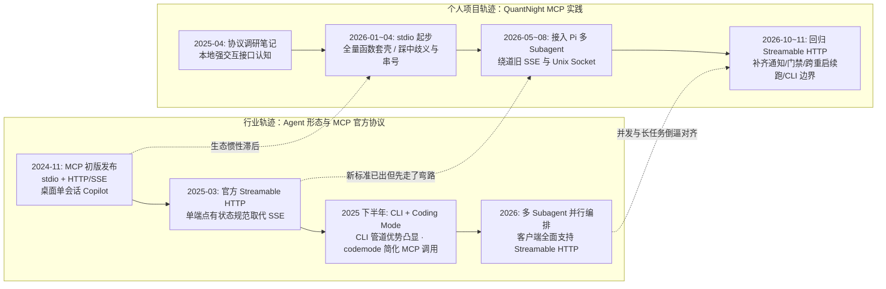

> **阅读定位**：本文属于 `agent/extension` 工程实践系列，讨论的是**如何把一个 MCP Server 从玩具原型打磨成多 Agent 并发可用的常驻基础设施**。文中的 **`quant_night_mcp` 仅作为这套方法论的落地示例（Case Study）**——它从 2026 年 1 月 12 日首次提交起步，历经 60+ 次迭代，几乎踩遍了“工具暴露设计、传输层选型、认证与状态持久化、OS 进程身份校验、热更新不中断在途任务”这五大关。希望这份复盘能为其他 MCP/Agent 扩展开发省掉同类弯路。

---

## 一、行业演进坐标系：Agent 形态与 MCP 协议史 vs 个人项目演化

要把 `quant_night_mcp` 踩过的坑看透，必须把它放进**外部 Agent 与 MCP 协议本身的演进史**里并排对照——很多弯路，本质上是**“个人项目的工具链惯性，慢了行业协议与 Agent 形态演化半拍”**造成的：

| 时期 | 行业 Agent 形态 & MCP 官方协议演进 | QuantNight MCP 个人项目演化与真实体感 |
|---|---|---|
| **2024-11 ~ 2025 上半年** 萌芽与 `stdio` 主导期 | • **2024-11-25**：Anthropic 发布 MCP（初版规范 `2024-11-05`），主打本地 `stdio` 子进程与早期双端点 `HTTP+SSE`。 • 当时主流客户端是 **Claude Desktop / Cursor** 等**单会话桌面 Copilot**，一个窗口一个用户，`stdio` 零配置即插即用。 • **2025-03-26**：MCP 官方发布 `2025-03-26` 规范，推出单端点 **`Streamable HTTP`** 正式取代旧 `HTTP+SSE`，但当时大部分本地客户端生态尚未跟进。 | • **2025-04**：停留在协议调研期（[2025-04-04-agent-tools.md](2025-04-04-agent-tools.md)），把 MCP 理解为本地强交互的“AI USB 接口”，重点关注 Schema 约束、Function Calling 与 Skills 的概念切分，尚未在项目落地。 |
| **2025 下半年 ~ 2026-04** CLI 成熟与 Coding Mode 引入 | • **CLI 本身已具备天然优势**：零 Schema 驻留开销、`--output` 落盘与 Shell 管道过滤，天然适合大批量查询与本地编排。 • 随后 **Coding Mode（`codemode`）** 引入后，进一步**简化了 MCP 的调用方式**（工具可设为 `hidden`/`codemode`，Agent 用代码直接串联调用、过滤结果，不再受限于全量 Schema 驻留和一问一答的 Tool Call），进而促使开发者重新审视“既然 MCP 调用也变简单了，什么该放 MCP、什么仍留 CLI”。 | • **2026-01 ~ 04**：项目正式落地 `quant_night_mcp`（`4d57297`），但初期仍沿用了早期“把内部函数全包成 MCP”的惯性，很快在 `parse_alpha_expression` 混淆、默认参数猜错、各自建连串号上连续踩坑（§二）。 |
| **2026-05 ~ 09** 多 Subagent 并发撞墙期 | • Agent 形态彻底从“单窗口 Copilot”跳变到**主会话派生多个 Subagent 并行跑长任务**。 • 单机多 Agent 下，行业早期的“按需 spawn `stdio`”模型彻底失效。 | • **2026-05 底**接入 Pi 多 Subagent（`b27701f`）后，`stdio` 瞬间撞墙（N 份百兆向量模型 + Cookie 互踢）。 • 虽然官方早在 2025-03 已发布 Streamable HTTP，但项目先绕道试了**早期 `HTTP+SSE`**（05-02），8 月又自己造了一套 **`Unix Socket + launchd`** 本地共享方案（§三）。 |
| **2026-10 ~ 11** 协议对齐与长任务深水区 | • 客户端适配层普遍成熟支持 **`Streamable HTTP`**（`Mcp-Session-Id` 断线重建）；Agent 进入 **Durable Worker + 事件驱动异步唤醒** 的常驻运行阶段。 | • **2026-10-05** 正式收口至 **`Streamable HTTP` 单守护进程**，对齐官方规范；11 月进一步解决 MCP 协议本身不管的深水区：**事件通知身份漂移、68MB/2.4 万检查点阻塞、跨重启无缝续跑、以及与 Rust `task-core` CLI 的对称分工**。 |

---

## 二、早期滞后与工具设计弯路（2026-01 ~ 2026-04）

如上表所示，当个人项目在 2026 年初动手写第一个 MCP Server 时，虽然行业已经开始反思工具膨胀，但自己还是完整踩了一遍“全量函数直接暴露 + `stdio` 单会话假设”的初期坑：

1. **工具粒度与命名歧义直接搞乱 Agent 决策**
   - 早期暴露过一个 `parse_alpha_expression` 工具，结果 Agent 经常在“校验表达式”还是“解析表达式”之间反复横跳、传错参数；最终在 `3428318`（02-12）果断把它从 MCP 中直接删掉。
   - **教训**：MCP 的 `tools/list` 不是传统后端 SDK 文档，每个多余或语义重叠的工具都在稀释 LLM 的路由准确率。**宁可少而边界清晰，不要大而全。**

2. **隐式默认值与“静默容错”是 LLM 调用的毒药**
   - 早期不少工具给参数写了隐式 `default`，或者校验不严就放行去请求远端。结果 LLM 一旦没看清就瞎猜参数，把错误配置带进耗时数十分钟的远端任务。
   - **教训（`1ffe2ca` / `ec9b8e6`）**：对高风险或强语义参数去掉危险默认值（例如 Python 策略必须显式提供 `lookback`），在 JSON Schema 里加死必填与枚举，在 `description` 里明写 `Do NOT guess parameters`，并在服务端入口做即时校验报错（`instant feedback`）。

3. **多工具各自维护数据库连接与登录会话导致“串号/互踢”**
   - 在单会话 `stdio` 串行测试下问题被掩盖；但随着 Agent 开始在单轮内并发调多个工具，早期每个工具文件自己 `MongoClient()`、自己调登录函数的写法立刻引发 Cookie 覆盖和连接泄露。
   - **教训（`07484ec` / `b97b6dc`）**：在进入高并发多 Agent 协作前，必须先把**认证 Owner（单把 `_brain_login_lock` + 同账号校验）**和**统一 DB 配置工厂**收口成唯一底层入口，禁止业务工具私建客户端。

---

## 三、传输层四次迁徙：为什么绕了一大圈还是回到 Streamable HTTP？

对照前面的行业坐标系就会发现一件很有意思的事：**MCP 官方早在 2025 年 3 月就发布了 `Streamable HTTP` 规范，为什么个人项目直到 2026 年 10 月才定型到它，中间还要先经历 `stdio` → `SSE` → `Unix Socket` 这一大圈？**

原因非常真实：

1. **第一代：`stdio` 按需子进程（2026-01 ~ 04，延续桌面 Copilot 时代惯性）**
   - **当时心态**：所有开源 MCP 教程都教 `stdio`，零端口配置最省事。
   - **撞墙点**：5 月接入 Pi 并启动多 Subagent 后，`pi-mcp-adapter` 默认按需给每个 Pi 进程各自 spawn 一个 `stdio` Server。开 N 个 Worker 就要同时常驻 N 份百兆级 `SentenceTransformer` + FAISS 向量索引；更致命的是 N 个独立进程拿着同一个账户并发读写 Cookie、各自算各自的 429 限流退避，直接触发平台会话互踢。

2. **第二代：早期 `HTTP + SSE` 双端点（2026-05 `1a29dcf`，旧远程规范惯性）**
   - **当时心态**：发现 `stdio` 不能共享后，第一反应是按 MCP 初版远程文档搭 `/sse` + `/messages`。
   - **撞墙点**：虽然把 Server 独立常驻了出来，但旧版 SSE 双端点协议在长连接断线重连、反向代理兼容以及服务端会话状态清理上都非常脆弱。

3. **第三代：定制 `Unix Socket (/tmp/quant-night.sock)` + `launchd`（2026-08 `4999731`，工程洁癖绕路）**
   - **当时心态**：觉得“都在同一台 Mac 上跑，HTTP 太重了，不如直接走 Unix Domain Socket 既快又不用管端口”。
   - **撞墙点**：Unix Socket 不在 MCP 官方标准传输规范里——客户端适配器必须打非标补丁，守护进程异常退出时还会残留 `.sock` 文件锁死下次启动，也缺少标准 HTTP 的 `Host/Origin` 检查与 Bearer Token 鉴权边界，属于典型的“为了局部省事引入长期非标维护债”。

4. **第四代：标准 `Streamable HTTP` 单守护进程（2026-10 `44f48ce` 正式收口）**
   - **回归原因**：绕了一圈后发现，**MCP `2025-03-26` 官方确立的 `Streamable HTTP` 本身就是为这个场景设计的**——单端点 `/mcp` 兼顾短请求与流式响应，支持 `Mcp-Session-Id` 会话重建，原生兼容 Pi 与 AGY 等多客户端，且天然具备 `Host/Origin` 与 Bearer Token 安全边界。
   - **最终形态**：唯一守护进程固定监听 `127.0.0.1:8765/mcp`，由系统 `tmux` 会话 `mcp_shared` 托管，彻底淘汰多进程 `stdio` 与非标 Unix Socket。

**采用 Streamable HTTP 带来的热更新红利**：只要**没增删工具、没改参数 Schema**，改完服务端源码重启 `mcp_shared`，Pi 客户端（`pi-mcp-adapter`）与 AGY 在下次调用发现旧 `mcp-session-id` 失效后会自动重建 HTTP session 并路由到新代码，**无需 `/reload` 或重开客户端**；只有在工具列表或 Schema 变化时才需要通知客户端重载刷新工具定义。

---

## 四、长驻运行的工程深坑：检查点膨胀、门禁自锁与进程身份漂移

MCP 工具一旦作为常驻进程长期在线运行并承接长耗时异步任务（10 分钟 ~ 数小时），状态持久化、安全门禁与长驻进程对子进程的身份校验就会连续暴露出单次短跑测试根本测不出来的工程坑：

### 坑一：68MB 单文件注册表拖垮事件循环
- 早期把所有异步任务进度全塞进一个 `tmp/mcp_task_registry.json`。跑了几个月后膨胀到 **68MB**——每次任意一个后台任务做 15 秒心跳保存，都要把 68MB JSON 全量序列化并刷盘，直接卡死整个异步事件循环。
- **解法（`44f48ce`）**：拆成**单任务独立检查点** `tmp/mcp_tasks/<task_id>.json`，采用“写临时文件 + `fsync` + `os.replace` 原子替换 + `0600` 权限”，仅在收到远端回执（`Location`）等关键边界强制同步刷盘。

### 坑二：24,472 个检查点把维护重启拖到 50 秒，且历史拒收记录永久卡死门禁
单文件拆分解决单次写入性能后，过了几个月目录下又积攒了 **24,472 个文件**（其中仅单次查详情的 `fetch-*` 缓存就占了 7,716 个），在 2026 年 11 月做维护重启时直接炸出连环死锁：
1. **50 秒备份撞上 15 秒心跳**：重启安全门禁 `--prepare-maintenance` 在停服前要对所有文件逐一校验目录权限、拷贝并 `os.fsync` 做 SHA-256 备份。2.4 万个 `fsync` 耗时近 **50 秒**，而活跃任务每 **15 秒**写一次心跳，导致备份结束前最后一次一致性校验必报 `checkpoint_changed_during_backup` 失败。
2. **历史拒收记录永久锁死普通重启**：4,868 条早期因平台限流被拒收（`status="failed"`, `acceptance="NOT_ACCEPTED"`, `rejection_evidence_received=True`）且结束时清零了 `ownerPid` 的记录，因为没有平台终态字段 `terminal_status`，被门禁代码一律判成 `unresolved_nonterminal`，把正常重启与源码热重载全部永久挡在门外。

- **解法（`c80fe36`）**：
  - 修复门禁逻辑，明确将 `recoveryRequired=False` 终态记录和“有拒收证据且无回执 URL”的记录判为**已结算（settled）**；
  - 对 2.4 万+历史结算文件做一次归档，并在 `APITools._load_tasks()` 启动阶段加入**超过 24 小时已结算文件自动移入 `tmp/mcp_tasks_archive/`**，同时维护脚本按唯一父目录去重校验，把日常预检与备份压缩回 **< 1 秒**。

### 坑三：长驻进程在 macOS 下的 `psutil` `INIT_BOOT_TIME` 漂移导致 Watcher 握手误杀
- **现象（2026-11-21）**：所有新拉起的外部通知进程（`watch_mcp_task.py`）都在握手期报错退出。追进 `psutil` macOS 底层源码（`_psosx`）发现，`psutil` 会在首次 `import` 时将系统开机时间截断为整数秒缓存成 `INIT_BOOT_TIME`；长驻了数天的 MCP 守护进程在系统发生微小 NTP 时钟校准后，计算出的子进程创建时间与子进程自己写入 `.lock` 的 `processCreatedAt` 恰好相差 `+1.0s`，外加原先 `3s` 墙钟死线在冷负载下偶发超时，引发全盘握手误杀。
- **取舍**：删掉脆弱的系统 `create_time()` 比对，防 PID 复用改由 **`PID 存活 + `.lock` 独占绑定（`taskId` / `itemKey` / `target`）+ 完整 `cmdline` 含任务 UUID`** 共同承担；握手等待改用单调时钟 `time.monotonic() + 10`，失败时透出具体 `(reason=...)`。

---

## 五、如何让 MCP 重启时“在途任务不断、不误报失败”？

早期的重启动作是一刀切：只要 `mcp_shared` 重启，`APITools._load_tasks()` 就把运行中的回测全标为 `status="failed"`（`errorClass="mcp_server_restart"`），甚至还会把属于相关性模块的 `corr-prod-*.json` 一并扫进去覆写成 `status="error"`。这导致外部正在轮询的 `watch_mcp_task.py` 一看到 `status="failed"`，**瞬间向等待中的 Agent 发送“任务失败”通知，大量正常执行中的 Worker 被错误中止**。

**最终通过三处解耦实现了跨重启无感续跑**：
1. **检查点边界隔离**：回测加载器启动时跳过 `corr-*` 文件，交由相关性模块独立读取与恢复。
2. **Watcher 瞬态保活**：`watch_mcp_task.py` 遇到 `errorClass="mcp_server_restart"` 且 `recoveryRequired=True` 时，判定为重启过渡态，**不触发终态失败通知**，继续等待后续更新。
3. **启动后自动后台续跑（同时保持测试纯洁性）**：把自动续跑逻辑放在延迟初始化 `_ensure_initialized()` **之后**的独立异步阶段 `_resume_restarted_tasks()` 中执行（既不破坏无网络冷启动单测契约，又能在真实服务启动后第一时间接管）：
   - 对持有有效平台 `progress_url` 的在途回测，自动拉起 **GET-only** 观察直至平台终态（绝不重发 `POST`）；
   - 对未过截止期的 `corr-prod-*` 任务，保留重启前已完成的 `correlations` 字典并续跑剩余 Alpha 轮询。

---

## 六、通用边界取舍：当系统同时拥有 MCP 与 CLI 时，什么该合、什么不该迁？

当一个工程项目同时拥有 **MCP（常驻服务入口）** 与 **CLI（原生命令行 / 本地控制面）** 时，开发者很容易陷入“非此即彼”的洁癖——要么想把所有 CLI 命令全塞进 MCP，要么想把 MCP 工具全改成 CLI。经过多轮演化后，真正可复用的跨项目架构取舍有四条：

1. **淘汰功能完全重合的越界入口**：如果某项纯本地查询或控制操作已经收口到权威 CLI 控制面，就应果断下线 MCP 中语义重复或绕过统一锁的旧工具，避免同一件事维护两套状态机（例如示例项目中下线与 `taskctl` 重复的 `find_history_alphas` 与旧任务包装器）。
2. **不要为了“复用查库代码”破坏单个 MCP 工具的 Schema 一致性**：如果某个 MCP 工具的本地查库实质上是远端 API 的 **Read-Through 省流缓存**（用来拦截高频重复请求、防止打爆平台限流），它就必须与穿透远端 API 返回**同一套原始 Schema**；如果硬把它转去复用面向前端表格的扁平化 CLI 输出，同一个工具在不同命中路径下吐出两套结构，会直接导致 Agent 解析崩溃。
3. **不要为了“技术栈统一”把重模型/常驻状态强迁进短命 CLI**：很多看似“只是查一下本地库”的工具，底层其实依赖百兆级 Embedding 模型、内存向量索引或常驻连接池。把它们留在常驻 MCP 守护进程内**冷加载一次即可长期复用**，远比强塞进每次运行都要冷启动的短命 CLI 更高效。
4. **引入 Coding Mode（`codemode`）后重新对齐的 MCP vs CLI 边界**：
   - 在 Coding Mode 出现之前，CLI 本身就已经具备不占系统提示词 Schema、`--output` 落盘以及配合 Shell 管道过滤的天然优势；
   - **Coding Mode（`codemode`）真正改变的是 MCP 的调用体验**：它让 MCP 工具可以隐藏在 `hidden` / `codemode` 后按需以代码形式直接调用与循环批处理，大幅简化了 MCP 调用复杂度并消除了直接暴露全量 Schema 的上下文负担。正因两者在“好不好调”上拉平了，分工才彻底回归数据流与状态本质：
     - **输入复杂（多行代码/嵌套 JSON）、需要常驻在线 Session/模型、需要按角色隔离敏感权限** 👉 **走 MCP**；
     - **参数扁平但输出庞大（百条列表/大时序）、本地直连大查询与多步批处理编排** 👉 **走 CLI**。

---

> [!SUMMARY] 示例项目 MCP 演进关键时间轴（2026-01 → 2026-11，60+ 次提交）
> - **2026-01-12 (`4d57297`)**：首次提交引入 `quant_night_mcp`，跑通基础 MCP 工具调用；
> - **2026-02-06 ~ 02-17 (`b0836aa` / `3428318` / `0f0d153`)**：接入字段搜索并清理易混淆的 `parse_alpha_expression`，开启工具收敛；
> - **2026-02-28 ~ 04-21 (`23f43d7` / `d9777b8` / `07484ec` / `b97b6dc`)**：修复早期异步 fetch bug，收口同账号 `auth_profile` 登录锁与共享 Mongo 客户端；
> - **2026-04-28 ~ 04-29 (`1ffe2ca` / `ec9b8e6` / `2ccbe58`)**：强化参数 Schema 校验、禁止猜测参数，引入任务持久化与回测前置校验；
> - **2026-05-02 ~ 06-23 (`1a29dcf` / `f26ac30` / `1faec0e`)**：从 `stdio` 迁向 HTTP 协议，新增相关性工具与批量多 ID 查询；
> - **2026-08-04 ~ 08-08 (`4999731`)**：尝试 Unix Socket (`/tmp/quant-night.sock`) 共享方案以消除多进程内存与 Cookie 踩踏；
> - **2026-09-14 (`7198bcf` / `3a9b045`)**：落地基于 `pi-agent-notify` + `watch_mcp_task.py` 的事件驱动通知，并加入重启状态围栏；
> - **2026-10-05 (`44f48ce`)**：淘汰 Unix Socket 与 68MB 单文件注册表，收口为单一 Streamable HTTP 守护进程（`127.0.0.1:8765/mcp`）、`0600` Bearer 鉴权、单任务检查点与结果直传；
> - **2026-11-19 (`b9f6854`)**：打通异步提交闭环，退役冗余的 `find_history_alphas`，明确与 `task-core` 的双端边界；
> - **2026-11-22 (`c80fe36`)**：移除 macOS `create_time()` 校验并改为 10s 单调时钟握手，修复重启门禁历史误阻断，落地 Simulation 与 `corr-prod-*` 跨重启无缝续跑及 >24h 过期检查点自动归档。
